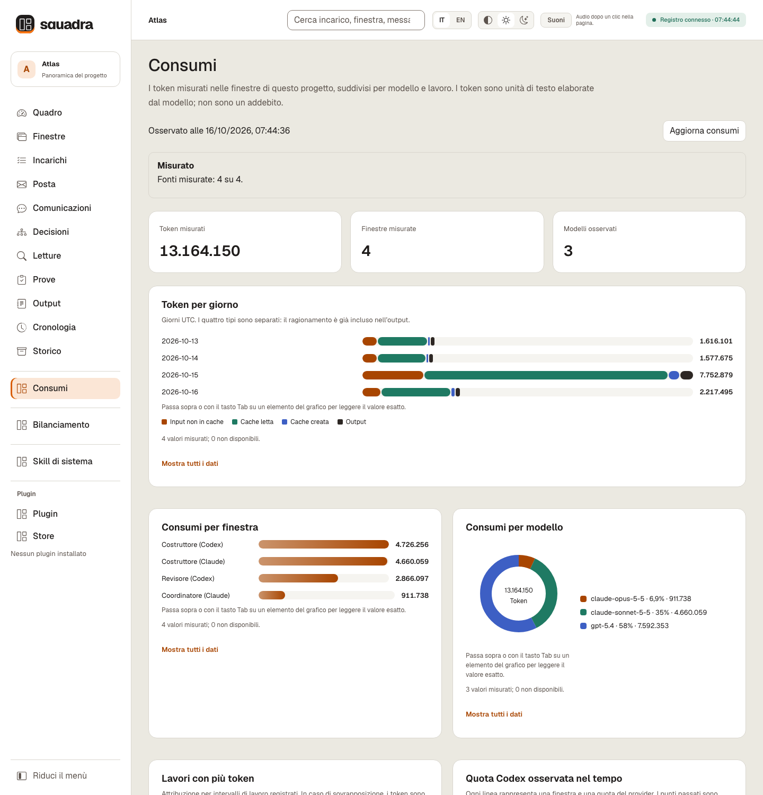
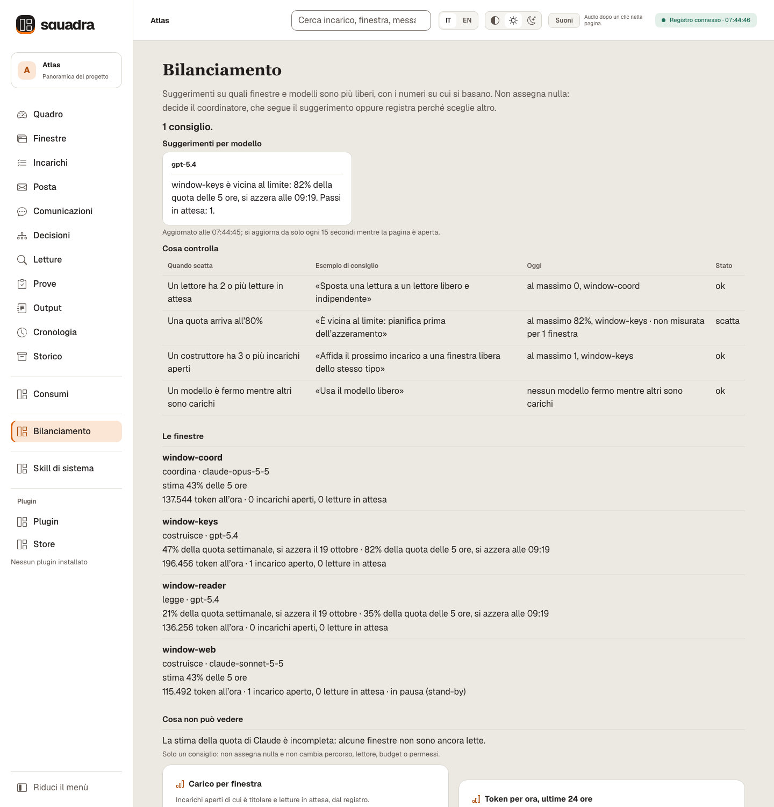
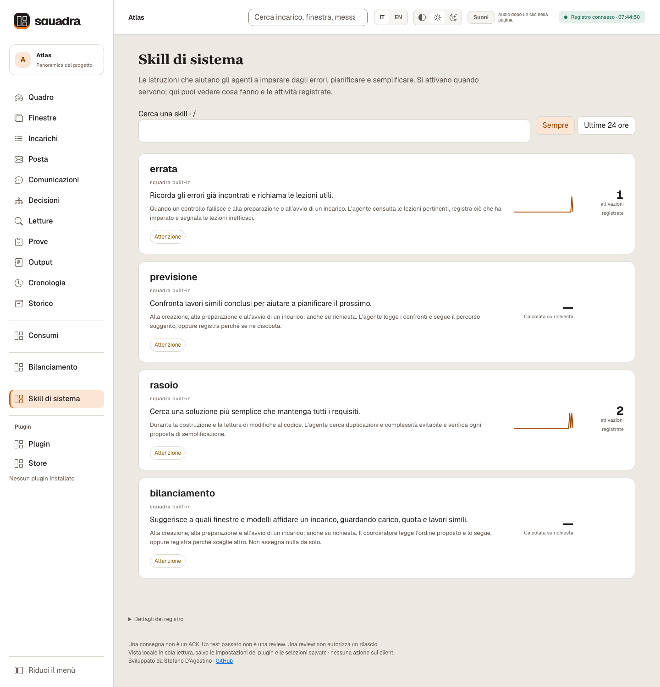

<div align="center">

<picture>
  <source media="(prefers-color-scheme: dark)" srcset="assets/squadra-logo-dark.svg">
  
</picture>

# Squadra 3+

**I tuoi agenti di codice, una sola squadra — e la prova di ogni passo.**

Coordina Claude Code, Codex e Cursor con incarichi condivisi, revisioni indipendenti e una dashboard locale.

**Gratuita e open source** — licenza MIT, nessun account, tutto gira sul tuo computer.

**Versione 3.11.2** · Python 3.12+ · macOS / POSIX

[English](README.md) · **Italiano** · [Privacy](PRIVACY.it.md)

[Panoramica](#overview) · [Installa](#start) · [Primi passi](#first-steps) · [Prompt](#prompts) · [Dashboard](#dashboard) · [Plugin](#plugins) · [Comandi](#commands) · [Guide](#reference) · [Novità](#news) · [Comunità](#community)

</div>

[](https://github.com/dagoSte/squadra/actions/workflows/cisco-skill-scan.yml) [](https://github.com/dagoSte/squadra/releases/latest) [](https://github.com/dagoSte/squadra/blob/main/LICENSE) [](#start) [](#start) [](#start) [](#start) [](#start) [](https://github.com/dagoSte/squadra/stargazers) [](https://github.com/dagoSte/squadra/commits/main)

[Che cosa copre la scansione di sicurezza](#security-scan).

<a id="overview"></a>
## Cosa fa Squadra

Squadra fa lavorare più finestre di agenti di codice sullo stesso progetto come una squadra: una coordina, altre costruiscono e una finestra che non ha scritto il codice lo rilegge. Incarichi, decisioni, verifiche eseguite e rapporti di revisione restano in un unico registro condiviso sul tuo computer.

Usala quando il lavoro coinvolge più sessioni di agenti e vuoi sapere chi segue ogni incarico, quale codice è stato verificato e che cosa aspetta una decisione. Ogni finestra può lavorare nella propria copia del codice, il checkout, e condividere lo stesso registro.

| Parte | Che cosa fa |
|---|---|
| **Skill** | Indica agli agenti il metodo di coordinamento da seguire. |
| **CLI** | Registra incarichi, messaggi, verifiche e decisioni. |
| **Dashboard** | Mostra avanzamento, prove e richieste del tuo parere. |

**Composizione della squadra:** parti da un coordinatore Claude, poi fai entrare le finestre Codex, Claude o Cursor interattive. Le [regole di squadra](#team-rules) spiegano ruoli e limiti.


*Il Quadro su un registro dimostrativo, Atlas ([in inglese](docs/images/dashboard-overview-en.png), [tema scuro](docs/images/dashboard-overview-dark-it.png)). I testi registrati, come i briefing, le parole del proprietario e i messaggi, restano come sono stati scritti. Gli esempi non contengono dati di clienti e non misurano la qualità dei modelli.*

**Guarda il tour di 84 secondi — attiva l'audio nel lettore:**

https://github.com/user-attachments/assets/d0a696da-9562-4a84-9eea-0fda7b8c75d1

<a id="cosa-la-rende-diversa"></a>
## Perché usare Squadra

- **Un solo registro per tutte le finestre.** Incarichi, prove e decisioni restano sul tuo computer, non nella memoria di una chat.
- **Chi scrive non si rilegge.** Ogni modifica la controlla una finestra che non l'ha scritta.
- **Prove legate al codice esatto.** Se il codice cambia dopo la prova, prova e lettura non valgono più.
- **Prima la conferma, poi il lavoro.** Un incarico parte solo quando chi lo riceve conferma di averlo ricevuto.
- **Domande con la frase pronta.** Quando serve una tua decisione, ricevi le opzioni, una raccomandazione e le parole esatte per rispondere.
- **Una dashboard in parole semplici**, in italiano o in inglese, per seguire tutto dal vivo.
- **Claude, Codex e Cursor insieme**, e aperta ai plugin della community.
- **Un'unica vista di quanto spende ogni finestra AI.** Token per finestra, modello e lavoro, tra Claude Code e Codex, con il consiglio su quale finestra o modello debba prendere il prossimo lavoro, calcolati sul tuo computer.

<a id="start"></a>
## Installazione

**Requisiti:** Python 3.12+, Git e un browser per la dashboard. Il programma usa la libreria standard di Python; Node.js serve per `selftest`. macOS / POSIX è l’ambiente provato. [Requisiti completi e limiti delle piattaforme](#requirements).

### Consigliata: installazione con una frase

<a id="one-sentence"></a>
**Si installa con una frase.** Incollala in Claude Code, Codex o Cursor:

```text
Installa Squadra seguendo https://github.com/dagoSte/squadra/blob/main/SETUP.md: mostrami prima il piano, aspetta il mio sì, poi installala e controlla che funzioni.
```

L'agente controlla che cosa hai già, ti mostra ogni comando con che cosa cambia e come annullarlo, aspetta il tuo sì, installa e fa una verifica di un secondo.

A te resta un solo gesto: `/reload-plugins` in Claude Code, oppure una nuova sessione in Codex o Cursor.

<details>
<summary><strong>Altri metodi: plugin o comando autonomo</strong></summary>

### Con /plugin

In Claude Code:

```text
/plugin marketplace add dagoSte/squadra
/plugin install squadra@squadra
```

Dal terminale, per Codex:

```sh
codex plugin marketplace add dagoSte/squadra
codex plugin add squadra@squadra
```

Il plugin porta la skill, i suoi script, i riferimenti e la dashboard. Non aggiunge il comando `squadra` al PATH: gli agenti eseguono `python3 <cartella della skill>/scripts/squadra.py`, anche per le istruzioni che Squadra stampa, come `squadra ack …`. Se vuoi il comando `squadra`, usa al posto del plugin l'installatore autonomo qui sotto. Usa il plugin oppure l'installatore autonomo, non entrambi, così la skill non viene registrata due volte.

### Installatore autonomo (aggiunge il comando `squadra`)

```sh
git clone https://github.com/dagoSte/squadra.git
cd squadra
python3 -B scripts/install.py \
  --backup "$HOME/.local/state/squadra/install-backup-001"
export PATH="$HOME/.local/bin:$PATH"
squadra --version
```

Installa da un checkout pulito, senza modifiche fuori dai commit, con una **nuova cartella di backup** ogni volta; l'installatore conserva le skill e il comando precedenti, così puoi tornare indietro: `python3 -B scripts/install.py --undo <cartella di backup>` ripristina le skill precedenti e conserva il backup. La riga `export PATH` vale solo per quel terminale: aggiungila al profilo della shell (per esempio `~/.zshrc` o `~/.bashrc`) perché i terminali nuovi trovino `squadra`. Senza installare, usa `python3 -B scripts/squadra.py <comando>`. [Dettagli e ritorno alla versione precedente](references/start.md#install-and-join-details), in inglese.

</details>

<a id="updating"></a>
<details>
<summary><strong>Aggiornare un’installazione esistente</strong></summary>

### Aggiornare

**Con /plugin.** In Claude Code esegui `/plugin marketplace update squadra`, poi `/plugin update squadra@squadra`, poi riavvia Claude Code. Per Codex esegui `codex plugin marketplace upgrade`, poi di nuovo `codex plugin add squadra@squadra`.

**Con l'installatore autonomo.** Dalla 3.6.1 in poi le versioni conservano la loro storia: esegui `git pull`, poi di nuovo l'installatore, con una nuova cartella di backup ogni volta. Un checkout della 3.6.0 o precedente richiede invece `git fetch origin` e `git reset --hard origin/main`, che cancella le modifiche locali di quel checkout.

```sh
git pull
python3 -B scripts/install.py \
  --backup "$HOME/.local/state/squadra/install-backup-002"
squadra --version
```

Ogni rilascio alza il numero di versione, tranne un aggiornamento che arricchisce un rilascio mantenendone il numero, come per la 3.10.2 il 17 ottobre 2026. I plugin installati dallo Store mantengono la loro versione finché `squadra plugin install <nome>` non viene rieseguito dalla nuova release ([Plugin inclusi nella release](#plugin-store)). Le finestre già aperte mantengono la versione letta finché non si riavviano, e una squadra al lavoro mantiene il suo protocollo finché non la cambi esplicitamente.

**Aggiornare dalla 3.10.3 o dalla 3.10.2 alla 3.10.4: il registro resta com'è.**
- **Le finestre possono passare una alla volta.** Finestre 3.10.2, 3.10.3 e 3.10.4 condividono lo stesso registro; niente viene convertito.
- **Aggiorna prima il coordinatore.** La regola per cui rilegge l'altro modello vale per gli incarichi registrati da una finestra 3.10.4, e una finestra precedente non la controlla a `check` e `close`. Gli incarichi registrati prima dell'aggiornamento si chiudono come prima.
- **Plugin dello Store:** esegui di nuovo `squadra plugin install <nome>`, come dopo ogni rilascio.

**Aggiornare dalla 3.10.1 alla 3.10.2: il registro resta com'è.**
- **Le finestre possono passare una alla volta.** Finestre 3.10.1 e 3.10.2 condividono lo stesso registro mentre le aggiorni; niente viene convertito.
- **Due cose aspettano l'ultima finestra.** Una modifica delle impostazioni fatta da una finestra 3.10.1 riporta ai valori predefiniti le due nuove soglie di attesa (`to-forward` e `plan`). E rimuovere un file finito nel registro per errore, con una decisione registrata, fa fallire su quel file mancante la verifica completa e la dashboard di una finestra 3.10.1: aggiorna tutte le finestre prima di rimuoverne uno.
- **Plugin dello Store:** esegui di nuovo `squadra plugin install <nome>`, come dopo ogni rilascio.

**Aggiornare dalla 3.10.0 o precedenti alla 3.10.1: meno lavoro ripetuto sulla storia, e tutte le finestre devono passare insieme.**
- **Prima di aggiornare** il coordinatore salva la squadra: `squadra save --actor <coordinatore> --to <una cartella nuova>`. È la tua strada per tornare indietro.
- **Il registro che hai viene letto così com'è.** Niente viene convertito e la storia già scritta non si tocca. Dal primo comando sulla 3.10.1, gli eventi nuovi si scrivono nel formato più leggero.
- **Aggiorna tutte le finestre insieme,** Claude Code e Codex. Una finestra rimasta alla 3.10.0 si ferma al primo evento nuovo con `Event integrity failure at sequence N`. È voluto: una versione vecchia si ferma invece di accettare eventi che non sa leggere. Non si perde niente: aggiorna quella finestra e riparte.
- **Sullo stesso registro non si torna indietro.** Dopo l'aggiornamento la 3.10.0 non può più usare quel registro. Per tornare indietro ripristina il salvataggio fatto prima di aggiornare, con l'una o l'altra versione, poi continua a usare la versione vecchia sulla copia ripristinata: il primo comando della 3.10.1 o successiva su quella copia scrive di nuovo il formato più recente.
- **Se hai dubbi,** esegui `squadra doctor` sulla 3.10.1: ti dice quando un registro richiede la 3.10.1 o successiva.
- **Plugin dello Store:** esegui di nuovo `squadra plugin install <nome>`, come dopo ogni rilascio.
- **Se hai installato Squadra dalla directory di Claude,** ricevi la versione indicata nella directory finché non passa alla 3.10.1.

La prima finestra che scrive su un registro precedente o spostato costruisce la cache; le altre attendono. Se un comando risponde `registry busy, retry`, riprova quando la prima scrittura è terminata.

</details>

<a id="requirements"></a>
<details>
<summary><strong>Requisiti completi: self-test, runner nativi e limiti delle piattaforme</strong></summary>

**Requisiti:** Python 3.12+, Git e la libreria standard di Python. **Node.js** esegue i controlli JavaScript della dashboard nella suite di test e in `selftest`: senza Node quei controlli falliscono, non vengono mai saltati. Un browser per la dashboard; la CLI di Codex o di Claude solo per i runner nativi. L'ambiente di processi provato è macOS/POSIX; il controllo dei processi su Windows e il ripristino con submodule, LFS o checkout sparsi non sono qualificati.

</details>

**Aggiornamento alla 3.11.1:** aggiorna insieme tutte le finestre e reinstalla i plugin. `replace`, `wait`, `access probe`, `ready` e le impostazioni di onboarding scrivono il formato 4 del giornale, che la 3.11.0 e i client precedenti rifiutano invece di ignorarlo.

**Aggiornamento alla 3.11.0:** aggiorna tutte le finestre e reinstalla i plugin prima di creare nuovi incarichi o riassegnare letture. I nuovi incarichi usano consegne congelate e il formato 3 del giornale; i client precedenti lo rifiutano. Gli incarichi storici mantengono il comportamento precedente. Il programma di installazione aggiunge anche la skill `migliora`.

<a id="first-steps"></a>
## Primi passi

Dopo l’installazione dai istruzioni in parole semplici; gli agenti eseguono i comandi. Una **finestra** è una sessione di lavoro. Tutte le finestre della squadra usano lo stesso registro.

1. **Avvia il coordinatore.** Di' a una finestra Claude: «Usa squadra per questo progetto. Usa il registro in `/percorso/del/registro`. Trova le altre finestre e presentati; descrivi il lavoro in parole semplici.» Una finestra Codex chiamata per prima non coordina: ti dà la frase da scrivere in una finestra Claude.
2. **Apri le altre finestre** su quel registro. Coordina la finestra Claude; ogni finestra conferma il proprio incarico prima di cominciare.
3. **Affida il primo incarico al coordinatore.** Descrivi il risultato che vuoi e come verificarlo. Il coordinatore assegna il lavoro e la revisione indipendente; i [prompt di esempio](#prompts) ti danno istruzioni pronte da copiare.
4. **Apri la dashboard** con `squadra dash --root /percorso/del/registro --open` (se hai installato il plugin, chiedi all'agente di aprirla) e segui ogni incarico: conferma → lavoro → verifica eseguita → lettura di un'altra finestra → chiusura del coordinatore.

**Quando Serve a te chiede il tuo parere**, rispondi al coordinatore; il tempo che passa non è una risposta. Il lavoro chiuso non viene mai pubblicato da solo.

<details>
<summary><strong>Percorso completo: dodici passi e comandi</strong></summary>

È la prima volta con Squadra? Prova questi dodici passi una volta, dall'inizio alla fine, su un progetto di prova. Una **finestra** è una sessione di lavoro: un agente Codex, Claude o Cursor, oppure una persona. Tutte le finestre usano lo stesso registro.

1. **Installa** e imposta `export SQUADRA_ROOT=...` in ogni finestra.
2. **Crea il registro e registra ogni finestra** con `init` e `agent`.
3. **Trova le finestre e presentati:** `census` le elenca senza scrivere nulla; `send` e `transport` consegnano la presentazione; ogni finestra risponde con `ack`.
4. **Racconta in parole semplici di cosa si tratta** con `brief --project`.
5. **Assegna il primo incarico e spiegalo** con `task` e `brief --task`.
6. **Il costruttore conferma e comincia:** `ack`, poi `start`.
7. **Il costruttore prova e consegna:** `prove` esegue la verifica concordata sui file esatti; `deliver` li consegna.
8. **Legge qualcun altro:** un lettore che non ha scritto il lavoro registra il verdetto con `review`.
9. **Il coordinatore chiude:** `check`, poi `close`.
10. **Controlla chi risponde ancora:** il coordinatore lancia `ping --all`; `ping --sweep` mette in stand-by una finestra che non ha risposto, senza fermare nulla di ciò che esegue.
11. **Apri la dashboard** con `dash --open`; «Come leggere questa pagina» spiega ogni termine.
12. **Registra quello che dice il proprietario** con `decision`, `--owner-words`, `--channel` e `--task`.

Ogni passo più in dettaglio: [avvio e presentazione](references/start.md#install-and-join-details), in inglese.

**I dodici passi come comandi**

```sh
squadra census --project /path/to/project
squadra send --actor coord --to builder --id HELLO-builder --body-file /evidence/introduction.md
squadra transport --actor coord --message HELLO-builder --via manual
squadra ack --actor builder --message HELLO-builder
squadra brief --actor coord --project --file /evidence/project.md
squadra task --actor coord --id T1 --owner builder --reviewer reader \
  --title "Key rotation" --repo /path/to/builder-checkout \
  --scope-file /evidence/scope.md --proof-file /evidence/argv.json
squadra brief --actor coord --task T1 --file /evidence/t1.md
squadra ack --actor builder --message assign-T1
squadra start --actor builder --task T1
squadra prove --actor builder --task T1 -- python3 -B -m unittest discover -s tests -v
squadra deliver --actor builder --task T1
squadra ack --actor reader --message "review-ID-RETURNED-BY-DELIVER"
squadra review --actor reader --task T1 --verdict accepted --report /evidence/code-read.md
squadra check --actor coord --task T1
squadra close --actor coord --task T1
squadra ping --actor coord --all
squadra ack --actor builder --message "PING-ID-RETURNED-BY-PING"
squadra ping --actor coord --sweep
squadra decision --actor coord --reason "Istruzione del proprietario" --task T1 \
  --owner-words "Teniamo leggibili le chiavi vecchie per un mese" --channel typed-here
squadra dash --open
```

</details>

<a id="prompts"></a>
## Prompt di esempio

Con gli agenti parli in parole semplici; i comandi li eseguono loro. Copia un prompt nella finestra a cui è destinato e sostituisci percorsi e nomi. Ogni prompt funziona nelle finestre Codex, Claude e Cursor interattivo che hanno la skill squadra installata; una squadra parte da una finestra Claude.

**Avviare una squadra (in una finestra Claude, che diventa il coordinatore)**

```text
Usa la skill squadra per questo progetto. Registro comune: ~/.local/state/squadra/atlas.
Leggi prima il mandato del progetto. Trova le altre finestre Codex, Claude e Cursor che ci lavorano,
presentati a ciascuna e aspetta le loro conferme.
Poi scrivi un briefing del progetto in parole semplici e mostrami la tabella dell'avanzamento.
```

**Entrare in una squadra esistente**

```text
Usa la skill squadra. Registro comune: ~/.local/state/squadra/atlas.
Registra questa finestra, presentati al coordinatore e aspetta un ruolo.
Non prendere incarichi né risorse finché il tuo incarico non è confermato.
```

**Affidare un lavoro (coordinatore)**

```text
Crea un incarico "Servizio di rotazione delle chiavi" per la finestra costruttrice, con il checkout in
/percorso/del/checkout e la finestra revisora come lettore indipendente.
La prova è l'intera suite di test. Scrivi un briefing che dica perché l'incarico esiste,
per chi è e quando sarà finito. Poi consegnalo e aspetta l'ACK del costruttore.
```

**A che punto siamo?**

```text
Mostrami la tabella dell'avanzamento presa dal registro: in corso, da fare e fatti, con chi fa cosa.
Dimmi in una frase cosa è fermo e se c'è qualcosa che devo decidere io.
```

<details>
<summary><strong>Altri prompt:</strong> costruire, leggere e chiudere, dashboard, decisioni, pausa e ripresa, cambio di contesto, plugin, cose da ricordare, le regole in pratica</summary>

**Costruire e consegnare (finestra costruttrice)**

```text
Conferma il tuo incarico, poi costruiscilo nel tuo checkout.
Quando la modifica è pronta, congelala, esegui la prova concordata sui file esatti e consegnala
al lettore. Registra un output con l'esito e il prossimo passo, poi fermati.
```

**Chiedere una lettura indipendente (finestra revisora)**

```text
Conferma il passaggio di lettura che hai ricevuto, poi leggi il candidato congelato su una copia privata.
Esegui sonde tue, scrivi prima il rapporto e registra il verdetto con i requisiti che copre.
Bloccano solo i rilievi gravi; elenca gli altri come attività da seguire, ognuna con un responsabile.
```

**Chiudere un incarico (coordinatore)**

```text
Controlla che prova e lettura riguardino lo stesso candidato, poi chiudi l'incarico T1.
Fai un checkpoint e mostrami la tabella dell'avanzamento. Non pubblicare nulla.
```

**Aprire la dashboard**

```text
Apri nel mio browser la dashboard di squadra per questo registro.
```

Una finestra Codex la cui sandbox blocca la rete non può aprire la porta locale della dashboard: chiedilo a una finestra Claude.

**Registrare una decisione (coordinatore)**

```text
Registra la mia decisione, collegata all'incarico T1, come scritta qui:
"Teniamo leggibili le chiavi vecchie per un mese." Poi avvisa il costruttore.
```

**Mettere in pausa e riprendere (coordinatore)**

```text
Metti in pausa la squadra: ferma solo i processi che possiedi, salva il registro e il codice e dimostra
il salvataggio con un vero controllo di ripristino. Ti dirò io quando riprendere.
```

```text
Riprendi la squadra: rileggi il mandato e il registro, riconcilia sorgenti e risorse,
registra la ripresa e dimmi il prossimo passo.
```

**Prima di un cambio di sessione o con il contesto pieno**

```text
Il tuo contesto si sta riempiendo. Salva un checkpoint e un passaggio di consegne completo con incarico,
identità, branch, rilievi aperti e il prossimo passo esatto, così una sessione nuova può continuare.
```

**Plugin** (il secondo prompt è per il coordinatore)

```text
Mostrami nella dashboard la pagina del plugin "memo": cos'è, le sue impostazioni e le sue bozze.
```

```text
Ho selezionato delle bozze e premuto "Invia per revisione" nella dashboard. Leggi l'AGENTS.md del plugin
ed esegui solo il suo consumatore per la richiesta in attesa, nei permessi già autorizzati.
Poi dimmi com'è andata.
```

**Da ricordare alla chiusura**

```text
Prima di chiudere T1, rispondi alla domanda "da ricordare". Scrivi da-ricordare.json con una frase
per ogni decisione, vincolo o trappola, ognuna con la sua prova e quanto ne sei sicuro,
senza segreti, dati personali o percorsi privati. Allegalo al tuo output di chiusura.
```

**Le regole in pratica (coordinatore)**

```text
Abbiamo appena chiuso T4. Guarda nella dashboard dove è andato il suo tempo e dimmi, in una riga,
come il prossimo incarico può andare più veloce. Poi applicalo quando assegni il successivo.
```

```text
Lavora in parallelo: dai subito a ogni finestra libera un incarico indipendente, ciascuno con
il suo albero e i suoi file, e unisci tu le corsie quando consegnano.
```

```text
Mostrami la tabella dell'avanzamento con la colonna del tempo: i tempi misurati dal board,
più la tua stima di quanto manca per ogni incarico, segnata come stima.
```

```text
Prima di riportare un numero, un identificativo o un percorso, leggilo dall'uscita di un
comando, non dalla memoria.
```

```text
Se un test fissa qualcosa che ti ho chiesto di cambiare, registra prima la mia decisione,
poi cambia insieme il test e il codice.
```

```text
Prima di una chiamata a pagamento (modelli, voce, immagini), dimmi il costo previsto e un
tetto, e fermati al tetto.
```

```text
Usa il blocco finale predefinito: fissa le giunture, unisci le consegne provate e congela
un candidato. Claude e Codex non autori leggono ogni delta; fai un giro di correzione
e rileggine insieme i delta. Conserva i rinvii non gravi per la tappa successiva.
```

</details>

<a id="dashboard"></a>
## Dashboard: il lavoro a colpo d'occhio

`squadra dash --open` si apre sul **Quadro**: una frase e quattro indicatori dicono a che punto è il lavoro, **Serve a te** compare solo quando qualcosa aspetta il proprietario, e una scheda per incarico mostra i suoi passi, chi costruisce e chi legge, e il prossimo passo. Ogni scheda apre la **storia** dell'incarico in ordine di tempo.


Grafici, tabelle ordinabili, una finestra «Leggi» per i testi lunghi, suoni e avvisi quando si chiude un passo, IT / EN e tema chiaro o scuro: [ogni parte della pagina, vista per vista](references/recovery.md#dashboard-page), in inglese, con ogni schermata in entrambe le lingue.

Viste: **Quadro**, **Finestre**, **Incarichi**, **Posta**, **Comunicazioni**, **Decisioni**, **Prove**, **Output**, **Cronologia** e **Storico**; che cosa mostra ognuna è nella [guida della pagina](references/recovery.md#dashboard-page). **Consumi**, **Bilanciamento** e **Skill di sistema** hanno voci proprie nel menù, mostrate qui sotto.

**Comunicazioni** mostra chi parla con chi, in frasi semplici. Inviato non vuol dire letto: solo una conferma registrata dimostra la lettura.


**Consumi** mostra i token spesi da ogni finestra, per giorno, finestra, modello e incarico, letti dai file di sessione che Claude Code e Codex tengono già; ne conserva i conteggi dei token, con modello, orario e gli identificativi di sessione e di messaggio che servono a contarli una volta sola, e non salva, non mostra e non invia mai il testo delle conversazioni ([dettagli](references/usage.md), in inglese).



**Bilanciamento** suggerisce a quale finestra o modello conviene dare il prossimo incarico, in base a carico, quota e lavori simili, con i numeri su cui si basa ogni suggerimento; non assegna niente ([dettagli](references/skills/bilanciamento.md), in inglese).



**Skill di sistema** elenca le cinque skill incluse ([errata](references/skills/errata.md), [previsione](references/skills/previsione.md), [rasoio](references/skills/rasoio.md), [bilanciamento](references/skills/bilanciamento.md), [migliora](references/skills/migliora.md), in inglese), con cosa fa ognuna, la sua attività registrata e l'esito del controllo di sicurezza sui suoi file.



*Le pagine Consumi, Bilanciamento e Skill di sistema sullo stesso registro dimostrativo Atlas, con file di sessione dimostrativi senza testo di conversazioni ([in inglese](docs/images/dashboard-usage-en.png), [Bilanciamento in inglese](docs/images/dashboard-balance-en.png), [Skill di sistema in inglese](docs/images/dashboard-system-skills-en.png)).*

### Cosa hanno fermato le letture

Apri **Letture** nella dashboard per vedere i verdetti su piani e codice, in totale e per incarico, e le nuove versioni presentate dopo una richiesta di modifiche, ognuna collegata al suo rapporto e alla storia dell'incarico. Sono conteggi di letture e di versioni successive, non di difetti evitati o correzioni riuscite; le letture ripetute restano registrazioni distinte, e gli incarichi chiusi o sostituiti restano inclusi.


Il lettore può aggiungere osservazioni limitate con `review --findings-file`; vedi [i dettagli](references/work.md#readme-protocol-details), in inglese.

<a id="decisions"></a>
### Le decisioni e la loro storia


*Il riquadro selezionato è un'istruzione del proprietario riferita dal coordinatore: chi, quando, le parole esatte, il canale e i collegamenti registrati.*

Risali da una risposta del proprietario alla domanda e all’incarico. [Briefing e collegamenti registrati](#decision-reference) spiegano come si costruisce la traccia.

<details>
<summary><strong>Aggiornamento della dashboard, ricerca e accesso locale</strong></summary>

**Aggiornamento e sicurezza.** La pagina si aggiorna ogni due secondi, sospende gli aggiornamenti quando la scheda è nascosta e si aggiorna subito al ritorno. La ricerca trova incarichi, esecuzioni, messaggi, risultati, decisioni, domande e letture per inizio di parola, senza distinguere gli accenti; il menù mostra prima i più recenti e offre un prompt da copiare per il tuo agente. Gli artefatti registrati si aprono in una finestra. È **in sola lettura salvo impostazioni e selezioni dichiarate dei plugin installati**; le azioni sul registro passano dalla CLI. Ascolta su `127.0.0.1`, verifica Host e token, controlla Origin per il salvataggio di impostazioni e selezioni, e non carica script remoti né CDN. `--port` sceglie una porta (senza, ne cerca una libera); `Ctrl-C` chiude il server della dashboard, non gli agenti; se si disconnette, la pagina conserva l'ultima vista con un avviso.

</details>

<a id="plugins"></a>
## Plugin

I plugin portano nella dashboard i dati di altri strumenti. Apri **Plugin** per vedere le integrazioni installate e i loro dati per il registro corrente.


Impostazioni, risultati per ogni servizio, selezione delle bozze e regole di aggiornamento dello Store: [la pagina del plugin in dettaglio](references/plugins.md#plugin-page), in inglese.

<a id="plugin-store"></a>
### Plugin inclusi nella release

Apri **Plugin → Store** per vedere il catalogo della release in esecuzione, i comandi di installazione e lo stato locale. Si aggiorna solo all'apertura o con **Aggiorna catalogo**; non c'è un pulsante per installare. I siti dei plugin si aprono al clic in una nuova scheda. Chiedi al coordinatore di eseguire il comando mostrato, che usa questa installazione di Squadra.


`squadra plugin list` mostra il catalogo della release e `squadra plugin install <nome>` copia un plugin incluso; nulla viene scaricato o eseguito. Con un'installazione tramite `/plugin`, chiedi al coordinatore di eseguirli con `python3 <cartella della release>/scripts/squadra.py`.

I plugin si propongono tramite PR o email di contatto del manutentore, che li analizza dando precedenza a quelli basati su MCP. Inclusione e data della lettura valgono solo per la versione accettata. Il catalogo è locale alla release: non è un marketplace remoto e non esegue nulla automaticamente.

Il [plugin memoranda nello Store](plugins/memoranda/README.it.md) raccoglie le lezioni
dichiarate e le propone a memoranda.dev, senza approvarle. Il plugin si installa
gratuitamente; il servizio collegato inizia con una prova gratuita, poi è a pagamento.

**Prova i collaudi del browser:** il [plugin Playwright MCP](plugins/playwright/README.it.md), facoltativo, prepara i controlli di un incarico, salva la tua selezione e permette a un agente autorizzato di usare i propri strumenti browser collegati e riferire l’esito. Installare il plugin di dati non installa né attiva MCP.

**Porta dentro gli errori dell'app (anteprima):** il [plugin Sentry](plugins/sentry/README.it.md), facoltativo, porta in Squadra riepiloghi ripuliti degli errori dalla tua connessione Sentry autorizzata, così scegli i problemi da analizzare e ne segui gli incarichi. Gratis · Sviluppo finanziato da memoranda: plugin gratuito per tutti. Provato solo con una connessione simulata; il collegamento reale a Sentry non è ancora verificato.

<a id="plugin-agent-instructions"></a>
<details>
<summary><strong>File, esecuzione e permessi dei plugin</strong></summary>

### Plugin di dati locali

Un **plugin** porta nella dashboard i dati di un altro strumento: una cartella `$HOME/.squadra/plugins/<name>/` con un manifesto `plugin.json`, in cui un programma separato, il *produttore* del plugin, scrive i pannelli di dati. Il gruppo **Plugin** del menù elenca ogni manifesto installato, oppure dice «Nessun plugin installato» e spiega dove si installano; scegline uno per vedere i suoi dati per il registro aperto.

Le cartelle dei plugin devono appartenere a te e non essere scrivibili da gruppo o altri; lo Store le crea private.

**Chi esegue la richiesta?** Un plugin installato può fornire `$HOME/.squadra/plugins/<name>/AGENTS.md` con istruzioni per gli agenti. La finestra coordinatrice lo legge all’avvio e alla ripresa ed esegue solo i comandi indicati, nei permessi già autorizzati e solo finché `squadra plugin list` riporta quel plugin con `instructions: valid` e `files: verified`: il produttore dopo una chiusura, il consumatore quando la dashboard mostra una richiesta in attesa, poi riferisce l’esito. Vale solo un file regolare di proprietà dell’utente, non scrivibile da gruppo o altri e non un link simbolico. Senza un file valido, la richiesta resta in attesa e la coordinatrice lo segnala: non devi lanciare comandi. La dashboard non legge, non scrive e non esegue questo file. Questo file non amplia mai i permessi e non autorizza installazioni, push, pubblicazioni o decisioni riservate all’utente; per qualunque richiesta oltre a eseguire il produttore o il consumatore di quel plugin, fermarsi e riferire.

Schemi, dimensioni, limiti e codici di rifiuto esatti: [contratto dei plugin](references/plugins.md), [metadati about](references/plugins.md#optional-about-metadata), [sito e icona](references/plugins.md#homepage-and-local-icon).

</details>

<details>
<summary><strong>Creare e pubblicare un plugin</strong></summary>

### Creare un plugin

**Costruisci il tuo.** Il formato è aperto: chiunque nella community può pubblicare un plugin per squadra, gratuito o a pagamento. Un plugin è fatto di dati e di un programma separato. La dashboard e la CLI non eseguono mai il codice dei plugin; gli agenti lo eseguono solo come indicato nell'`AGENTS.md` del plugin, rispettando le [condizioni di affidabilità del file e i permessi già concessi dall'utente](references/plugins.md#agent-instructions). Parti dal [formato dei plugin](references/plugins.md).

**Passo per passo:** la [guida per creare un plugin](references/plugin-authoring.md) (in inglese) costruisce un plugin funzionante, lo prova con la dashboard e spiega come pubblicarlo, gratuito o a pagamento.

**Pubblica il tuo plugin:** leggi la [panoramica italiana](docs/plugin-authoring.it.md), che rimanda alla guida tecnica in inglese per esempi, verifiche e compatibilità. Questi plugin di dati sono separati dall’installazione di Squadra tramite `/plugin`; pubblicare un pacchetto non lo inserisce automaticamente in un catalogo, non lo installa e non lo approva.

</details>

<a id="reference"></a>
## Flusso di lavoro e guide

Le sezioni seguenti conservano gli esempi operativi completi. Apri l’argomento che ti serve; le guide collegate definiscono l’intero protocollo.

| Vuoi… | Apri |
|---|---|
| Configurare le finestre o capire le regole | [Regole e configurazione manuale](#team-rules) |
| Seguire un incarico dall’assegnazione alla chiusura | [Flusso di lavoro](#workflow) |
| Ricostruire un’istruzione o registrare una decisione | [Briefing, messaggi e decisioni](#decision-reference) |
| Salvare il lavoro o riprendere una sessione | [Checkpoint e ripristino](#checkpoints) |
| Cercare un comando o il suo prompt in parole semplici | [Tutti i 59 comandi](#commands) |

[Skill](SKILL.md) · [Avvio](references/start.md) · [Lavoro/prova/lettura](references/work.md) · [Runner nativi](references/runtime.md) · [Ripristino/passaggio di contesto](references/recovery.md) · [Sfide/confronto](references/benchmark.md) · [Plugin](references/plugins.md) · [Creare un plugin](references/plugin-authoring.md)

I riferimenti dettagliati del protocollo sono in inglese. Questo README e [l'edizione inglese](README.md) descrivono le stesse funzioni e gli stessi confini.

<details>
<summary><strong>Termini usati nelle guide</strong></summary>

| Termine | Significato |
|---|---|
| ACK | La conferma esplicita del destinatario; un messaggio in coda non è ancora confermato. |
| Candidato / lettura | Una versione fissata del lavoro / un controllo fatto da chi non l'ha scritto. |
| Checkpoint / WIP | Una copia del registro per il ripristino / modifiche al codice non ancora finite. Un checkpoint da solo non copia il codice. |
| Briefing | Una breve descrizione in parole semplici del progetto o di un incarico, scritta dal coordinatore; il briefing di un incarico gli dà il nome sulla pagina. |
| Ping / stand-by | Una chiamata di presenza che chiede a una finestra di confermare che risponde ancora / la registrazione, fatta dal coordinatore, che una finestra per ora non riceve nuovi incarichi. Lo stand-by non ferma nulla di ciò che è in esecuzione. |

Altri termini, come log ed exit, UTC, PID e cwd: [la guida della pagina](references/recovery.md#dashboard-page), in inglese.

</details>

<a id="rule-1"></a>
<a id="team-rules"></a>
<details>
<summary><strong>Regole di squadra e configurazione manuale del registro</strong></summary>

### Regola 0: trovare le finestre e presentarsi

La squadra parte da una finestra Claude: la prima finestra Claude che applica la skill diventa il coordinatore, trova ogni finestra Codex, Claude o Cursor del progetto e si presenta a ciascuna. Una finestra Codex chiamata per prima non coordina, perché dalla sua sandbox non riesce né a trovare né a raggiungere le finestre Claude: te lo dice, ti dà la frase da scrivere in una finestra Claude e aspetta come esecutore. Poi la finestra Claude si presenta a ogni finestra, compresa quella Codex. Se non hai una finestra Claude decidi tu, dopo che la finestra Codex ti ha detto che cosa non può fare. Un coordinatore già presente nello stesso registro, che risponde a un ping, mantiene il ruolo; un ping in attesa o scaduto non trasferisce mai la guida o le risorse. Con la presentazione, a ogni ripresa e quando una finestra entra o esce, il coordinatore ti dice come dividere il lavoro tra finestre Claude e Codex (la riga Composizione di `squadra status` e della dashboard): è solo un consiglio, non assegna nulla. La regola completa è nella [skill](SKILL.md); i limiti del censimento e come entrare in una squadra sono in [avvio e presentazione](references/start.md#install-and-join-details), in inglese.

**Le finestre Cursor lavorano solo in modo interattivo:** sei tu ad aprire l'agente Cursor (`cursor-agent`), che poi usa la CLI di squadra come ogni altra finestra. Squadra non lo avvia mai da sola, perché Cursor esegue gli hook del team, dell'utente e dell'azienda fuori da qualunque sandbox e non permette di disattivarli.

### Configurazione manuale del registro

Crea un unico registro durevole, fuori dalle cartelle temporanee:

```sh
export SQUADRA_ROOT="$HOME/.local/state/squadra/my-project"
squadra init --name "My project" --project /path/to/project
squadra agent --id coord --identity window-01 --session CLAUDE-SESSION-ID \
  --role coordinator --client claude --repo /path/to/project
squadra agent --id builder --identity window-02 --session CLAUDE-SESSION-ID \
  --role builder --client claude --repo /path/to/builder-checkout
squadra agent --id reader --identity window-03 --session CODEX-THREAD-ID \
  --role reviewer --client codex --repo /path/to/reader-checkout
squadra status
squadra dash --open
```

`--session` è l'identificativo della sessione della finestra: il nome del file della sua trascrizione in
`~/.claude/projects/<progetto>/`, senza `.jsonl`, per Claude Code, l'UUID alla fine del suo file `~/.codex/sessions/…/rollout-…` per Codex.
Usage e Balance misurano una finestra solo attraverso questo, e la coda di Codex ne ha bisogno.

### Regola 1: lavoro in parallelo

Il coordinatore affida subito lavoro indipendente a ogni finestra disponibile (Codex, Claude, Cursor interattivo), e nessuna finestra resta ferma mentre c'è lavoro: un costruttore per albero, letture su copie congelate, e la lettura finale di un rilascio fatta da un lettore Claude e da un lettore Codex nello stesso momento. Se scrive Codex rilegge Claude, e viceversa: conta la lettura dell'altro modello, una lettura dello stesso modello si aggiunge soltanto, e `task` rifiuta un lettore dello stesso modello del titolare dell'incarico, a meno che tu non registri il motivo con `--same-client-reason`. Il coordinatore costruisce solo l'unione e il rilascio e affida le corsie ai costruttori, così resta attento alla posta e alle giunture. Il coordinatore legge la posta del registro a ogni passo, perché una finestra può ricevere lavoro direttamente dal proprietario e riferirlo solo lì.

### Regola 2: la tabella sempre visibile

Ogni aggiornamento al proprietario mostra la tabella di `squadra board`: **In corso**, **Da fare** e **Fatti**, colonne **Finestra | Lavoro | Stato | Tempo (circa)**, «Realizzati X su Y» in fondo, poi «Tu adesso: …». I tempi sono misurati, le stime sono segnate come stime, nessuna percentuale inventata.

### Regole 3–10: metodo

Fissato il perimetro di un giro, un problema trovato durante il giro diventa un nuovo incarico solo se blocca una chiusura; il resto aspetta nella decisione di rinvio del giro fino all'avvio del successivo. Ai momenti di ripresa, assegnazione, consegna e push, la finestra esegue `squadra checklist`: un `fail` ferma il passo; ogni limite `unverifiable` resta esplicito. [Guida e hook pre-push facoltativo](references/skills/checklist.md), in inglese.

Le finestre silenziose da due giorni sono elencate da `doctor --resume` come archiviabili o no, e messe in stand-by con `standby` solo su parola del proprietario. I test già rossi su `main` pulito stanno in `tests/known_reds.json`: il runner parallelo li separa dai rossi nuovi, `--accept-known` fa passare una prova d'incarico solo sui rossi noti e la prova di rilascio resta rigorosa. A ogni ripresa il coordinatore lancia prima `squadra doctor --resume`: i checkout mancanti di incarichi aperti bloccano, distanza dal rilascio e finestre silenziose sono elencate. Fondamentale: il coordinatore controlla sempre che le finestre coordinate non si sovrappongano (albero, ramo, file, risorse, commit) prima di assegnare lavoro. Leggi prima di citare; registra la decisione prima di cambiare un test che fissa un requisito; ogni corsia parallela ha i suoi file; dichiara costo e tetto prima di spendere. Il metodo predefinito è un blocco finale: contratto comune prima del lavoro, unione delle consegne verdi, registro di ogni delta e candidato congelato per letture non autrici Claude/Codex, poi un giro di correzione e un blocco di rilettura. Bloccano solo i reperti gravi; i rinvii diventano incarichi all'avvio della tappa successiva. Ogni chiusura dice come accelerare il prossimo incarico. Resta l'ora limite due ore dopo che il perimetro è fissato, salvo altro orario scelto dal proprietario; le prove riguardano la testa del rilascio e le letture ferme passano a lettori liberi. Le letture per corsia restano un'opzione su parola del proprietario. Tutte le regole per intero: la [skill](SKILL.md).

</details>

<a id="workflow"></a>
<details>
<summary><strong>Flusso di lavoro: incarico, prova, lettura indipendente e chiusura</strong></summary>

### Incarico, prova, lettura indipendente e chiusura

**Scegli il percorso.** Il costruttore propone e il coordinatore registra la scelta usando le cinque domande della [pagina di triage IT/EN](references/work.md#triage-in-una-pagina); il lettore non autore la controlla nel blocco assegnato. Nessuna regex, nessun modello di percorso e nessun punteggio sceglie il percorso. Le tappe coordinate usano il [blocco finale predefinito](references/work.md#final-block); i comandi seguenti illustrano un incarico isolato o una lettura per corsia scelta dal proprietario.

- **Correggi subito con prova:** reversibile, Q1 no e Q3 sì; un breve controllo di un non autore prima della chiusura.
- **Una lettura del codice:** una scelta ordinaria e delimitata, con perimetro, prova vincolata e una lettura indipendente.
- **Percorso completo:** Q1 sì o incerta, Q2 irrisolta, un danno silenzioso rilevante in Q5, o un mandato esistente: prova completa, lettura di un non autore e verifiche richieste. La lettura del piano può precedere il lavoro su parola del proprietario o per un confine di fiducia; un piano già richiesto resta obbligatorio.

**Le regole della lettura:** blocca solo un rilievo grave; nel blocco finale i reperti non gravi irrisolti vanno in una decisione di rinvio, poi diventano incarichi all'avvio della tappa successiva, ognuno con responsabile, verifica di accettazione e reperto di origine. **Mai passare comandi al proprietario.** Tutte le regole: [dettagli](references/work.md#readme-protocol-details), in inglese.

**Contratto, prova, lettura e chiusura.** Tieni le prove fuori dal checkout consegnato: `scope.md` (comportamento, percorsi posseduti, dipendenze, risorse, verifiche, confini del rilascio), `argv.json` come elenco esatto di argomenti, non una stringa di shell (`["python3", "-B", "-m", "unittest", "discover", "-s", "tests", "-v"]`), e un `requirements.json` facoltativo (`[{"id": "R1", "text": "I valori si sommano correttamente"}, {"id": "R2", "text": "La somma di una lista vuota è zero"}]`).

```sh
squadra task --actor coord --id T1 --owner builder --reviewer reader \
  --title "Verificare la funzione di somma" --repo /path/to/builder-checkout \
  --scope-file /evidence/scope.md --proof-file /evidence/argv.json \
  --requirements-file /evidence/requirements.json
squadra ack --actor builder --message assign-T1
# Facoltativo o già richiesto: un piano letto da un non autore prima della costruzione.
squadra plan --actor coord --task T1 --file /evidence/plan.md
squadra review --actor reader --task T1 --stage plan \
  --verdict accepted --report /evidence/plan-read.md
squadra start --actor builder --task T1
# Implementa la modifica, poi congela i sorgenti.
squadra prove --actor builder --task T1 --covers R1 --covers R2 \
  --timeout 120 -- python3 -B -m unittest discover -s tests -v
squadra deliver --actor builder --task T1
squadra inbox --agent reader
# Usa l'ID esatto restituito da deliver; leggi il candidato congelato e scrivi prima il rapporto.
squadra ack --actor reader --message "review-ID-RETURNED-BY-DELIVER"
squadra review --actor reader --task T1 --covers R1 --covers R2 \
  --verdict accepted --report /evidence/code-read.md
squadra check --actor coord --task T1
squadra close --actor coord --task T1
```

Opzioni, budget e che cosa registrano `prove`, `deliver`, `review` e `check`: [dettagli](references/work.md#readme-protocol-details), in inglese.

**Il completamento non dà l'autorità di pubblicare.** Il protocollo completo è in [lavoro, prova e lettura](references/work.md).

</details>

<a id="decision-reference"></a>
<details>
<summary><strong>Briefing, messaggi, output e decisioni del proprietario</strong></summary>

### Grafo delle decisioni e briefing

I **briefing** sono brevi descrizioni in testo semplice scritte dal coordinatore, da leggere prima di qualunque identificativo.

```sh
squadra brief --actor coord --project --file /evidence/project.md
squadra brief --actor coord --task T1 --file /evidence/t1.md
```

```markdown
# Atlas
Atlas tiene in ordine le chiavi d'accesso dei clienti. Questa fase porta in produzione il servizio delle chiavi.

## Passi
- [x] Piano del servizio delle chiavi
- [ ] Servizio delle chiavi in produzione

## Glossario
- JEV: verifica del motore dei lavori
```

**Collegamenti registrati.**

```sh
squadra decision --actor coord --id D-SCOPE --task T1 \
  --follows ask:Q1 --follows decision:D-EARLIER \
  --owner-words "Teniamo leggibili le chiavi vecchie per un mese" --channel relayed \
  --reason "Istruzione del proprietario riferita dal coordinatore"
```

Ogni riquadro del grafo è un fatto registrato; le linee continue sono collegamenti registrati, le tratteggiate dicono solo «dopo, nello stesso incarico». Le regole per briefing, collegamenti delle decisioni, sostituzione di un incarico e lettura del grafo sono nei [dettagli](references/work.md#readme-protocol-details), in inglese.

### Posta, output e cose da ricordare

```sh
squadra send --actor coord --to builder --id M1 \
  --task T1 --body-file /evidence/message.md
squadra inbox --agent builder
squadra ack --actor builder --message M1
squadra output --actor coord --task T1 --file /evidence/update.md \
  --next "Lettura indipendente del candidato congelato" --artifact /evidence/result.json
```

Salva **un output sostanziale per ogni passo completato**; il prossimo passo che dichiara non prova che sia successo qualcosa. Un avviso di avanzamento che non chiede risposta si manda con `send --info`: resta visibile senza aspettare un ACK. Risposte, destinatari attesi e trasporti: [dettagli](references/work.md#readme-protocol-details), in inglese.

| Finestra / ruolo | Incarico / candidato | Esito / prova | Skill | Traccia / prossimo passo |
|---|---|---|---|---|
| builder / esecutore | T1 / SHA esatto | Exit nativo + log | Hash della skill | Ricevuta salvata + azione successiva |

#### Da ricordare alla chiusura (facoltativo)

Alla chiusura, registra quello che vale la pena ricordare (una decisione e chi l'ha presa, un vincolo, una trappola già pagata) in `da-ricordare.json`, allegato all'output di chiusura, ognuno con la sua prova e quanto ne sei sicuro. **Mai** inserire segreti, dati personali o percorsi privati: gli artefatti registrati sono immutabili, quindi un segreto inserito per errore non si può più togliere. Se è in uso un servizio di memoria, dichiara alla chiusura e non proporre la stessa voce attraverso un altro canale; nulla viene proposto o approvato da solo. Vedi [lo schema e gli esempi](references/work.md#da-ricordare-at-close), in inglese.

### Domande e decisioni del proprietario

`ask` registra una domanda prima che venga mostrata, con almeno due opzioni dai valori `id`, `label` e `say` distinti (`say` è la frase da dire); `buys`, `costs` ed `example` sono facoltativi.

```json
[
  {"id": "A", "label": "Tieni questo perimetro", "say": "Continua con il perimetro già letto"},
  {"id": "B", "label": "Prima il piano", "say": "Pianifica prima l'integrazione facoltativa"}
]
```

```sh
squadra ask --actor coord --id Q1 --task T1 --waiting builder \
  --question "Quale perimetro costruiamo?" \
  --options-file /evidence/choices.json --recommended A
# Solo dopo la risposta effettiva del proprietario:
squadra decision --actor coord --reason "Il proprietario ha scelto il perimetro A" \
  --answers Q1 --choice A --channel typed-here \
  --owner-words "Continua con il perimetro già letto"
```

Parole riferite, ritiri e che cosa non vale mai come decisione: [dettagli](references/work.md#readme-protocol-details), in inglese.

</details>

<details>
<summary><strong>Attese, risorse e presenza</strong></summary>

### Attese, risorse e presenza

Le attese si calcolano quando una vista viene letta; valori predefiniti in secondi: **ACK 900**, **delivered 3600**, **reviewed 1800**, **heartbeat 1800**, **alive 300**. Un avviso non riprova, non riassegna e non rilascia nulla. I comandi stampano le attese raggruppate, al massimo cinque; `squadra status --all` le stampa tutte. Riserva gate, porte e database prima di usarli. **Lo stand-by non ferma nulla:** non annulla processi, non rilascia risorse, non trasferisce ruoli e non riassegna lavoro.

Soglie, chiamate di presenza e perché tutte le finestre dovrebbero usare la stessa versione: [dettagli](references/work.md#readme-protocol-details), in inglese.

</details>

<a id="checkpoints"></a>
<details>
<summary><strong>Checkpoint, ripristino e contesti puliti</strong></summary>

### Checkpoint, ripristino e contesti puliti

**Gli agenti fanno i checkpoint senza aspettare che tu lo chieda.** È il modo di lavorare richiesto dalla skill, non un servizio in background né un contatore invisibile di token.

| Quando | Azione richiesta |
|---|---|
| Incremento completato o lettura accettata | Nuovo checkpoint durevole del registro e ricevuta registrata. |
| Prima di una pubblicazione o di un cambio di sessione | Checkpoint e passaggio di consegne preciso. |
| WIP a rischio, stop del proprietario o contesto sotto pressione | `save` completo, poi un vero `restore-check`. |

```sh
squadra checkpoint --to /durable/checkpoint-001
squadra save --actor coord --to /durable/recovery-001
squadra restore-check --actor coord --from /durable/recovery-001 --to /durable/restore-test-001
squadra pause --actor coord --reason "Il proprietario ha chiesto lo stop"
squadra doctor
squadra resume --actor coord --reason "Il proprietario ha ripreso esplicitamente"
```

`checkpoint` copia **solo il registro**; `save`, solo per il coordinatore, aggiunge ogni repository Git registrato con il suo lavoro non finito; `restore-check` dimostra un pacchetto ripristinandolo davvero in una cartella nuova. Quando il contesto si riempie, l'agente salva un passaggio di consegne **prima di continuare**. [Dettagli](references/recovery.md#checkpoint-details), in inglese.

**Limiti del ripristino:** i filtri per i segreti sono parziali, **non** una scansione completa di storia e artefatti; una copia sullo stesso disco non sopravvive a un guasto del disco; `--declared-offsite` è una dichiarazione, non un archivio remoto verificato. Il contratto completo è in [ripristino e passaggio di contesto](references/recovery.md).

</details>

<details>
<summary><strong>Runner nativi, self-test e verifiche dei difetti</strong></summary>

### Runner nativi facoltativi

`run` avvia un nuovo turno non interattivo di Codex o Claude e non si collega mai a una finestra aperta; un exit 0 da solo non è un esito valido. **Cursor viene rifiutato:** Squadra non avvia `cursor-agent`. Vedi [il riassunto](references/runtime.md#readme-runner-summary) e [i contratti di esecuzione](references/runtime.md), in inglese, prima di usare i runner in automatico.

### Self-test, sfide ai difetti e banco comparativo

Per un incarico dichiarato con `task --defect-fix`, la chiusura richiede la prova che il test rilevi il difetto senza la modifica: gli stessi byte del test falliscono per un'asserzione sulla base registrata e passano sul candidato esatto. Il coordinatore può dichiarare un'eccezione motivata; il lettore indipendente la verifica, e non compare mai come una verifica riuscita. Vedi [l'esempio completo e i limiti](references/work.md#defect-fixes-show-that-the-regression-detects-the-original), in inglese.

```sh
squadra selftest --output /durable/selftest-001
```

`selftest` mette alla prova il toolkit senza chiamare alcun modello, non il tuo prodotto né un modello; il confronto offline usa client finti e non proclama mai un vincitore. Vedi [il riassunto](references/benchmark.md#readme-selftest-summary) e [i contratti di sfide e confronti](references/benchmark.md), in inglese.

</details>

<details>
<summary><strong>File del registro, integrità e percorso leggero</strong></summary>

### Stato durevole e integrità

| File | A cosa serve |
|---|---|
| `registry.sqlite3` | Stato di riferimento; eventi transazionali, WAL, synchronous FULL. |
| `artifacts/` | Prove ed elenchi dei file sorgente indirizzati per contenuto; gli elenchi conservano l'impronta originale del codice. |
| `events.jsonl` | Vista degli eventi aggiornata aggiungendo quelli registrati; può restare indietro dopo un'interruzione. |
| `state.json` | Esportazione strutturata completa, aggiornata nel registro attivo da `export`; `checkpoint` e `save` la scrivono nella loro copia. |
| `stato.md`, `squadra-posta.md` | Viste leggibili dello stato e della posta; usa la CLI per lavoro e messaggi correnti. |
| `posta/exchange-YYYY-MM-DD.md` | Vista giornaliera in UTC comune a tutte le finestre; le scritture ordinarie aggiornano i giorni interessati. |

I comandi di sola lettura non scrivono nel registro né nelle sue viste derivate. Usa `squadra export` quando servono esportazioni complete, inclusa la storia della posta. Prima di considerare completa una vista, confronta la sequenza e l'impronta dell'ultimo evento dichiarate dalla vista con quelle correnti lette tramite Store: un evento può essere registrato prima che i file esportati lo mostrino. La cache conserva lo stato già calcolato e i suoi indici; il punto di ripartenza è l'ultimo evento già incorporato in quello stato.

| Operazione | Cosa viene verificato |
|---|---|
| Altri comandi ordinari, compresi `check` e `close` di un incarico ordinario; aggiornamenti della dashboard dopo l'avvio | L'evento usato come punto di ripartenza e la sua impronta, tutti gli eventi e collegamenti successivi, e le prove d'integrità di ogni valore o indice letto dalla cache. |
| Controllo rapido alla ripresa (`doctor --quick`) | Il punto di ripartenza, gli eventi successivi e i valori della cache richiesti; il rapporto dichiara i limiti, senza controllo storico completo, di tutti gli artefatti o confronto con la ricostruzione completa. |
| Calcoli espliciti `usage`/`balance`, controllo della fonte di una lezione e suggerimento di una lezione dopo una prova fallita | L'intera catena delle impronte degli eventi e le prove storiche richieste. Queste letture non controllano tutti gli artefatti. |
| `doctor`, `export`, `checkpoint`, `save`, `restore-check` e `close` di un incarico di verifica del rilascio | L'intera catena, gli artefatti e gli elenchi dei file richiamati, e la ricostruzione completa per confrontare o rigenerare la cache. |
| Avvio della dashboard | Il percorso ordinario verificato mostra i dati mentre il controllo completo di catena, artefatti e ricostruzione viene eseguito in sottofondo. Uno stato visibile segnala il controllo in corso; se fallisce, il server smette di fornire dati e la pagina rimuove quelli mostrati. |

Le altre letture ordinarie indicate sopra non ricontrollano gli eventi precedenti, le parti della cache non lette o la sua impronta complessiva rispetto alla ricostruzione completa dello stato. Una cache mancante o estranea richiede una ricostruzione verificata. Se il controllo completo trova una discordanza tra cache e registro, `doctor` resta in sola lettura e rifiuta il risultato; anche la dashboard smette di fornire dati. Usa esplicitamente `doctor --repair` in un registro scrivibile per ricostruire la cache; salvataggi e checkpoint rifiutano la riparazione. Una verifica fallita non diventa un successo grazie alla cache. Gli indici derivati possono aumentare lo spazio usato; il nuovo formato degli eventi non promette un database più piccolo. Aggiorna tutte le finestre insieme prima della prima scrittura nel nuovo formato. Gli eventi di questa versione includono un indicatore di formato nella loro impronta: Squadra 3.10.0 si ferma con un errore di integrità a quel punto, anche con status/check/close. Il rifiuto è intenzionale, non una perdita di dati; usa la CLI aggiornata. Gli eventi precedenti restano invariati. Scrivi sempre attraverso la CLI, mai nei file generati. L'integrità non prova che le affermazioni siano vere, né autentica crittograficamente le identità. [Dettagli](references/recovery.md#registry-verification), in inglese.

#### Piccole modifiche: il percorso leggero

Il coordinatore può dichiarare `task --route light` per una modifica delimitata e reversibile: al massimo **80 righe aggiunte più eliminate in quattro file**, e 16 KiB di righe cambiate (criterio **light-v1 / P2**), contate dalla base Git originale pulita. Script, pacchetti dei plugin, la pagina della dashboard, file di istruzioni e contratti normativi restano protetti, e un impatto sulla sicurezza o un gate completo richiesto portano comunque al percorso completo. Il percorso leggero salta la lettura del piano e usa la prova mirata concordata; restano la lettura di un non autore, i legami e i budget. Solo il coordinatore può promuovere un incarico al percorso completo, e la promozione non azzera mai un budget. Vedi [il percorso leggero](references/work.md#light-route) e [i dettagli](references/work.md#readme-protocol-details), in inglese.

</details>

Le copie congelate e le quarantene sono in sola lettura. Prima di eliminare un
registro ritirato, checkpoint o quarantena di tua proprieta, esegui
`chmod -R u+w /percorso/albero-ritirato`, poi elimina quell'albero. Per una copia
chiusa preferisci `candidate retire`, che registra il ritiro; cancellare una copia
attiva degrada l'integrita del candidato. Vedi la
[pulizia nel recupero](references/recovery.md#removing-read-only-copies).

<a id="commands"></a>
## Comandi di squadra

Non serve scrivere questi comandi: **il modo consigliato è chiedere alla finestra in parole semplici**, come nella colonna *Oppure chiedi* e nei [prompt di esempio](#prompts); il comando lo esegue la finestra. I comandi sono quello che eseguono le finestre, e quello che puoi scrivere tu per controllare.

Ogni comando, raggruppato per scopo: **59 sottocomandi**, più `--version`. Usa `squadra <comando> --help` per le opzioni; i comandi del registro accettano `--root` o `SQUADRA_ROOT`. «Solo il coordinatore» segna ciò che solo il coordinatore può registrare: `task`, `route`, `supersede`, `reassign`, `replace`, `brief`, `close`, `ask`, `decision`, `settings`, `pause`, `resume`, `save`, `standby`, `ping --all`, `ping --sweep`, e la ricevuta che `restore-check` scrive nel registro vivo. Senza installare, gli stessi comandi girano come `python3 -B scripts/squadra.py <comando>`.

<details>
<summary><strong>Tutti i 59 comandi con i loro prompt, raggruppati per scopo</strong></summary>

### Avvio e squadra

| Comando | Cosa fa | Oppure chiedi |
|---|---|---|
| `--version` | Stampa la versione installata. | «Che versione di Squadra è installata?» |
| `init` | Crea il registro di un progetto, con nome, lingua e budget di lettura. | «Usa la skill squadra e crea il registro di questo progetto in ~/.local/state/squadra/atlas.» |
| `agent` | Registra una finestra: identità, ruolo, client, checkout e le skill che ha letto davvero. | «Registra questa finestra nella squadra, con le skill che hai letto davvero.» |
| `census` | Trova le finestre Codex, Claude e Cursor del progetto senza scrivere nulla; prima di `init` serve `--project`. Va lanciato da una finestra Claude: dentro la sandbox di Codex non vede le altre finestre, e lo dice. | «Trova le finestre Codex, Claude e Cursor che lavorano a questo progetto, senza scrivere nulla.» |
| `ping` | Manda una chiamata di presenza a una finestra (`--to`) o, solo il coordinatore, a tutte (`--all`); `--sweep` (solo il coordinatore) registra lo stand-by per una chiamata senza risposta che un trasporto ha consegnato, e il ritorno dopo un ACK nuovo. | Al coordinatore: «Controlla quali finestre ci sono ancora: manda a tutte una chiamata di presenza.» |
| `replace` | Solo il coordinatore: sostituisce finestre, trasferisce incarichi e posta utile; anteprima con `--dry-run`. | «Passa il lavoro della finestra esaurita alla sostituta.» |
| `access` | Verifica dalla finestra destinataria la scrittura nel registro e nel clone, prima dell’incarico. | “Controlla i permessi di questa finestra.” |
| `ready` | Il lettore assegnato dichiara di essere pronto prima della consegna; `--revoke` ritira la disponibilità. La consegna richiede comunque il suo ACK. | «Segna che sono pronto a leggere questo incarico quando verrà consegnato.» |
| `wait` | Registra un limite del servizio con `--until` e `--cause 429|outage`, senza dormire o ritentare. | «Segna il disservizio fino alle 19:30.» |
| `standby` | Solo il coordinatore: mette una finestra in stand-by, o la fa tornare con `--resume`; lavoro, esecuzioni e riserve restano suoi. | Al coordinatore: «Metti in stand-by la finestra revisora finché non te lo dico.» |
| `settings` | Solo il coordinatore: imposta le soglie di attesa in secondi: `ack`, `delivered`, `reviewed`, `heartbeat`, `alive`. | Al coordinatore: «Segnala come attesa un ACK che manca da più di 10 minuti, invece di 15.» |

### Incarichi e piani

| Comando | Cosa fa | Oppure chiedi |
|---|---|---|
| `task` | Solo il coordinatore: assegna un incarico: responsabile, lettore, checkout, perimetro, prova, requisiti, dipendenze; `--supersedes` sostituisce un incarico aperto. | Al coordinatore: «Affida "Servizio di rotazione delle chiavi" alla finestra costruttrice, con la finestra revisora come lettore indipendente e l'intera suite di test come prova.» |
| `route` | Solo coordinatore: promuove con `--full`, conservando base/storia/budget; nuove prova e lettura. | Al coordinatore: «T3 non è più una piccola modifica: passalo al percorso completo.» |
| `supersede` | Solo il coordinatore: registra dopo che un incarico esistente e più recente sostituisce uno aperto, con lo stesso effetto di `--supersedes`. | Al coordinatore: «T7 sostituisce T5: registralo, conservando la storia di T5.» |
| `reassign` | Solo il coordinatore: cambia il lettore sulla stessa consegna, conservando prove e budget; serve un nuovo ACK. `--same-client-reason` motiva il passaggio allo stesso client; passando a un altro client la vecchia motivazione viene tolta. | «Affida la stessa consegna a un altro lettore libero.» |
| `brief` | Solo il coordinatore: descrive in parole semplici il progetto (`brief --project`) o un incarico (`brief --task ID`), da un file UTF-8 di al massimo 8192 byte. | Al coordinatore: «Scrivi in parole semplici il briefing di T1: perché esiste, per chi è e quando sarà finito.» |
| `plan` | Registra un piano prima della costruzione, da far leggere a un non autore. | «Scrivi il piano di T1 e fallo leggere a un non autore prima di costruire.» |
| `start` | Segna che un incarico confermato è in costruzione. | «Conferma l'incarico e comincia a costruirlo.» |
| `candidate` | Esamina copie congelate (`status`); il coordinatore registra recupero (`repair`), ritiro di copie chiuse (`retire`) o quote MiB (`limits`). | “Mostra lo spazio, recupera la consegna esatta o ritira una copia chiusa.” |
| `resource` | Riserva o rilascia un gate, una porta o un database condivisi (`acquire`, `release`, `status` in sola lettura con titolare e coda). | «Prima di lanciare il gate riserva il database di test, e rilascialo quando hai finito.» |

### Messaggi

| Comando | Cosa fa | Oppure chiedi |
|---|---|---|
| `send` | Scrive un messaggio a una finestra, eventualmente su un incarico o in risposta a un altro; `--info` indica un avviso che non chiede ACK (non con `--to-new`). | «Scrivi al costruttore che le vecchie chiavi devono restare leggibili per un mese.» |
| `inbox` | Legge i messaggi che aspettano ancora il tuo ACK e gli ultimi 10 (`--all` li mostra tutti, `--message ID` ne apre uno per intero); `--follow [--since SEQ]` segue in sola lettura i nomi indicati con più `--agent` e segnala le ACK ancora attese e riprende senza ripetere i messaggi precedenti; `--until-first` esce al primo messaggio, per un comando in background che risveglia la sua finestra. | «Leggi i tuoi messaggi; tieni d'occhio la posta di tutti i nomi di questa finestra, occupati dei nuovi messaggi e riavvia l'ascolto dall'ultimo cursore quando scade.» |
| `ack` | Conferma un messaggio ricevuto davvero; può farlo solo il destinatario. | «Conferma i messaggi che hai letto davvero.» |
| `transport` | Consegna un messaggio a mano o tramite la coda di Codex (per un posto registrato con `--session`), e ne registra l'esito. | «Il revisore non ha visto il mio messaggio: prepara la consegna manuale e registra che l'inoltro è ancora da fare.» |

### Prova, lettura e chiusura

| Comando | Cosa fa | Oppure chiedi |
|---|---|---|
| `prove` | Esegue la prova concordata nella copia di lavoro del costruttore, sui file esatti dell'impronta prima che siano congelati, e ne conserva l'esito nativo. | «Esegui la prova concordata sulla tua modifica esatta.» |
| `probe` | Registra un test indipendente, compreso un controllo negativo che deve fallire; la sonda di un lettore su una consegna congelata gira su una copia privata del candidato congelato. | Al revisore: «Esegui un tuo test sul candidato, con un controllo negativo che deve fallire, e registralo.» |
| `deliver` | Consegna al lettore un pacchetto immutabile del candidato provato. | «Consegna al revisore il candidato provato.» |
| `advance` | Riconcilia un passaggio già consegnato, senza costruire né approvare. | «T1 è già stato consegnato: riconcilia il passaggio, senza costruire né approvare nulla.» |
| `review` | Registra il verdetto di un non autore su un piano o sul codice: accettato, correzioni richieste o bloccato. | Al revisore: «Leggi il candidato congelato di T1 e registra il tuo verdetto.» |
| `migliora` | Analizza gli attriti; applica e verifica una regola del progetto e crea il suo commit locale. | «Elimina i passaggi ripetuti dimostrati dalle prove.» |
| `check` | Controlla che prova, lettura e candidato corrispondano ancora. | «Controlla che prova, lettura e candidato di T1 corrispondano ancora.» |
| `close` | Solo il coordinatore: registra la fine di un incarico controllato. | Al coordinatore: «Chiudi T1 se il controllo passa, poi mostrami la tabella dell'avanzamento.» |
| `challenge` | Dimostra che un fix dichiarato fallisce senza la modifica, oppure esegue la sonda autonoma a tre input. | «Dimostra che il fix di T2 serve: il suo test deve fallire senza la modifica.» |
| `lesson` | Registra quello che un esito negativo ha insegnato (errata), segna una lezione come inefficace o la ritira, oppure elenca le lezioni; briefing e avvio mostrano quelle pertinenti. | «Registra cosa ci ha insegnato questo test fallito, così i prossimi briefing lo mostrano.» |

### Proprietario e output

| Comando | Cosa fa | Oppure chiedi |
|---|---|---|
| `ask` | Solo il coordinatore: registra una domanda per il proprietario, con opzioni e una raccomandazione, prima di mostrarla. | Al coordinatore: «Prima di farmi la domanda, registrala con le opzioni e la tua raccomandazione.» |
| `decision` | Solo il coordinatore: registra una risposta, un ritiro, un'istruzione del proprietario (`--owner-words`, `--channel`) o una motivazione, collegate con `--task` e `--follows`. | Al coordinatore: «Registra la mia decisione su T1, come l'ho scritta qui: "Teniamo leggibili le vecchie chiavi per un mese".» |
| `output` | Salva un aggiornamento sostanziale: testo, prove e prossimo passo. | «Salva questo aggiornamento con le prove e il prossimo passo, prima di mostrarmelo.» |
| `board` | Mostra l’avanzamento per finestra con il tempo trascorso misurato e arrotondato, in italiano o in inglese con `--lang`; il coordinatore aggiunge le stime, indicate come tali, del tempo rimanente o dell’intera attività. | «Mostrami l'avanzamento per finestra, con il tempo trascorso.» |
| `forecast` | Confronta un incarico aperto con lavori simili conclusi: tempi trascorsi osservati e percorso suggerito; sola lettura, nessuna cifra sotto tre esempi completi. | «Quanto tempo hanno richiesto lavori simili a T5? Conviene il percorso leggero?» |
| `balance` | Suggerisce finestre e modelli in base a carico, quota e lavori simili, con i numeri di ogni suggerimento; sola lettura, non assegna nulla, quota di Claude solo come stima dichiarata. | «A quale finestra o modello conviene dare il prossimo incarico?» |
| `usage` | Leggi i token locali per finestra, modello e incarico, con copertura e stime su prezzi inseriti da te; [dettagli](references/usage.md) in inglese. | «Quanti token hanno consumato finestre e modelli?» |
| `context` | Prepara un passaggio di consegne breve, in sola lettura, per compattare con il client o riprendere in una sessione nuova; [dettagli](references/context.md). | «Dammi lo stato essenziale registrato per T5 senza la cronologia della conversazione.» |

### Continuità

| Comando | Cosa fa | Oppure chiedi |
|---|---|---|
| `pause` | Solo il coordinatore: ferma nuovo lavoro, letture ed esecuzioni, lasciando possibili consultazione e ripristino. | Al coordinatore: «Metti in pausa la squadra: niente lavoro nuovo finché non te lo dico.» |
| `resume` | Solo il coordinatore: riprende dopo la parola esplicita del proprietario e una riconciliazione. | Al coordinatore: «Riprendi il lavoro: prima riconcilia, poi dimmi il prossimo passo.» |
| `checkpoint` | Copia il registro, i suoi artefatti e le viste derivate in una cartella nuova. | «Fai un checkpoint del registro in una cartella nuova.» |
| `save` | Solo il coordinatore: impacchetta il registro con ogni repository Git registrato e il lavoro in corso; `--repo ROOT --allow-name REL --reason TEXT` registra una deroga al nome per un solo salvataggio. | Al coordinatore: «Salva il registro e il codice di ogni repository, compreso il lavoro non finito.» |
| `restore-check` | Dimostra un pacchetto ripristinandolo davvero in una cartella nuova; registrare la ricevuta nel registro vivo spetta solo al coordinatore. | «Dimostra che il salvataggio funziona ripristinandolo in una cartella nuova.» |

### Runner nativi

| Comando | Cosa fa | Oppure chiedi |
|---|---|---|
| `run` | Avvia un turno non interattivo del client Codex o Claude registrato, per leggere o per costruire. | «Avvia un turno non interattivo di Codex che legga il candidato di T1.» |
| `cancel` | Chiede di fermare un'esecuzione posseduta; con `--abandon`, `--reason` e `--evidence`, la finestra che ha avviato un'esecuzione la dichiara orfana, senza processo e senza risultati; con `--reconcile` chiude un'esecuzione orfana che ha lasciato una ricevuta o un output, dalla ricevuta oppure come interrotta con i suoi log. | «Ferma l'esecuzione che hai avviato per T1.» |

### Stato e storico

| Comando | Cosa fa | Oppure chiedi |
|---|---|---|
| `status` | Mostra incarichi, richieste per il proprietario, le attese raggruppate e le tabelle dell'avanzamento; `--all` stampa tutte le attese e la tabella completa. | «A che punto siamo? Mostrami la tabella dell'avanzamento e cosa aspetta una mia decisione.» |
| `checklist` | Controlla in sola lettura ripresa, assegnazione, consegna e push; elenca i limiti non verificabili. | «Verifica la checklist prima del prossimo passo.» |
| `doctor` | Controlla la catena di hash e gli artefatti; segnala ACK in sospeso ed esecuzioni incerte. | «Controlla che il registro sia integro e dimmi quali ACK sono in sospeso.» |
| `export` | Rigenera dal registro le esportazioni complete strutturate, leggibili e della storia della posta. | «Esporta il registro in forma leggibile, con la storia della posta.» |
| `legacy` | Importa vecchi record come copie storiche non verificate. | «Importa i nostri vecchi record come copie storiche non verificate.» |
| `plugin` | Elenca i plugin inclusi o ne installa uno da questa release; non scarica né esegue codice. | Al coordinatore: «Quali plugin sono inclusi in questa release? Installa quello di Playwright.» |
| `dash` | Apre la dashboard locale, in sola lettura salvo impostazioni e selezioni dichiarate dei plugin installati. | «Apri nel mio browser la dashboard di squadra per questo registro.» |

### Verifiche del toolkit

| Comando | Cosa fa | Oppure chiedi |
|---|---|---|
| `selftest` | Esegue i controlli sintetici del toolkit (serve Node.js), senza chiamate ai modelli. | «Esegui il self-test di Squadra e dimmi l'esito.» |
| `bench-example` | Scrive l'esempio del confronto offline con client finti. | «Prepara l'esempio di confronto offline, con client finti.» |
| `bench-run` | Esegue un confronto registrato in anticipo. | «Esegui il confronto che abbiamo registrato in anticipo.» |
| `bench-score` | Assegna i punteggi a un confronto con la sua sonda separata. | «Assegna i punteggi al confronto con la sua sonda separata.» |

</details>

## Confini operativi

**Cosa Squadra non può fare.**
- **Solo finestre affidabili:** Squadra coordina finestre locali affidabili.
- **Non garantito:** che una finestra si svegli, la visione di ogni finestra di token, il controllo di client non registrati, o l'autenticazione delle identità contro un attaccante che condivide il tuo account.
- **Il giudizio resta tuo:** i legami nativi non sostituiscono il giudizio su asserzioni, correttezza o autorità di pubblicare.
- **Non un backup:** il ripristino locale non è una copia fuori sede.
- **Non un'accettazione:** le verifiche sintetiche non sono un'accettazione per la produzione né per la qualità dei modelli.
- **Nessun pulsante della dashboard** pubblica qualcosa o esegue comandi.

<a id="security-scan"></a>
<details>
<summary><strong>Che cosa copre la scansione di sicurezza</strong></summary>

Controlli statici, comportamentali e delle dipendenze, con `tests/` esclusa. Il controllo passa in assenza di rilievi HIGH o CRITICAL; quelli di gravità inferiore restano nel report. Clicca sul badge per i risultati.

</details>

<a id="news"></a>
## Novità

**3.11.2 — regole che si controllano da sole: nessuna sovrapposizione, ripresa in un passo, rossi noti, finestre ferme, checklist e perimetro del giro**

- **Nessuna sovrapposizione tra finestre.** Il coordinatore controlla checkout, ramo, file posseduti, base, risorse riservate e commit attesi prima di ogni assegnazione ([guida](references/skills/sovrapposizioni.md)).
- **Ripresa in un passo.** `doctor --resume` riporta l'interprete, ogni checkout di incarichi aperti e finestre attive, la distanza dal rilascio e le finestre silenziose; un checkout mancante di un incarico aperto blocca con codice 1.
- **Rossi noti di main.** `tests/known_reds.json` elenca i test già rossi su main pulito; il runner parallelo separa `KNOWN RED` da `NEW RED` e `--accept-known` fa passare una prova d'incarico solo sui rossi noti. La prova di rilascio resta rigorosa, e l'elenco è di nuovo vuoto.
- **Finestre ferme.** `doctor --resume` segna le finestre silenziose come `archivable` o dice cosa le trattiene (`keeps`), su tutti i posti di un'identità; solo la parola del proprietario le mette in stand-by con `standby`.
- **Checklist.** `squadra checklist --moment resume|assign|deliver|push` controlla in sola lettura i momenti critici: al push, un'email di autore o committer mai vista prima fa fallire.
- **Perimetro del giro.** Fissato il perimetro di un giro, ciò che emerge aspetta il giro successivo, salvo che blocchi una chiusura.
- **Correzioni.** `test_rf4a_upgrade` gira su una fixture verificata di 5099f0c; `test_challenge` non entra più in corsa con la manutenzione di Git.

**3.11.1 — sostituzione delle finestre, permessi all’ingresso, una posta per finestra e contesto di rientro**

- **Sostituisci in un passo le finestre chiuse.** `replace` (o `--map`) passa incarichi, letture, posta e risorse dalle finestre vecchie alle nuove in un solo evento registrato, conservando autori, budget, il vincolo di approvazione del piano (il successore lo fa riapprovare) e le prenotazioni dei processi ancora vivi. `--dry-run` mostra l’anteprima e ripetere è sicuro; `census --unregistered` elenca le sessioni nuove.
- **Limiti del servizio visibili.** `wait --until ORA --cause 429|outage` mostra in stato, tabella e dashboard che una finestra aspetta il servizio del modello.
- **Permessi verificati all’ingresso.** `access probe` registra, dall’interno della finestra, se può scrivere nel registro e nel suo clone; `access status` mostra verificato, negato o non verificato.
- **Una posta per finestra.** `inbox` e il suo follower leggono tutti i ruoli della stessa finestra e conservano il destinatario di ogni ACK; `ready` mostra un lettore in attesa della consegna.
- **Contesto di rientro.** `context --for FINESTRA --since SEQ:HASH` mostra cosa è cambiato per una finestra e conserva sempre vincoli, ACK dovuti, budget e prove attuali.
- **Correzioni.** `transport` non riconsegna più in silenzio un messaggio vecchio con un ID riusato; `save --repo` segnala come avvisi i repository non selezionati mancanti.
- Plugin: memoranda 1.0.10, Playwright 1.0.11, Sentry 0.1.8.

<details>
<summary><strong>Versioni precedenti</strong></summary>

**3.11.0 — consegne congelate, letture riassegnabili e migliora**

Aggiornamento: l’avvio della dashboard libera la lettura del WAL; risposte JSON e transport brevi, deroghe registrate per singolo percorso e rifiuti di recupero più chiari.

- **Il costruttore può continuare dopo la consegna.** La copia del candidato verificato resta nel registro e contiene anche le modifiche non committate.
- **Cambia lettore senza rifare la prova.** `reassign` conserva candidato, prove e budget, richiedendo il nuovo ACK.
- **Posta e risorse più leggibili.** Il cursore della posta si salva; `resource status` mostra titolare e coda. Le prenotazioni possono indicare l’incarico.
- **Comandi più brevi.** Verdetti identici senza duplicati, note a consegna e chiusura, prova dichiarabile con argomenti diretti e risposta breve di `send`.
- **Migliora.** Una skill automatica per gli attriti dimostrati: regole circoscritte, verifica e commit locale dei propri file dopo le letture richieste dal progetto.
- Plugin: memoranda 1.0.9, Playwright 1.0.10, Sentry 0.1.7.

**3.10.4 — le prove in una cartella temporanea privata dal percorso corto, e Claude e Codex rileggono l'uno il lavoro dell'altro**

- **Le prove in una cartella temporanea privata dal percorso corto.** Le prove, i controlli rapidi, `selftest` e i benchmark offline tengono i file temporanei in una cartella privata dal percorso corto, fuori dal registro, così un progetto tenuto in una cartella condivisa come `htdocs` di MAMP non fallisce più per percorsi temporanei troppo lunghi o scrivibili da altri.
- **Rifiuti che nominano i file.** Una lettura rifiutata dice quali file sono cambiati dopo la consegna.
- **Due modelli che si controllano a vicenda.** Se scrive Codex rilegge Claude, e viceversa: un lettore dello stesso modello viene rifiutato, a meno che tu non registri il motivo. Nel blocco finale, per ogni modifica conta la lettura dell'altro modello.
- **Un consiglio su come dividere le finestre.** Il coordinatore ti dice come dividere le finestre tra i due modelli, per esempio che con 2 finestre Claude e 1 Codex la finestra Codex rileggerebbe tutto.
- Plugin: memoranda 1.0.8, Playwright 1.0.9, Sentry 0.1.6.

**3.10.3**

- **Blocco finale di revisione predefinito.** I costruttori consegnano lavoro verificato; lettori indipendenti Claude e Codex rileggono il candidato riunito prima del rilascio.
- **Continuità per i lavori lunghi.** `squadra context --task ID` prepara un pacchetto di ripresa limitato all’incarico e alle sue prove.
- **Consumi circoscritti al progetto.** I totali dei token partono dall’ingresso registrato di ogni finestra nel progetto; la quota dell’account resta separata.

<details>
<summary><strong>3.10.3: dettagli su metodo, contesto e consumi</strong></summary>

**3.10.3 — il blocco finale diventa la modalità predefinita.** Contratto comune e
giunture si fissano prima di costruire. Le corsie si uniscono alla consegna con la
propria prova verde; un registro dei delta prepara il candidato congelato per le
letture non autrici di Claude e Codex su ogni delta e giuntura. Un giro di correzione
è seguito da un blocco di rilettura dei suoi delta. Bloccano solo i reperti gravi;
una decisione raccoglie i rinvii non gravi, trasformati in incarichi all'avvio della
tappa successiva. Le prove native richieste riguardano la testa del rilascio.
Le letture per corsia restano un'opzione scelta dal proprietario. Cambia il metodo
della skill, non la CLI o il formato del registro; una squadra attiva mantiene la
modalità registrata fino al cambio esplicito. [Metodo](references/work.md#final-block).

**Contesto più piccolo nei lavori lunghi.** `squadra context --task ID` prepara un
passaggio di consegne breve, in sola lettura, con riferimenti a incarico, perimetro
e prove. Il flusso usa la compattazione nativa di Codex/Claude e conserva le
verifiche previste. Non svuota la cache del fornitore e non garantisce risparmi.
[Gestione del contesto](references/context.md).

**Correzione consumi — 20 ottobre 2026.** I totali del progetto contano solo i token
successivi all'ingresso registrato di ogni finestra. Riutilizzare una sessione più
vecchia non porta più i giorni precedenti nei grafici o nelle stime di costo del
progetto. Gli intervalli che attraversano l'ingresso sono esclusi e segnalati come
parziali. Lo storico resta intatto; la quota dell'account rimane separata.
[Perimetro e limiti](references/usage.md#project-scope).

</details>

**3.10.2 — messaggi che arrivano sempre, e una dashboard che sta al passo con una squadra al lavoro**

Il coordinatore può consegnare ogni messaggio alla sua finestra, la dashboard aggiorna solo ciò che è cambiato e la casella di ricerca trova il lavoro passato dalle parole che le persone hanno scritto. Il formato del registro non cambia.

**Guarda il film delle novità, due minuti — attiva l'audio nel lettore:**

https://github.com/user-attachments/assets/8f38a443-b738-48f8-b562-9b072419b5f0

<details>
<summary><strong>3.10.2: miglioramenti e misure della dashboard</strong></summary>

- **Si installa con una frase.** Incolla nel tuo agente la frase in [Installazione](#one-sentence): ti mostra il piano, aspetta il tuo sì, installa e verifica ([SETUP.md](SETUP.md)).
- **Le piccole modifiche richiedono minuti.** Prima di cominciare, l'agente ti dice quanti minuti servono. Una piccola modifica si fa e basta, con al massimo un controllo. La rilettura di un'altra finestra o la suite completa dei test partono solo se le chiedete tu o il coordinatore; per una modifica importante ti vengono proposte, con il loro tempo.
- **La squadra parte da Claude.** Una finestra Codex chiamata per prima non prova più a coordinare finestre che non vede e non può raggiungere: ti dice quale frase scrivere in una finestra Claude, e quella finestra si presenta a tutte, compresa quella Codex.
- **I messaggi arrivano sempre.** Il coordinatore può consegnare qualsiasi messaggio, anche uno scritto da una finestra Codex nella sandbox, e ogni tentativo di consegna resta registrato. Una finestra Claude riceve la propria posta appena arriva con `squadra inbox --follow`. Un messaggio per una finestra Codex che nessuno ha ancora consegnato compare per primo, come «da inoltrare», con da quanto tempo aspetta.
- **Attese che dicono il vero.** Le attese elencano solo ciò che è ancora aperto: le conferme di un incarico chiuso ne escono, e un piano che aspetta il suo lettore vi compare.
- **Ricerca.** La casella di ricerca trova il lavoro passato dalle parole che le persone hanno scritto, in qualsiasi ordine e con o senza accenti, comprese decisioni, domande e letture. Il menu a tendina mostra prima i risultati più recenti e finisce con una domanda pronta per il tuo agente.
- **I più recenti in cima, ovunque.** Ogni elenco e ogni scelta dell'incarico mostra per primi gli elementi più recenti.
- **Una dashboard che sta al passo.** Dopo un nuovo evento la pagina aggiorna solo ciò che è cambiato; una pagina ferma non costa quasi nulla, e una ricerca invia solo i suoi risultati.
- **Risposte più brevi.** `task`, `brief` e `start` stampano un riepilogo breve. `inbox` senza opzioni mostra i messaggi che aspettano te più gli ultimi 10; `--all` mostra tutto.
- **Un registro più sicuro.** Una nuova cartella del registro viene ignorata da Git, così non finisce in un commit per sbaglio. Una scrittura lenta trattiene le altre finestre solo per poco. `doctor` lavora in sola lettura e segnala una cache danneggiata; `doctor --repair` la ripara e `--quick` fa un controllo veloce. I comandi spiegano gli errori a parole semplici. Un file finito nel registro per errore si può rimuovere con una decisione registrata.
- **Salvataggio e ripristino affidabili.** `save` funziona su progetti grandi e sui repository che tracciano `.env.example`; il ritorno a una versione precedente funziona con l'una e con l'altra versione; un pacchetto di salvataggio si ripristina anche dopo che l'hai aperto, e il lavoro messo da parte con lo stash torna indietro.
- **Consumi e Bilanciamento misurano ogni finestra registrata come indica la guida** (`--session`), anche sui computer con molte conversazioni salvate.
- **Si installa ovunque.** L'installatore funziona con una umask di gruppo condivisa e con una cartella home collegata. Con Python più vecchio della 3.12 si rifiuta con una riga chiara.
- **L'inglese resta inglese.** Uno spazio di lavoro in inglese riceve l'inglese in ogni comando.
- **Ingresso e presenza.** Una nuova finestra può rispondere al suo primo appello di presenza, e il giro di presenza del coordinatore lascia attivo il coordinatore stesso.
- **In fila, invece che a tentativi.** `resource acquire --wait SECONDI` tiene il posto in fila per una risorsa occupata, come la suite dei test, invece di fallire finché non si libera: le finestre che aspettano con `--wait` la ottengono nell'ordine in cui l'hanno chiesta, e mentre aspettano non si registra nulla. `prove` controlla prima di partire che la prova copra i requisiti dell'incarico, così una prova lunga non va mai buttata per un `--covers` mancante.
- **Una sola prova per le due letture finali.** `prove --also <incarico>` fa valere una sola esecuzione della suite per più incarichi sullo stesso codice congelato, come le letture finali Claude e Codex di un rilascio; ogni incarico controlla comunque i propri requisiti. Usala quando lo Squadra di ogni lettore elenca `--also` in `squadra prove --help`; altrimenti prova ogni incarico per conto suo.
- **Le finestre che non ci sono più non riempiono le attese.** La posta per una finestra messa in stand-by compare come una riga per finestra, per esempio «12 messaggi a core-A in stand-by (finestra chiusa)», e torna appena la finestra rientra.
- **Un registro che resta piccolo.** Il file di appoggio del registro torna piccolo dopo le scritture, anche con la dashboard aperta; `doctor` ne riporta la dimensione e `doctor --repair` lo compatta. Non si cancella nulla.
- **Il coordinatore coordina, e i rilasci partono prima.** Il coordinatore costruisce solo l'unione e il rilascio, e affida le corsie ai costruttori. In 3.10.2 ogni corsia aveva una propria lettura completa e le correzioni si rileggevano insieme al rilascio; 3.10.3 rende invece predefinito il blocco finale.
- Plugin: memoranda 1.0.7, Playwright 1.0.8, Sentry 0.1.5.

**Misurato sulla nostra squadra.** Il nostro coordinatore ha lanciato lo stesso script sulla dashboard della 3.10.1 pubblicata e poi della 3.10.2, sulla stessa copia del registro di questa squadra (11.488 eventi), su un computer a 8 core con un carico moderato (load average tra 5 e 11 durante le misure): cinque aggiornamenti, ciascuno dopo un nuovo messaggio, e tre ricerche. Il tempo è quello che la dashboard impiega per elaborare una richiesta. Qui la dashboard era già aperta sulla copia prima della sua prima scrittura, quindi il primo aggiornamento ha pagato una lettura completa in più (8,5 s): un registro copiato o spostato ricollega la propria cache alla prima scrittura nella nuova posizione, e una dashboard già aperta lì paga una lettura completa all'aggiornamento successivo. La tabella mostra gli aggiornamenti seguenti.

| Cosa abbiamo misurato | 3.10.1 | 3.10.2 |
|---|---|---|
| Aggiornamento della pagina dopo un nuovo messaggio | 4,7–5,3 s, 8,2 MB | 0,17 s, 0,56 MB |
| Una ricerca | 3,1–6,6 s, 8,3 MB | 0,4 s, al massimo 0,13 MB |
| Aggiornamento della pagina quando nulla è cambiato | 0,02 s | circa 0,001 s |

</details>

**3.10.1 — vedi quanto spende davvero ogni finestra AI, e a chi conviene dare il prossimo lavoro**

Una squadra mescola finestre Claude Code e Codex, e ogni fornitore ti mostra solo i propri consumi. Squadra 3.10.1 li mette tutti in un'unica vista, lavoro per lavoro: quale finestra ha speso quanti token, con quale modello, rispetto a quale quota, e a quale finestra o modello conviene dare il prossimo lavoro. Per ogni consiglio vedi anche il perché. Il calcolo avviene sul tuo computer, a partire dai file di sessione che i programmi già tengono; il testo delle conversazioni non viene salvato, mostrato né inviato da nessuna parte.

- **Bilanciamento (nuova skill di sistema).** Consigli su finestre e modelli in base a carico, quota e storia, con i numeri su cui si basa ogni consiglio. Non assegna niente. La pagina dice a parole semplici cosa controlla, i valori di oggi e perché non c'è nessun consiglio quando non ce n'è.
- **I totali dei Consumi restano stabili mentre i file di sessione crescono.** I calcoli salvati si riusano al riavvio della dashboard; un file riscritto viene ricontato, e una cache assente o danneggiata viene ricostruita. Se una cartella nel percorso della cache è un collegamento simbolico, la cache resta spenta e la pagina Consumi lo segnala: i numeri restano corretti, ma a ogni riavvio la dashboard rilegge i file di sessione.
- **Comandi che costano meno token alle finestre.** Ogni comando stampava nella finestra che lo lanciava l'intero elenco degli avvisi aperti; ora stampa una risposta breve, e `squadra status --all` stampa l'elenco completo. `task`, `brief` e `start` aggiungono la previsione e un bilanciamento breve, la prima finestra per costruire e per leggere con il suo motivo; `squadra balance --task` stampa la classifica completa (le misure sono nella tabella qui sotto).
- **Un registro che resta veloce mentre la storia cresce.** Un comando ora legge e scrive solo ciò che è cambiato, non tutta la storia; su una copia del nostro registro di 8.500 eventi, l'invio di un messaggio a un'altra finestra è passato da 27 a 3,2 secondi. La verifica dell'intera catena resta, nei momenti indicati nella guida.
- **Una dashboard più leggera** che scarica solo ciò che è cambiato, e **grafici animati** nelle pagine Consumi e Bilanciamento.
- **Messaggi solo informativi** (`send --info`) che non chiedono risposta: non restano più aperti come attese.
- Plugin: memoranda 1.0.6, Playwright 1.0.7, Sentry 0.1.4.

**Misurato sulla nostra squadra.** Il nostro coordinatore ha preso queste misure sul registro di questa squadra (circa 9.980 eventi) dopo l'installazione della 3.10.1. I due tempi «prima» vengono dagli stessi comandi cronometrati su una copia precedente dello stesso registro, prima della modifica. Una cache mancante o spostata richiede una ricostruzione verificata alla prima scrittura; il costo dipende dal registro e dalla macchina. I comandi di sola lettura ricostruiscono dai dati verificati finché la cache non è disponibile. I tempi qui sotto descrivono i comandi successivi con cache pronta, non un tempo garantito di avvio.

| Cosa abbiamo misurato | Prima | Con la 3.10.1 |
|---|---|---|
| «A che punto siamo» (`squadra status`) | 8,6 s | 0,85 s |
| Salvare un aggiornamento (`squadra output`) | 10,7 s | 0,86 s |
| Risposta stampata da un comando | 75–95 KB | circa 2,2 KB; `task`, `brief` e `start` circa 2,0 KB con 10 finestre (squadra sintetica), previsione e bilanciamento compresi |
| Aggiornamento della dashboard quando nulla è cambiato | 8 MB | 0,2 KB |
| Totali dei Consumi mentre le finestre lavorano | salivano e scendevano | solo in crescita (50 campioni, nessuno più basso) |

**3.10.0**
- **Pagina «Consumi»: i token spesi dai modelli.** Squadra legge i file di sessione che Claude Code e Codex tengono già sul tuo computer e ne conserva solo i conteggi dei token, con modello, orario e gli identificativi di sessione e di messaggio che servono a contarli una volta sola: non salva, non mostra e non invia mai il testo delle conversazioni. Li mostra per finestra, giorno, modello e incarico, con grafici e suggerimenti per modello. La quota di Codex è misurata, per ogni finestra del fornitore; un costo stimato compare solo se inserisci i tuoi prezzi. `squadra usage` stampa gli stessi dati.
- Plugin: memoranda 1.0.5, Playwright 1.0.6, Sentry 0.1.3.

**3.9.1**
- **Ritocchi all'interfaccia.** Più spazio nella pagina «Skill di sistema» e tra i suoi blocchi; il grassetto nelle descrizioni delle skill appare come grassetto; l'obiettivo del progetto e la guida alla lettura compaiono solo nella panoramica; più badge in cima a questa pagina.
- Plugin: memoranda 1.0.4, Playwright 1.0.5, Sentry 0.1.2.

**3.9.0**
- **Skill di sistema che si attivano da sole.** *errata* riporta a galla le lezioni che la squadra ha registrato dopo una prova fallita, una lettura che chiedeva modifiche o la chiusura di una correzione, quando un nuovo incarico tocca gli stessi file o le stesse parole. *rasoio* è una lente per il codice snello nelle letture del codice, che dichiara quante righe si potrebbero togliere. *previsione* confronta un nuovo incarico con quelli simili già chiusi e suggerisce un percorso. errata e rasoio registrano ogni attivazione nel registro; previsione viene calcolata al momento e non registra nulla.
- **Una pagina «Skill di sistema» nella dashboard** elenca le tre skill con cosa fanno, la loro attività registrata e l'esito del controllo di sicurezza sui loro file.
- **Prove sull'intera suite più veloci.** `tools/parallel_tests.py` esegue la suite su più processi e fallisce se un test raccolto non è stato eseguito: circa tre volte più veloce sulla nostra macchina di prova.
- **Più lettori a disposizione.** Un incarico può indicare fino a quattro lettori; il primo che conferma prende la lettura. Le piccole modifiche leggere si possono leggere una sola volta, al controllo di rilascio, e fino ad allora risultano chiuse ma non ancora lette.
- **Controlli rapidi prima della prova e della consegna.** Un progetto può dichiarare controlli veloci, per esempio che i file copiati siano identici, eseguiti sui file esatti prima di `prove` e `deliver`.
- **Un README più leggero.** Stesse sezioni, circa metà della lettura; i dettagli sono passati nelle guide.
- **Il rilascio parte in orario.** È una regola, non una scelta: l'ora limite è due ore dopo che il contenuto è fissato; le riletture finali guardano solo come sono state unite le corsie quando ognuna è già stata letta; una lettura che nessuno prende passa a un lettore libero.
- Plugin: memoranda 1.0.3, Playwright 1.0.4, Sentry 0.1.1.

**3.8.0**
- **Le correzioni di difetti dimostrano che il loro test fallisce senza di loro.** Dichiara una correzione con `task --defect-fix`; prima della chiusura, `challenge` esegue i test concordati sul codice originale e su quello consegnato.
- **Plugin Sentry (anteprima).** Porta in Squadra riepiloghi ripuliti degli errori. Gratis · Sviluppo finanziato da memoranda. Provato solo con una connessione simulata.
- **Una vista Letture più comoda.** Mantiene lo scorrimento della tabella, mostra schede sul telefono e perde lo spazio vuoto; i passi numerati dei plugin hanno un solo segno.
- Plugin: memoranda 1.0.2, Playwright 1.0.3, Sentry 0.1.0.

</details>

<a id="community"></a>
## Sponsor, sostenitori e contributori

Squadra è gratuita e open source, e cresce grazie a chi la usa, la estende e la fa conoscere.

### Sponsor

<p><a href="https://memoranda.dev/it/"></a></p>

**[memoranda](https://memoranda.dev/it/)** sostiene lo sviluppo di Squadra. memoranda è la memoria condivisa dei tuoi agenti AI, con fonti, approvazioni e una storia verificabile delle decisioni.

### Dove si trova Squadra

[](https://hub.xerj.org/contributors/dagoSte)

Squadra fa parte dello [XERJ Corpus Hub](https://hub.xerj.org/contributors/dagoSte), un indice pubblico di codice open source in cui gli agenti di programmazione cercano esempi pratici, con autore e licenza indicati.

### Sostenitori e contributori

Fa parte di Squadra chiunque costruisca un plugin, segnali un problema, migliori la documentazione o aiuti qualcuno a cominciare. Chi contribuisce al codice compare nella [pagina dei contributori](https://github.com/dagoSte/squadra/graphs/contributors) di GitHub; chi pubblica ogni plugin è indicato nella sua scheda dello Store, accanto a versione e licenza.

Le organizzazioni che vogliono sostenere Squadra possono scriverlo in una [issue](https://github.com/dagoSte/squadra/issues). Non c'è ancora un programma di sponsorizzazione, quindi la forma si decide insieme.

### Partecipa

Squadra è un progetto della community: migliora con ogni plugin, ogni segnalazione e ogni idea condivisa.

- **Costruisci un plugin e mettilo a disposizione degli altri.** La [panoramica italiana](docs/plugin-authoring.it.md) introduce la [guida tecnica](references/plugin-authoring.md) (in inglese), che costruisce passo per passo un plugin funzionante e lo prova con la dashboard; la [sezione 9](references/plugin-authoring.md#submitting-your-plugin) spiega come proporlo per lo Store.
- **Segnala un problema o proponi un'idea** nelle [issue](https://github.com/dagoSte/squadra/issues).
- **Migliora il codice o la documentazione** con una [pull request](https://github.com/dagoSte/squadra/pulls). Ogni proposta viene letta prima di essere accolta.
- **Aiuta Squadra a farsi conoscere.** Metti una stella al repository, condividilo con il tuo gruppo di lavoro e racconta come lavora la tua squadra: un prompt o un breve resoconto aiutano qualcuno a cominciare.
- **Usala e raccontaci come va.** Cosa funziona, cosa ti ostacola, cosa aggiungeresti: è l'uso reale a orientare le prossime versioni.

## Andamento delle stelle

<a href="https://www.star-history.com/#dagoste/squadra&Date">
 <picture>
   <source media="(prefers-color-scheme: dark)" srcset="https://api.star-history.com/svg?repos=dagoste/squadra&type=Date&theme=dark">
   
 </picture>
</a>

---

Sviluppato da Stefano D'Agostino · [GitHub](https://github.com/dagoSte/squadra)

## Sostituire le finestre durante un milestone

La 3.11.1 aggiunge `squadra replace`, `census --unregistered` e `wait --until … --cause 429|outage`. Il passaggio registrato conserva storico, autori e budget; offre anteprima e ripetizione sicura. Leggi [comandi, compatibilità ed esempio hotskills](references/replacement.it.md). Aggiornare tutte le finestre prima della prima scrittura nel formato 4 del registro.

### Controllo dei permessi all’ingresso

Prima dell’incarico, la finestra destinataria esegue `access probe` nel proprio sandbox ordinario; `access status` legge l’osservazione registrata. Registro e clone hanno stati distinti **verificato**, **negato** e **non verificato**, visibili in board, status e dashboard. Una prova con escalation non verifica il sandbox ordinario. Per un lettore il clone in sola lettura può essere corretto. Vedi [comandi e limiti delle prove](references/start.md#permission-check-at-entry). Una sonda registrata aggiorna anche le proiezioni giornaliere; un errore di proiezione viene segnalato separatamente dall’osservazione già registrata.

### Contesto di rientro per finestra

Usa `squadra context --task TASK --for WINDOW --since SEQ:HASH` quando una finestra rientra dopo una pausa, compattazione o sostituzione. Mostra le novità pertinenti e conserva vincoli precedenti, ACK dovuti, budget ereditati e riferimenti alle prove. Una revisione non corrispondente viene rifiutata; un delta vuoto non autorizza nulla. Apri gli originali quando ci sono omissioni o una prova non corrisponde più. [Comandi, limiti e confini delle prove](references/context.md#re-entry-for-one-window-and-one-revision). I diagnostici lunghi conservano un riepilogo limitato e la sequenza dell’evento originale; per uno storico esteso usa `--max-chars 32000` e apri gli eventi citati per il diagnostico completo.

### Posta per identità e disponibilità del lettore

`inbox --agent NOME` include tutti i ruoli registrati della stessa identità, una volta per messaggio. `--follow` include i ruoli aggiunti mentre gira e condivide il cursore fra gli alias. Ogni messaggio conserva il destinatario originale: usare quel ruolo per il suo ACK esplicito. La posta di altre identità resta esclusa.

Il lettore assegnato può eseguire `ready --actor LETTORE --task INCARICO` prima della consegna. Status, board e dashboard mostrano «lettore pronto, attende consegna». È una dichiarazione di disponibilità: non conferma una consegna futura, non avvia una lettura e non approva il lavoro. `--revoke`, stand-by, nuova registrazione della finestra e consegna la azzerano; una sostituzione non la trasferisce. Il lettore deve ancora confermare il messaggio della consegna reale prima di leggere. Vedi [il protocollo di lavoro](references/work.md#reader-readiness).
