<div align="center">

# Squadra 3+

**I tuoi agenti di codice, una sola squadra — e la prova di ogni passo.**

La skill di squadra più completa per Claude Code, Codex e Cursor.

**Gratuita e open source** — licenza MIT, nessun account, tutto gira sul tuo computer.

**Versione 3.8.0** · Gratuita · MIT · Toolkit locale · Python 3.12+ · macOS / POSIX

[English](README.md) · **Italiano** · [Privacy](PRIVACY.it.md)

[Inizia](#start) · [Prompt di esempio](#prompts) · [Primi passi](#first-steps) · [Dashboard](#dashboard) · [Plugin](#plugins) · [Decisioni](#decisions) · [Flusso di lavoro](#workflow) · [Checkpoint](#checkpoints) · [Comandi](#commands) · [Comunità](#community)

</div>

[](https://github.com/dagoSte/squadra/actions/workflows/cisco-skill-scan.yml)

Controlli statici, comportamentali e delle dipendenze, con `tests/` esclusa. Il controllo passa in assenza di rilievi HIGH o CRITICAL; quelli di gravità inferiore restano nel report. Clicca sul badge per i risultati.

**Guarda il tour di 84 secondi — attiva l'audio nel lettore:**

https://github.com/user-attachments/assets/d0a696da-9562-4a84-9eea-0fda7b8c75d1

Si installa con `/plugin` in Claude Code e Codex. **Per installarla:** vedi [Installazione](#start).

## Cosa la rende diversa

- **Un solo registro, in cui scrivono tutte le finestre.** Incarichi, messaggi, prove, letture, decisioni e parole del proprietario finiscono in un unico archivio durevole sul tuo computer, con una catena di hash che rivela le modifiche accidentali. Niente dipende da quello che una chat ricorda ancora.
- **Per ogni modifica, un lettore che non l'ha scritta.** Le letture sono registrate da un'identità diversa dagli autori; un alias non vale mai come secondo lettore.
- **Prove legate al codice esatto.** `prove` esegue il comando concordato sui file congelati e `deliver` consegna un pacchetto immutabile. Qualunque modifica successiva annulla prova e lettura.
- **Prima la conferma, poi il lavoro.** Un messaggio in coda non è un messaggio ricevuto: solo l'ACK del destinatario fa partire il lavoro.
- **Una dashboard locale, dal vivo e in parole semplici**, in italiano o in inglese, chiara o scura: una scheda e una storia per ogni incarico, grafici, un grafo delle decisioni, chi scrive a chi, un suono e un avviso quando si chiude un passo, una melodia quando il lavoro è finito.
- **Domande al proprietario con la frase da dire.** Opzioni, una raccomandazione e le parole esatte per rispondere; ogni risposta conserva il suo canale e i suoi collegamenti, e il grafo la segue fino al risultato.
- **Checkpoint, salvataggio e ripristino.** Gli agenti fanno i checkpoint da soli, i pacchetti completi di Git e del lavoro in corso si dimostrano ripristinandoli davvero, e i passaggi a un contesto pulito conservano identità, budget e paternità del lavoro.
- **Claude, Codex e Cursor nella stessa squadra**, con plugin locali che aggiungono una propria pagina, e un self-test e dei banchi offline che non chiamano alcun modello.
- **Aperta ai plugin della community.** Il formato dei plugin è aperto e documentato: chiunque può costruire un plugin, gratuito o a pagamento, che porta i propri dati nella dashboard, con una sua pagina, le sue impostazioni e un'azione facoltativa.

## Cosa fa Squadra

Squadra fa lavorare più finestre di agenti AI sullo stesso progetto come una squadra che puoi seguire: una finestra coordina, un'altra fa la modifica e una terza, mai l'autrice, la controlla. È pensata per i momenti in cui il lavoro degli agenti di solito si inceppa: un autore che rilegge il proprio lavoro, un test verde eseguito su un codice diverso, una conferma che nessuno ha dato, una decisione persa in una conversazione lunga, una sessione che si chiude a metà. Tre parti lavorano insieme: **la skill**, che gli agenti seguono; **la CLI**, che registra ogni passo; **la dashboard**, dove leggi il registro. Ogni finestra può lavorare su una propria copia del codice, un *checkout*, e tutte condividono un unico registro.

**Le finestre Cursor lavorano solo in modo interattivo.** Sei tu ad aprire l'agente Cursor (`cursor-agent`), che poi usa la CLI di squadra come ogni altra finestra. Squadra non avvia mai Cursor da sola, perché Cursor esegue gli hook del team, dell'utente e dell'azienda fuori da qualunque sandbox e non permette di disattivarli.

**Come funziona.**
1. **Installala** e di' alla prima finestra: «Usa squadra per questo progetto. Usa il registro in `/percorso/del/registro`. Trova le altre finestre e presentati; descrivi il lavoro in parole semplici.» Continua a usare lo stesso registro durevole.
2. **Apri le altre finestre** su quel registro. La prima coordina e affida alle altre costruzione e controllo; ogni finestra conferma il proprio incarico prima di cominciare.
3. **Apri la pagina** con `squadra dash --root /percorso/del/registro --open` (se hai installato il plugin, chiedi all'agente di aprire la dashboard) e segui ogni incarico: conferma → lavoro → verifica eseguita → lettura di un'altra finestra → chiusura del coordinatore.
4. **Quando Serve a te chiede il tuo parere**, rispondi al coordinatore; il tempo che passa non è una risposta. Il lavoro chiuso non viene mai pubblicato da solo.

**Parole che incontrerai.**

| Termine | Significato |
|---|---|
| ACK | La conferma esplicita del destinatario; un messaggio in coda non è ancora confermato. |
| Candidato / lettura | Una versione fissata del lavoro / un controllo fatto da chi non l'ha scritto. |
| ID / hash | Il nome tecnico di un record / un'impronta del contenuto esatto controllato. |
| Log / exit | L'output registrato di un comando / il suo codice di uscita. Vanno letti insieme. |
| Checkpoint / WIP | Una copia del registro per il ripristino / modifiche al codice non ancora finite. Un checkpoint da solo non copia il codice. |
| UTC / PID / cwd | Ora universale / numero del processo / cartella di lavoro. Dati tecnici, non prove di attività. |
| Briefing | Una breve descrizione in parole semplici del progetto o di un incarico, scritta dal coordinatore; il briefing di un incarico gli dà il nome sulla pagina. |
| Ping / stand-by | Una chiamata di presenza che chiede a una finestra di confermare che risponde ancora / la registrazione, fatta dal coordinatore, che una finestra per ora non riceve nuovi incarichi. Lo stand-by non ferma nulla di ciò che è in esecuzione. |

<a id="start"></a>
## Installazione e primo registro

**Requisiti:** Python 3.12+, Git e la libreria standard di Python. **Node.js** esegue i controlli JavaScript della dashboard nella suite di test e in `selftest`: senza Node quei controlli falliscono, non vengono mai saltati. Un browser per la dashboard; la CLI di Codex o di Claude solo per i runner nativi. L'ambiente di processi provato è macOS/POSIX; il controllo dei processi su Windows e il ripristino con submodule, LFS o checkout sparsi non sono qualificati.

### Con /plugin (consigliato)

In Claude Code:

```text
/plugin marketplace add dagoSte/squadra
/plugin install squadra@squadra
```

Dal terminale, per Codex:

```sh
codex plugin marketplace add dagoSte/squadra
codex plugin add squadra@squadra
```

Il plugin porta la skill, i suoi script, i riferimenti e la dashboard. Non aggiunge il comando `squadra` al PATH: gli agenti eseguono `python3 <cartella della skill>/scripts/squadra.py`. Usa il plugin oppure l'installatore autonomo, non entrambi, così la skill non viene registrata due volte.

### Installatore autonomo (aggiunge il comando `squadra`)

```sh
git clone https://github.com/dagoSte/squadra.git
cd squadra
python3 -B scripts/install.py \
  --backup "$HOME/.local/state/squadra/install-backup-001"
export PATH="$HOME/.local/bin:$PATH"
squadra --version
```

Installa da un checkout pulito, senza modifiche fuori dai commit, con una **nuova cartella di backup** ogni volta. L'installatore congela una copia legata al commit, collega la skill per Codex, Claude e Cursor (`~/.cursor/skills/squadra`) e prepara `~/.local/bin/squadra` (tieni quella cartella nel PATH), conservando le skill e il programma di avvio precedenti. Per tornare indietro, sostituisci solo le quattro destinazioni elencate in `INSTALL.json` con le versioni precedenti registrate. Senza installare, usa `python3 -B scripts/squadra.py <comando>`. L'installazione non migra mai una squadra al lavoro: ognuna tiene la versione con cui è partita finché non la cambi esplicitamente.

### Aggiornare

**Con /plugin.** In Claude Code esegui `/plugin marketplace update squadra`, poi `/plugin update squadra@squadra`, poi riavvia Claude Code. Per Codex esegui `codex plugin marketplace upgrade`, poi di nuovo `codex plugin add squadra@squadra`.

**Con l'installatore autonomo.** Ogni versione viene pubblicata come un unico commit che sostituisce la storia precedente, quindi `git pull` non riesce ad aggiornare la tua copia. Scarica la versione, riallinea la copia e poi esegui di nuovo l'installatore, ogni volta con una cartella di backup nuova. Il riallineamento cancella le modifiche locali fatte in quella copia:

```sh
git fetch origin
git reset --hard origin/main
python3 -B scripts/install.py \
  --backup "$HOME/.local/state/squadra/install-backup-002"
squadra --version
```

Ogni rilascio alza il numero di versione. I plugin installati dallo Store mantengono la loro versione finché non esegui di nuovo `squadra plugin install <name>` dalla nuova release ([Plugin inclusi nella release](#plugin-store)). Le finestre già aperte usano la versione che hanno letto finché non le riavvii, e una squadra al lavoro mantiene il suo protocollo finché non la passi esplicitamente alla nuova versione.

### Regola 0: trovare le finestre e presentarsi

La prima finestra che applica la skill a questo lavoro diventa il coordinatore: i suoi primi atti sono trovare ogni finestra Codex, Claude o Cursor del progetto e presentarsi a ciascuna. È il modo di lavorare degli agenti, non un'elezione fatta da un comando qualsiasi della CLI. Un coordinatore già presente nello stesso registro che risponde a un ping tiene il ruolo: presentati e aspetta un ruolo. Un ping in attesa o scaduto non trasferisce mai la guida né le risorse; un coordinatore che non risponde si riconcilia esplicitamente.

```sh
# Il censimento non scrive nulla, nemmeno prima di init. Usa sempre lo stesso --root condiviso.
squadra census --root /path/to/registry --project /path/to/project
# Per entrare in una squadra esistente: registra la finestra reale come esecutore, poi chiama il coordinatore.
squadra agent --id arrival --identity actual-session --role executor --client codex --repo /path/to/project
squadra ping --actor arrival --to coord
squadra transport --actor arrival --message PING-ID --via manual
```

Sostituisci `PING-ID` con l'ID restituito e aspetta l'ACK reale. Il censimento confronta i nomi degli eseguibili e le cartelle di lavoro, può non vedere wrapper, client grafici o remoti e processi terminati, e lascia visibili gli errori della scansione; aggiungi l'elenco dei peer di Claude e i file di sessione di Codex. Processi, registrazioni e ricevute di coda non dimostrano che una finestra risponda, e l'identità non si deduce mai da un PID o da una cartella condivisa. Ogni presentazione (identità, ruolo, registro, prossimo passo) parte con `send` e `transport`: `--via codex-queue` per un posto Codex registrato con `agent --session`, la messaggistica nativa fra peer di Claude con una ricevuta conservata, altrimenti `--via manual`. Le presentazioni senza risposta restano in sospeso. Dettagli in [avvio e presentazione](references/start.md).

Poi crea un unico registro durevole, fuori dalle cartelle temporanee:

```sh
export SQUADRA_ROOT="$HOME/.local/state/squadra/my-project"
squadra init --name "My project" --project /path/to/project
squadra agent --id coord --identity window-01 \
  --role coordinator --client codex --repo /path/to/project
squadra agent --id builder --identity window-02 \
  --role builder --client claude --repo /path/to/builder-checkout
squadra agent --id reader --identity window-03 \
  --role reviewer --client codex --repo /path/to/reader-checkout
squadra status
squadra dash --open
```

Ogni finestra usa lo stesso `SQUADRA_ROOT` o `--root`; i checkout separati non creano mai poste separate. `agent --skill` registra percorso e hash di ogni skill letta davvero, `--session` una sessione nota, `--model` un modello richiesto; ciò che un client non espone resta sconosciuto. **Un'identità non è un ruolo:** due alias della stessa finestra non fanno un lettore indipendente, e identità e ruolo di un posto non si riscrivono, quindi una finestra diversa richiede un posto nuovo. Esiste anche il ruolo `executor`. Aggiungi costruttori solo per perimetri indipendenti.

<a id="rule-1"></a>
### Regola 1: lavoro in parallelo

Il valore della squadra è il lavoro in parallelo: il coordinatore affida il lavoro indipendente a tutte le finestre disponibili insieme (Codex, Claude, Cursor interattivo), e nessuna resta ferma finché ce n'è. Un costruttore per albero; le letture di incarichi diversi procedono insieme su copie congelate; i lavori grandi si dividono per area una volta scritto il contratto comune; la lettura finale di un rilascio la fanno un lettore Claude e un lettore Codex nello stesso momento, nessuno dei due autore di ciò che legge. Il coordinatore legge la posta del registro a ogni passo, perché una finestra può ricevere lavoro direttamente dal proprietario e riferirlo solo lì. Dipendenze, riserve, budget e indipendenza dei lettori restano validi.

### Regola 2: la tabella sempre visibile

Ogni aggiornamento al proprietario, da qualunque finestra, mostra il lavoro preso da `squadra board`: **In corso**, **Da fare** e **Fatti**, colonne **Finestra | Lavoro | Stato | Tempo (circa)**, «Realizzati X su Y» in fondo. Una frase prima dice a che punto siamo e cosa deve fare il proprietario; dopo viene «Tu adesso: …». Nessuna percentuale inventata; uno stato dichiarato ma non registrato è indicato come tale. La tabella misura il tempo trascorso, arrotondato in minuti, ore o giorni: dall’assegnazione alla chiusura per i Fatti, dal primo avvio registrato (o dall’assegnazione) per quelli In corso, «—» per i Da fare. Il coordinatore aggiunge una stima approssimativa, indicata esplicitamente come stima: del tempo rimanente per gli In corso, dell’intera attività per i Da fare.

### Regole 3–8: metodo

- **Leggi prima di citare:** conteggi e identificativi in un resoconto si copiano dall'uscita di un comando, mai a memoria.
- **Prima la decisione, poi il test:** un requisito ritirato si registra come decisione; poi test e codice cambiano insieme.
- **Corsie parallele con i loro file:** ogni corsia sa quali file può toccare; la coordinatrice unisce e controlla che il lavoro di ogni corsia ci sia.
- **Il costo prima della spesa:** prima di una chiamata a pagamento la finestra dichiara costo previsto e tetto, e si ferma al tetto. Nessuna chiave in chat.
- **La modalità di revisione la sceglie il proprietario:** una lettura per ogni corsia, oppure un'unica revisione finale di Claude e Codex insieme quando conta la velocità.
- **Più veloce la prossima volta:** a ogni chiusura la coordinatrice guarda dove è andato il tempo, scrive una riga su come risparmiarlo e la applica all'incarico successivo.

<a id="prompts"></a>
## Prompt di esempio

Con gli agenti parli in parole semplici; i comandi li eseguono loro. Copia un prompt nella finestra a cui è destinato e sostituisci percorsi e nomi. Ogni prompt funziona nelle finestre Codex, Claude e Cursor interattivo che hanno la skill squadra installata.

**Avviare una squadra (la prima finestra diventa il coordinatore)**

```text
Usa la skill squadra per questo progetto. Registro comune: ~/.local/state/squadra/atlas.
Leggi prima il mandato del progetto. Trova le altre finestre Codex, Claude e Cursor che ci lavorano,
presentati a ciascuna e aspetta le loro conferme.
Poi scrivi un briefing del progetto in parole semplici e mostrami la tabella dell'avanzamento.
```

**Entrare in una squadra esistente**

```text
Usa la skill squadra. Registro comune: ~/.local/state/squadra/atlas.
Registra questa finestra, presentati al coordinatore e aspetta un ruolo.
Non prendere incarichi né risorse finché il tuo incarico non è confermato.
```

**Affidare un lavoro (coordinatore)**

```text
Crea un incarico "Servizio di rotazione delle chiavi" per la finestra costruttrice, con il checkout in
/percorso/del/checkout e la finestra revisora come lettore indipendente.
La prova è l'intera suite di test. Scrivi un briefing che dica perché l'incarico esiste,
per chi è e quando sarà finito. Poi consegnalo e aspetta l'ACK del costruttore.
```

**Costruire e consegnare (finestra costruttrice)**

```text
Conferma il tuo incarico, poi costruiscilo nel tuo checkout.
Quando la modifica è pronta, congelala, esegui la prova concordata sui file esatti e consegnala
al lettore. Registra un output con l'esito e il prossimo passo, poi fermati.
```

**Chiedere una lettura indipendente (finestra revisora)**

```text
Conferma il passaggio di lettura che hai ricevuto, poi leggi il candidato congelato su una copia privata.
Esegui sonde tue, scrivi prima il rapporto e registra il verdetto con i requisiti che copre.
Bloccano solo i rilievi gravi; elenca gli altri come attività da seguire, ognuna con un responsabile.
```

**Chiudere un incarico (coordinatore)**

```text
Controlla che prova e lettura riguardino lo stesso candidato, poi chiudi l'incarico T1.
Fai un checkpoint e mostrami la tabella dell'avanzamento. Non pubblicare nulla.
```

**A che punto siamo?**

```text
Mostrami la tabella dell'avanzamento presa dal registro: in corso, da fare e fatti, con chi fa cosa.
Dimmi in una frase cosa è fermo e se c'è qualcosa che devo decidere io.
```

**Aprire la dashboard**

```text
Apri nel mio browser la dashboard di squadra per questo registro.
```

**Registrare una decisione (coordinatore)**

```text
Registra la mia decisione, collegata all'incarico T1, come scritta qui:
"Teniamo leggibili le chiavi vecchie per un mese." Poi avvisa il costruttore.
```

**Mettere in pausa e riprendere (coordinatore)**

```text
Metti in pausa la squadra: ferma solo i processi che possiedi, salva il registro e il codice e dimostra
il salvataggio con un vero controllo di ripristino. Ti dirò io quando riprendere.
```

```text
Riprendi la squadra: rileggi il mandato e il registro, riconcilia sorgenti e risorse,
registra la ripresa e dimmi il prossimo passo.
```

**Prima di un cambio di sessione o con il contesto pieno**

```text
Il tuo contesto si sta riempiendo. Salva un checkpoint e un passaggio di consegne completo con incarico,
identità, branch, rilievi aperti e il prossimo passo esatto, così una sessione nuova può continuare.
```

**Plugin** (il secondo prompt è per il coordinatore)

```text
Mostrami nella dashboard la pagina del plugin "memo": cos'è, le sue impostazioni e le sue bozze.
```

```text
Ho selezionato delle bozze e premuto "Invia per revisione" nella dashboard. Leggi l'AGENTS.md del plugin
ed esegui solo il suo consumatore per la richiesta in attesa, nei permessi già autorizzati.
Poi dimmi com'è andata.
```

**Da ricordare alla chiusura**

```text
Prima di chiudere T1, rispondi alla domanda "da ricordare". Scrivi da-ricordare.json con una frase
per ogni decisione, vincolo o trappola, ognuna con la sua prova e quanto ne sei sicuro,
senza segreti, dati personali o percorsi privati. Allegalo al tuo output di chiusura.
```

**Le regole in pratica (coordinatore)**

```text
Abbiamo appena chiuso T4. Guarda nella dashboard dove è andato il suo tempo e dimmi, in una riga,
come il prossimo incarico può andare più veloce. Poi applicalo quando assegni il successivo.
```

```text
Lavora in parallelo: dai subito a ogni finestra libera un incarico indipendente, ciascuno con
il suo albero e i suoi file, e unisci tu le corsie quando consegnano.
```

```text
Mostrami la tabella dell'avanzamento con la colonna del tempo: i tempi misurati dal board,
più la tua stima di quanto manca per ogni incarico, segnata come stima.
```

```text
Prima di riportare un numero, un identificativo o un percorso, leggilo dall'uscita di un
comando, non dalla memoria.
```

```text
Se un test fissa qualcosa che ti ho chiesto di cambiare, registra prima la mia decisione,
poi cambia insieme il test e il codice.
```

```text
Prima di una chiamata a pagamento (modelli, voce, immagini), dimmi il costo previsto e un
tetto, e fermati al tetto.
```

```text
Per questo rilascio fai un'unica revisione finale: unisci le corsie man mano che consegnano,
poi un lettore Claude e un lettore Codex leggono tutto insieme.
```

## Cosa hanno fermato le letture

Apri **Letture** nella dashboard per vedere i verdetti su piani e codice, in totale
e per incarico, e le nuove versioni presentate dopo una richiesta di modifiche.
Ogni voce apre il rapporto e la storia dell’incarico. Sono conteggi di letture e
versioni successive, non di difetti evitati o correzioni riuscite; letture e
osservazioni ripetute restano registrazioni distinte. Sono inclusi anche gli
incarichi chiusi o sostituiti.

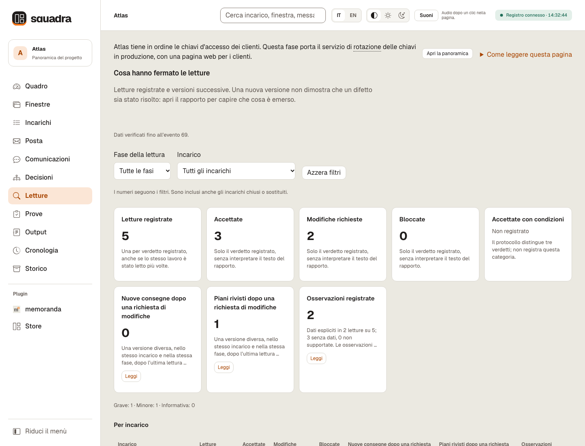

Il lettore può aggiungere `review --findings-file findings.json` con osservazioni
limitate (`severity`: `grave`, `minor` o `info`; `title`: una riga senza contenuti
privati). Vedi [il comando di lettura](references/work.md). I dati assenti sono
**Non registrato**; `[]` dichiara esplicitamente nessuna osservazione. La vista
mostra quante letture hanno fornito questi dati. **Accettate con condizioni** non
è registrato dal protocollo a tre verdetti. I metadati opzionali non cambiano
approvazioni, regole di chiusura o protocolli congelati.

<a id="first-steps"></a>
## Primi passi

È la prima volta con Squadra? Prova questi dodici passi una volta, dall'inizio alla fine, su un progetto di prova. Una **finestra** è una sessione di lavoro: un agente Codex, Claude o Cursor, oppure una persona. Tutte le finestre usano lo stesso registro.

1. **Installa** e imposta `export SQUADRA_ROOT=...` in ogni finestra.
2. **Crea il registro e registra ogni finestra** con `init` e `agent`, come sopra.
3. **Trova le finestre e presentati (regola 0):** `census` elenca i processi Codex, Claude e Cursor (`cursor-agent`) del progetto senza scrivere nulla; `send` e `transport` consegnano una presentazione, e ogni finestra risponde con `ack`.
4. **Racconta in parole semplici di cosa si tratta** con `brief --project`; la dashboard lo mostra per primo.
5. **Assegna il primo incarico e spiegalo:** `task` lo assegna; `brief --task` gli dà un titolo leggibile e dice perché esiste, per chi è e quando sarà finito.
6. **Il costruttore conferma e comincia:** `ack` («ho ricevuto»), poi `start` («sto costruendo»).
7. **Il costruttore prova e consegna:** `prove` esegue la verifica concordata sui file esatti; `deliver` li passa alla lettura.
8. **Legge qualcun altro:** un lettore che non ha scritto il lavoro conferma il passaggio e registra il verdetto con `review`.
9. **Il coordinatore chiude:** `check` verifica che prova e lettura riguardino la stessa versione; `close` registra la fine.
10. **Controlla chi risponde ancora:** `ping --all` chiama ogni altra finestra, e ognuna risponde con `ack`; `ping --sweep` mette in stand-by una finestra che non ha risposto entro l'attesa `alive` (300 secondi, salvo diversa scelta con `settings`). Non riceve nuovi incarichi, e niente di ciò che esegue viene fermato.
11. **Apri la dashboard** con `dash --open`; «Come leggere questa pagina» spiega ogni termine.
12. **Registra quello che dice il proprietario, con i suoi collegamenti:** `decision` con `--owner-words`, `--channel` e `--task`; poi seleziona il suo riquadro nella vista Decisioni.

```sh
squadra census --project /path/to/project
squadra send --actor coord --to builder --id HELLO-builder --body-file /evidence/introduction.md
squadra transport --actor coord --message HELLO-builder --via manual
squadra ack --actor builder --message HELLO-builder
squadra brief --actor coord --project --file /evidence/project.md
squadra task --actor coord --id T1 --owner builder --reviewer reader \
  --title "Key rotation" --repo /path/to/builder-checkout \
  --scope-file /evidence/scope.md --proof-file /evidence/argv.json
squadra brief --actor coord --task T1 --file /evidence/t1.md
squadra ack --actor builder --message assign-T1
squadra start --actor builder --task T1
squadra prove --actor builder --task T1 -- python3 -B -m unittest discover -s tests -v
squadra deliver --actor builder --task T1
squadra ack --actor reader --message "review-ID-RETURNED-BY-DELIVER"
squadra review --actor reader --task T1 --verdict accepted --report /evidence/code-read.md
squadra check --actor coord --task T1
squadra close --actor coord --task T1
squadra ping --actor coord --all
squadra ack --actor builder --message "PING-ID-RETURNED-BY-PING"
squadra ping --actor coord --sweep
squadra decision --actor coord --reason "Istruzione del proprietario" --task T1 \
  --owner-words "Teniamo leggibili le chiavi vecchie per un mese" --channel typed-here
squadra dash --open
```

<a id="dashboard"></a>
## Dashboard: il lavoro a colpo d'occhio

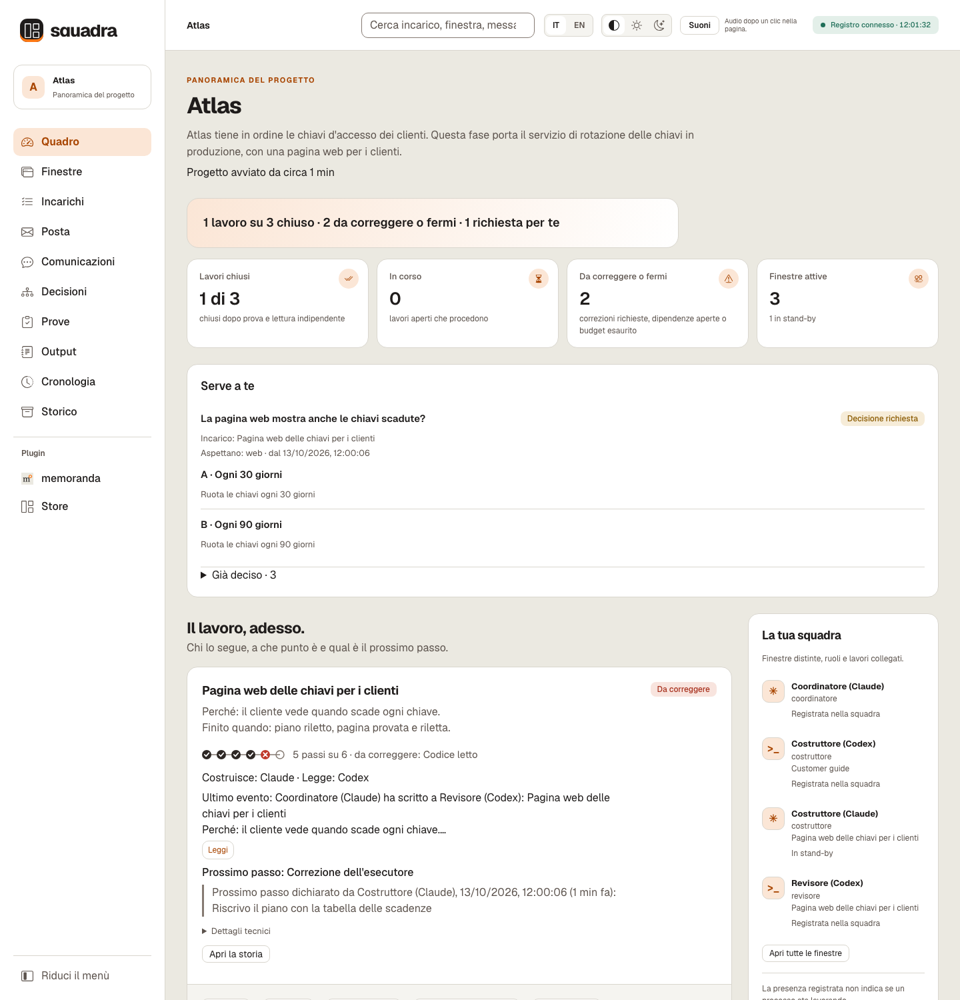

*Il Quadro su un registro dimostrativo, Atlas ([in inglese](docs/images/dashboard-overview-en.png), [tema scuro](docs/images/dashboard-overview-dark-it.png)). I testi registrati, come briefing, parole del proprietario e messaggi, restano come sono stati scritti. Gli esempi non contengono dati di clienti e non misurano la qualità dei modelli.*

`squadra dash --open` si apre sul **Quadro**. Una frase e quattro indicatori dicono a che punto è il lavoro: incarichi chiusi, in corso, da correggere o fermi, e finestre attive (con quante sono in stand-by). **Serve a te** compare solo quando per il proprietario è registrata una domanda, un budget esaurito o una pausa. Poi una scheda per ogni incarico: il titolo del briefing e i sei passi registrati, chi costruisce e chi legge («Costruisce: Claude · Legge: un'altra finestra Claude»), l'ultimo evento e il prossimo passo che il registro si aspetta, e a parte il prossimo passo dichiarato da una finestra, finché una decisione o un briefing successivi non vi rispondono. Ogni scheda apre la **storia** dell'incarico in ordine di tempo: briefing, piani e loro letture, prove, consegne, domande, decisioni e messaggi, con i documenti da aprire per nome. Sotto vengono i cinque grafici di **Andamento**; gli incarichi chiusi e sostituiti, la panoramica a cinque domande e gli indicatori tecnici stanno in fondo, richiusi. Gli identificativi restano in «Dettagli tecnici», che resta aperto, con il punto in cui stai leggendo, mentre arrivano eventi nuovi; un campo vuoto non viene mai stampato.

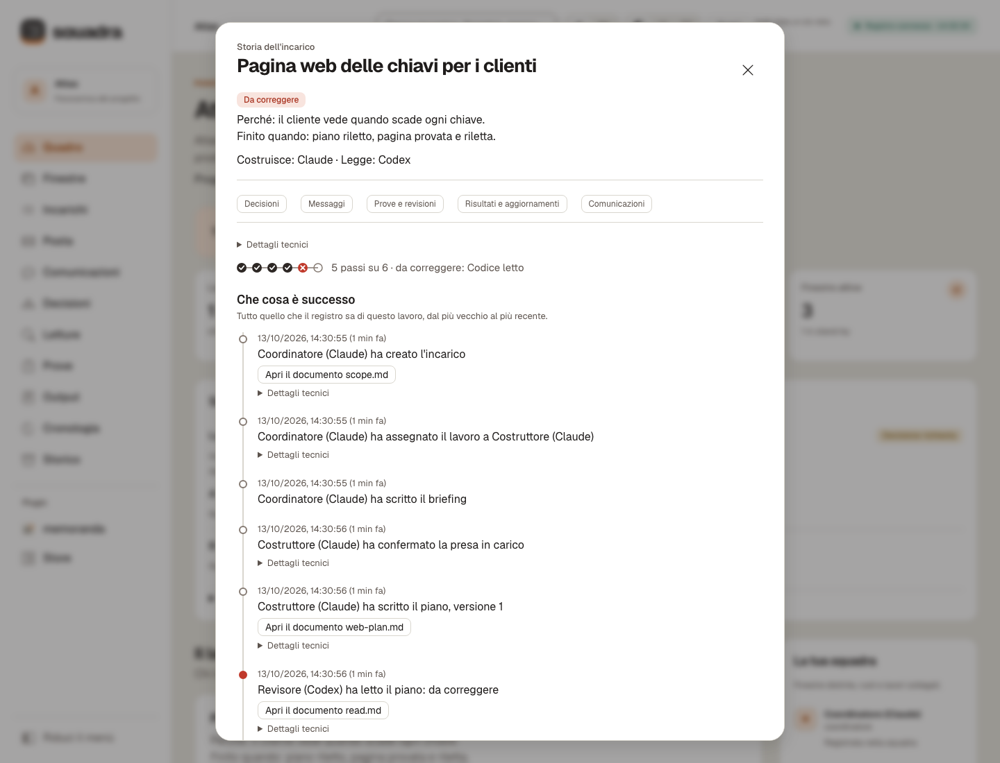

- **Menù e barra in alto.** Un menù laterale, riducibile alle sole icone, che sul telefono diventa un pannello (☰; si chiude con Esc, con × o scegliendo una vista). La barra in alto contiene il progetto, la ricerca, IT / EN, il tema (Automatico, Chiaro, Scuro), il pulsante **Suoni** e il collegamento al registro. Lingua e tema restano solo in questo browser, e la pagina funziona anche quando il browser rifiuta di salvarli. Le parole registrate non vengono mai tradotte; «Come leggere questa pagina» spiega ogni termine.
- **Cinque grafici:** incarichi per stato; avanzamento di ogni incarico (una croce rossa segna un passo raggiunto con correzioni richieste); attività nelle ultime 24 ore o negli ultimi 14 giorni, contata dal server a quarti d'ora e mostrata nel tuo fuso orario (o in UTC, con una nota), esclusi i segnali di vita delle esecuzioni; prove superate e fallite; letture e verdetti entro il budget di ogni incarico. Ognuno dice il suo risultato in una frase e può mostrare i dati in tabella; il significato lo portano ✓, ✗, ■ e i cerchi vuoti, mai il colore da solo.
- **Tabelle** per Incarichi, Finestre, Prove e Posta: si ordinano, si filtrano e si cercano, 100 righe alla volta; gli identificativi restano nei «Dettagli» di ogni riga, e il fuoco della tastiera non si perde con l'aggiornamento. I **testi lunghi**, ovunque, mostrano poche righe e un pulsante «Leggi» che apre il testo completo, come testo e mai come markup, in una finestra che si chiude con Esc.

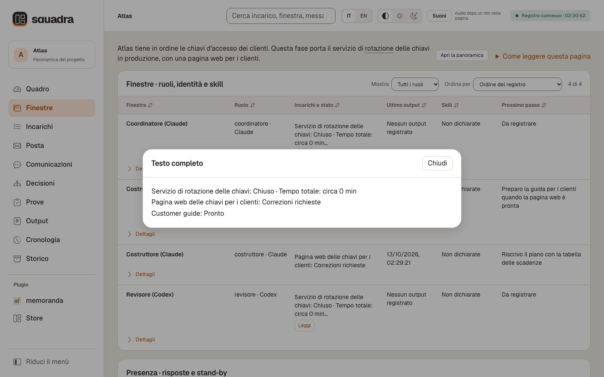

- **Suoni e avvisi.** Un suono breve e «Passo fatto: <titolo incarico>» quando si chiude un incarico («Passi fatti: N» se sono diversi); una melodia in salita e «Lavoro completato: nessun incarico aperto» quando si chiude l'ultimo. Gli avvisi spariscono dopo qualche secondo, si possono chiudere, se ne vedono al massimo tre e compaiono anche con i suoni spenti. I suoni sono accesi all'inizio e partono solo dopo il tuo primo clic nella pagina («Audio dopo un clic nella pagina.»), mai all'apertura, e una scheda nascosta può saltarne uno. Li genera il browser, senza file audio e senza richieste in rete.
- **I collegamenti di un incarico**, da ogni scheda, aprono le sue decisioni, i messaggi, le verifiche, le letture, i risultati e le comunicazioni, scegliendo l'incarico per la sua identità registrata anche quando i titoli si ripetono; una fascia spiega il contesto, **Torna all'incarico** riapre la sua storia e **Mostra la vista completa** toglie il contesto.
- **Piè di pagina:** «Vista locale in sola lettura, salvo le impostazioni dei plugin e le selezioni salvate · nessuna azione sui client.», e la firma «Sviluppato da Stefano D'Agostino · GitHub», con il collegamento al [progetto su GitHub](https://github.com/dagoSte/squadra).
- **Aspetto e contenuto.** Superfici crema e bianco carta con testo color inchiostro, un tema scuro su espresso, l'arancione evidenziatore come unico accento, il carattere Geist, colori di stato distinguibili anche da chi non distingue bene i colori e WCAG AA in entrambi i temi. Reboot 5.3.8, 40 icone di Bootstrap Icons 1.13.1 (MIT) e due caratteri (SIL Open Font License 1.1) sono copiati byte per byte e serviti da `squadra dash` stessa ([file, versioni, licenze e hash](assets/vendor/VENDOR.md)). Niente JavaScript di Bootstrap e niente dalla rete: la Content-Security-Policy aggiunge solo `font-src 'self'`.

| Vista (nome inglese) | Cosa puoi controllare |
|---|---|
| Quadro (Summary) | Stato, indicatori, Serve a te, schede e storie degli incarichi, attese e presenza, Andamento; in fondo, richiusi, la panoramica, gli indicatori tecnici, le riserve e le decisioni recenti. |
| Finestre (Windows) | Le finestre indicate a parole: ruolo, incarichi, ultimo output, skill, prossimo passo; identità, sessione, modello e hash delle skill nei Dettagli; poi il pannello di presenza. |
| Incarichi (Tasks) | Ogni incarico sotto il titolo del suo briefing: stato, costruttore e lettore, ultima prova, prossimo passo; descrizione, dipendenze, letture, requisiti e artefatti nei Dettagli. |
| Posta (Mail) | Chi ha scritto a chi su quale incarico, l'inizio del messaggio, ACK e consegna. |
| Comunicazioni (Communications) | Chi parla con chi e perché, in tempo reale, in parole semplici. |
| Decisioni (Decisions) | Il grafo delle decisioni, con dettagli, filtro per incarico e zoom. |
| Prove (Runs) | Incarico, chi, tipo, esito, durata; comando, esito nativo, log e stato di timeout o interruzione nei Dettagli. |
| Output (Outputs) | Aggiornamenti salvati e prossimi passi dichiarati. |
| Cronologia (Timeline) | Gli ultimi 120 eventi; la storia completa resta in `events.jsonl`. |
| Storico (History) | Vecchi record importati come copie storiche, non verificate. |

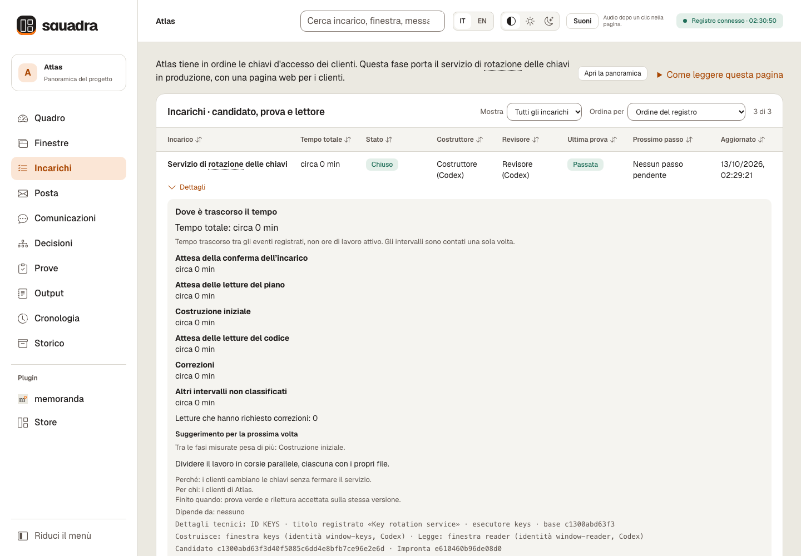

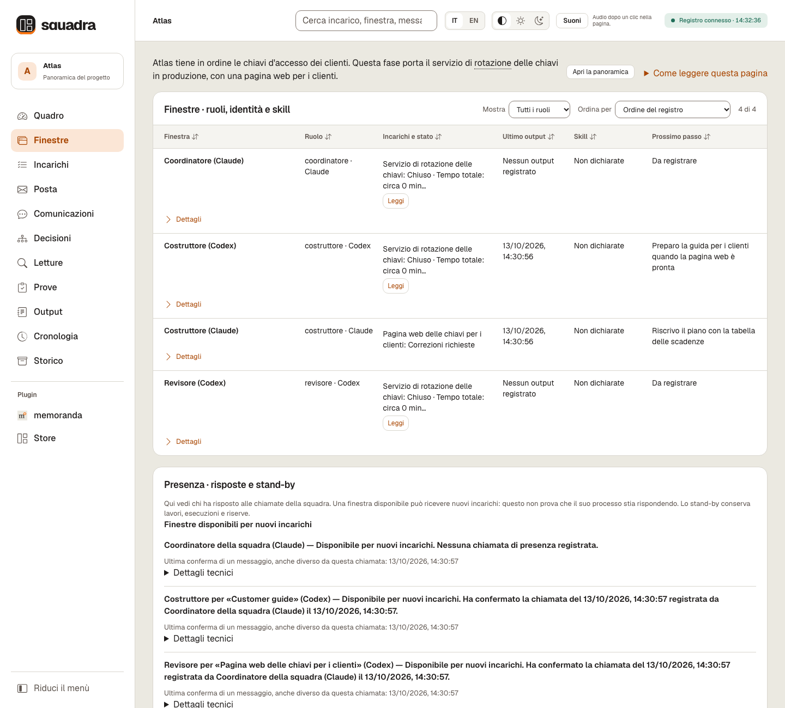

*Due finestre hanno confermato la chiamata del coordinatore; una non ha risposto ed è stata messa in stand-by. Le etichette dei ruoli mostrano il protocollo, non la qualità di un modello; registrazione, segnale di vita e risposte non dimostrano che un processo sia in esecuzione.*

**Presenza.** Il pannello di presenza indica ogni finestra con il suo ruolo e il suo incarico (la prima riga del briefing, altrimenti il titolo registrato) e spiega a parole chiamate, risposte e stand-by, tenendo distinte una risposta mancante e uno stop esplicito del coordinatore. Il pannello della squadra raggruppa i ruoli della stessa finestra; una presenza registrata non dice che un processo stia lavorando in questo momento.

**Comunicazioni** risponde a «chi sta parlando con chi, e a che punto è?». I filtri stanno sempre in alto (Periodo, Quanti, Incarico, Finestra, Cerca, «Azzera filtri»). «Chi parla con chi» ha una riga per ogni coppia di finestre, contata su tutto il registro; sceglierne una filtra la cronologia. La cronologia disegna una freccia per ogni messaggio con una frase semplice, come «Il coordinatore (Claude) ha scritto al revisore (Codex) sull'incarico «Pagina web delle chiavi per i clienti» — inviato, non ancora letto.», insieme a chiamate di presenza e stand-by. Inviato non vuol dire letto e messo in coda non vuol dire consegnato: solo una conferma registrata prova la lettura. Ogni stato è scritto a parole e ha il suo stile di linea; il testo di un messaggio si apre solo quando lo chiedi; gli aggiornamenti conservano il punto di lettura, le righe aperte e i filtri.

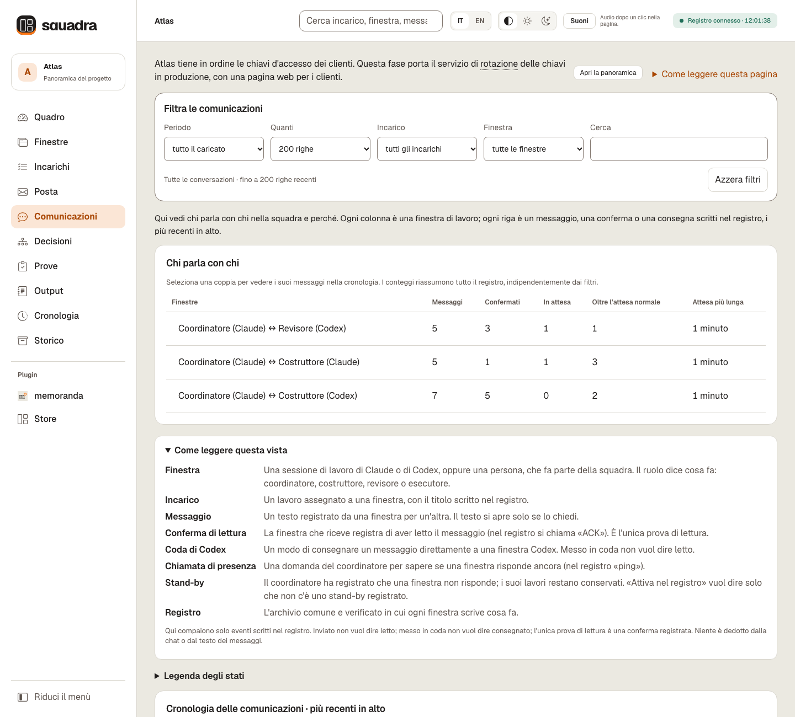

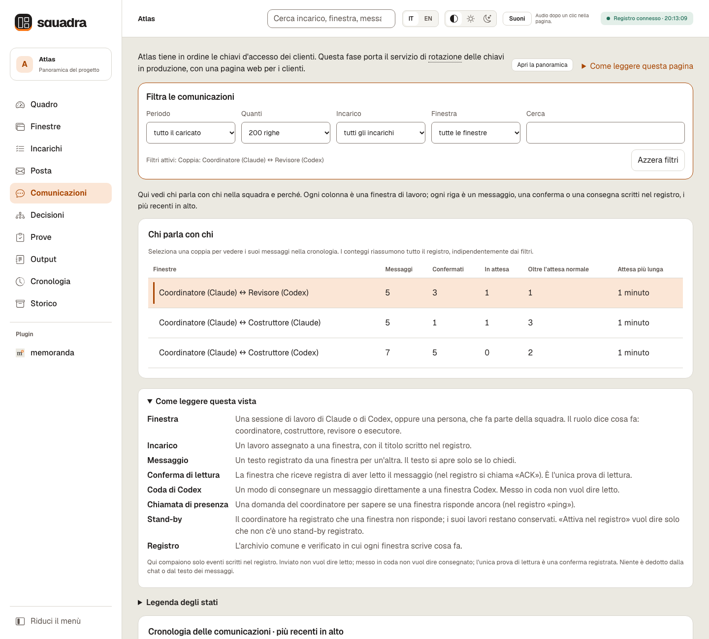

Ogni schermata esiste in entrambe le lingue:

| Vista | Inglese | Italiano |
|---|---|---|
| Quadro | [EN](docs/images/dashboard-overview-en.png) | [IT](docs/images/dashboard-overview-it.png) |
| Quadro, tema scuro | [EN](docs/images/dashboard-overview-dark-en.png) | [IT](docs/images/dashboard-overview-dark-it.png) |
| Telefono | [EN, scuro](docs/images/dashboard-phone-en.png) | [IT, menù](docs/images/dashboard-phone-it.png) |
| Storia di un incarico | [EN](docs/images/dashboard-story-en.png) | [IT](docs/images/dashboard-story-it.png) |
| Finestra «Leggi» | [EN](docs/images/dashboard-read-dialog-en.png) | [IT](docs/images/dashboard-read-dialog-it.png) |
| Incarichi | [EN](docs/images/dashboard-tasks-en.png) | [IT](docs/images/dashboard-tasks-it.png) |
| Finestre e presenza | [EN](docs/images/dashboard-presence-en.png) | [IT](docs/images/dashboard-presence-it.png) |
| Comunicazioni | [EN](docs/images/dashboard-comms-en.png) | [IT](docs/images/dashboard-comms-it.png) |
| Comunicazioni, una coppia | [EN](docs/images/dashboard-comms-pair-en.png) | [IT](docs/images/dashboard-comms-pair-it.png) |
| Decisioni | [EN](docs/images/dashboard-decisions-en.png) | [IT](docs/images/dashboard-decisions-it.png) |
| Letture | [EN](docs/images/dashboard-reads-en.png) | [IT](docs/images/dashboard-reads-it.png) |
| Pagina di un plugin | [EN](docs/images/dashboard-plugins-en.png) | [IT](docs/images/dashboard-plugins-it.png) |
| Impostazioni di un plugin | [EN](docs/images/dashboard-plugin-settings-en.png) | [IT](docs/images/dashboard-plugin-settings-it.png) |
| Memorie di un plugin | [EN](docs/images/dashboard-plugin-memories-en.png) | [IT](docs/images/dashboard-plugin-memories-it.png) |
| Store dei plugin | [EN](docs/images/dashboard-plugin-store-en.png) | [IT](docs/images/dashboard-plugin-store-it.png) |

**Aggiornamento e sicurezza.** La pagina si aggiorna ogni due secondi, sospende gli aggiornamenti quando la scheda è nascosta e si aggiorna subito al ritorno. Offre la ricerca nel testo e apre gli artefatti registrati in una finestra. È **in sola lettura salvo impostazioni e selezioni dichiarate dei plugin installati**; le azioni sul registro passano dalla CLI. Ascolta su `127.0.0.1`, verifica Host e token, controlla Origin per il salvataggio di impostazioni e selezioni, e non carica script remoti né CDN. `--port` sceglie una porta (senza, ne cerca una libera); `Ctrl-C` chiude il server della dashboard, non gli agenti; se si disconnette, la pagina conserva l'ultima vista con un avviso.

<a id="plugins"></a>
### Plugin di dati locali

Un **plugin** porta nella dashboard i dati di un altro strumento: una cartella `$HOME/.squadra/plugins/<name>/` con un manifesto `plugin.json`, in cui un programma separato, il *produttore* del plugin, scrive i pannelli di dati. Il gruppo **Plugin** del menù elenca ogni manifesto installato, oppure dice «Nessun plugin installato» e spiega dove si installano; scegline uno per vedere i suoi dati per il registro aperto.

HOME, `.squadra`, `plugins` e ogni cartella di plugin devono appartenere all'utente
corrente e non essere scrivibili da gruppo o altri. Elenco, lettura dei pannelli,
impostazioni e azioni rifiutano le cartelle non sicure con `unsafe_permissions`.
Le cartelle dell'utente con permessi 0700 o 0755 funzionano; lo Store crea cartelle
private con permessi 0700.

**Costruisci il tuo.** Il formato è aperto: chiunque nella community può pubblicare un plugin per squadra, gratuito o a pagamento. Un plugin è fatto di dati e di un programma separato. La dashboard e la CLI non eseguono mai il codice dei plugin; gli agenti lo eseguono solo come indicato nell'`AGENTS.md` del plugin, rispettando le [condizioni di affidabilità del file e i permessi già concessi dall'utente](references/plugins.md#agent-instructions). Parti dal [formato dei plugin](references/plugins.md).

**Passo per passo:** la [guida per creare un plugin](references/plugin-authoring.md) (in inglese) costruisce un plugin funzionante, lo prova con la dashboard e spiega come pubblicarlo, gratuito o a pagamento.

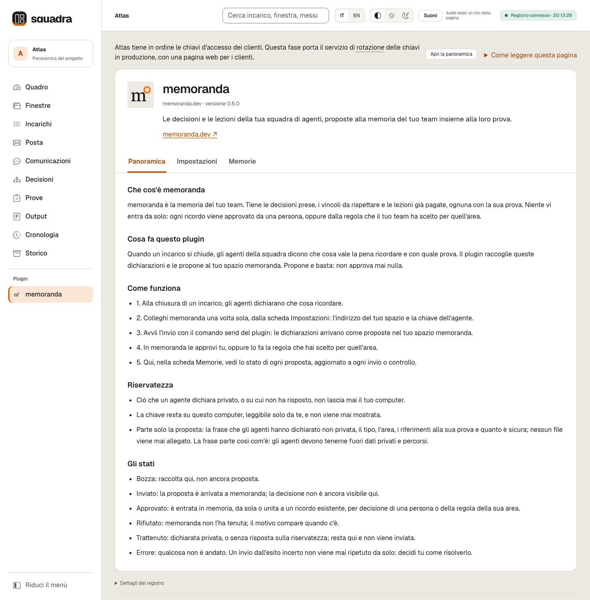

- **Dati, non codice.** La dashboard non esegue mai il codice dei plugin. La homepage HTTPS dichiarata si apre in una nuova scheda solo al tuo clic; i riferimenti a incarichi ed esecuzioni aprono la vista corrispondente del registro; un logo PNG locale facoltativo compare senza richieste remote; i badge di stato non danno alcuna autorità sul registro. La pagina `about` facoltativa (autore, versione, presentazione, fino a otto sezioni) è una descrizione del produttore, mai contenuto eseguibile né un'identità verificata.
- **Impostazioni.** Fino a quattro campi dichiarati, che si salvano con **Salva**; **Cancella** ha effetto al salvataggio, e una password lasciata vuota conserva il segreto salvato. I segreti non vengono mai precompilati né restituiti, e i gestori di password restano fuori dal controllo di Squadra. I file vanno nella **HOME dell'utente che esegue `squadra dash`** (una dashboard avviata da un agente con una HOME privata salva lì, non nella tua), come file locali in chiaro `settings.json` e `secrets/<id>` (0600): non una cassaforte cifrata, e mai nel registro. Le scritture sono atomiche file per file, quindi una risposta persa può voler dire un salvataggio parziale: rileggi lo stato e invia di nuovo con intenzione; non dedurre mai il successo da una risposta mancante.

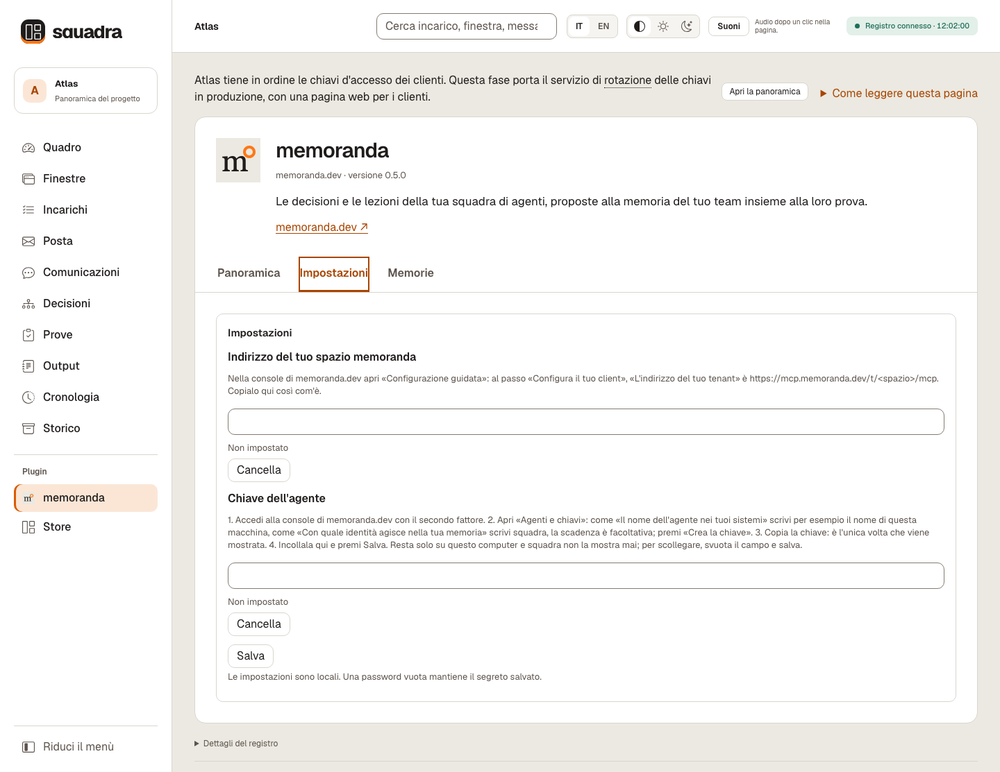

- **Risultati per ogni servizio.** Un plugin può dare un nome alla propria sezione di dati, per esempio «Collaudi», e spiegare gli stati dei risultati nelle due lingue. I plugin precedenti conservano «Memorie». Le voci possono collegarsi a un incarico esistente o a una sua esecuzione registrata: sono associazioni dichiarate dal produttore, non prove di successo o approvazione.
- **Selezionare le bozze.** Un plugin può dichiarare un'azione, per esempio «Richiedi un collaudo» o «Invia per revisione». Nella sua sezione di dati spunti le bozze e premi il pulsante: viene salvata solo la tua scelta. I suoi elementi mostrano «In attesa di invio»; selezione e invio restano disabilitati finché la richiesta viene consumata o usi «Annulla richiesta». L'annullamento non interrompe un lavoro già avviato. Parole e colori distinguono gli esiti comunicati dal plugin; gli elementi inviati, approvati e rifiutati compaiono sotto «Già inviate», con il loro conteggio. La dashboard non invia né esegue nulla.

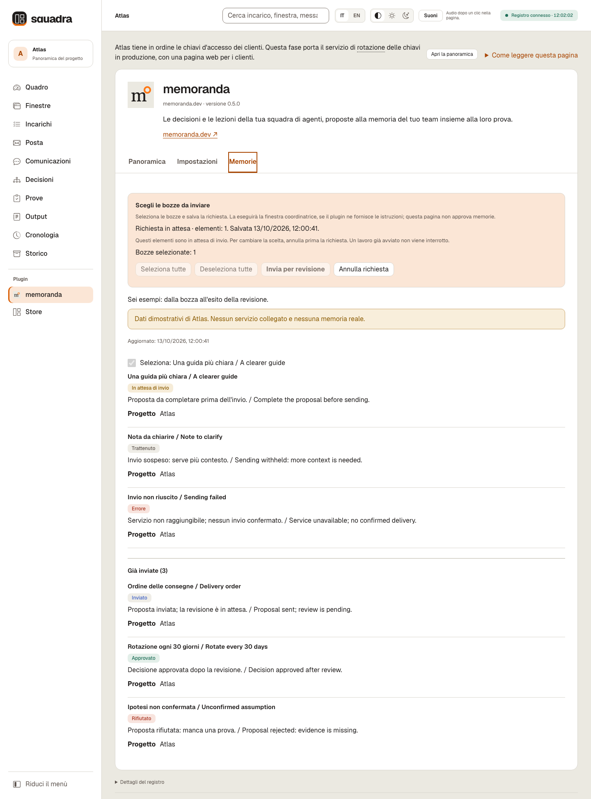

<a id="plugin-agent-instructions"></a>
**Chi esegue la richiesta?** Un plugin installato può fornire `$HOME/.squadra/plugins/<name>/AGENTS.md` con istruzioni per gli agenti. La finestra coordinatrice lo legge all’avvio e alla ripresa ed esegue solo i comandi indicati, nei permessi già autorizzati: il produttore dopo una chiusura, il consumatore quando la dashboard mostra una richiesta in attesa, poi riferisce l’esito. Vale solo un file regolare di proprietà dell’utente, non scrivibile da gruppo o altri e non un link simbolico. Senza un file valido, la richiesta resta in attesa e la coordinatrice lo segnala: non devi lanciare comandi. La dashboard non legge, non scrive e non esegue questo file. Questo file non amplia mai i permessi e non autorizza installazioni, push, pubblicazioni o decisioni riservate all’utente; per qualunque richiesta oltre a eseguire il produttore o il consumatore di quel plugin, fermarsi e riferire.

Schemi, dimensioni, limiti e codici di rifiuto esatti: [contratto dei plugin](references/plugins.md), [metadati about](references/plugins.md#optional-about-metadata), [sito e icona](references/plugins.md#homepage-and-local-icon).

<a id="plugin-store"></a>
### Plugin inclusi nella release

L’installazione rende disponibili alla coordinatrice anche le [istruzioni per gli agenti](#plugin-agent-instructions): le legge al prossimo avvio o alla ripresa ed esegue il produttore o il consumatore nei momenti documentati, entro i permessi già autorizzati.

Apri **Plugin → Store** per vedere il catalogo della release in esecuzione, i comandi di installazione e lo stato locale. Si aggiorna solo all'apertura o con **Aggiorna catalogo**; non c'è un pulsante per installare. I siti dei plugin si aprono al clic in una nuova scheda. Chiedi al coordinatore di eseguire il comando mostrato, che usa questa installazione di Squadra.

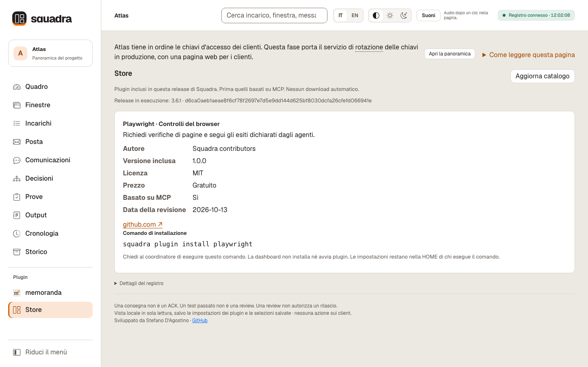

`squadra plugin list` elenca il catalogo accettato della release locale, prima i plugin basati su MCP, con lo stato d'installazione e la release installata e corrente. `squadra plugin install <name>` copia un plugin incluso: non scarica né esegue codice. Con l'installazione `/plugin` non c'è il comando autonomo: chiedi al coordinatore di usare `python3 <cartella della release>/scripts/squadra.py plugin list` o `plugin install <name>`.

Ripetere l'installazione applica esplicitamente il pacchetto di quella release e riporta le versioni **da X a Y**, segnalando anche un ritorno a una versione precedente. Impostazioni, segreti, selezioni salvate e pannelli restano intatti. Prima dell'aggiornamento ferma produttore e consumatore. Una cartella preesistente non gestita dallo store non viene adottata: salva `settings.json` e `secrets/`, sposta la cartella, poi installa; ripristina la configurazione solo dopo aver verificato lo schema del nuovo plugin. Per disinstallare, ferma produttore e consumatore, salva la configurazione e rimuovi solo la cartella di quel plugin. Una copia interrotta risulta incompleta: riprova con lo stesso pacchetto. L'aggiornamento dell'intera cartella non è atomico. Vedi [metadati e controlli dello store](references/plugins.md#release-local-plugin-store).

I plugin si propongono tramite PR o email di contatto del manutentore, che li analizza dando precedenza a quelli basati su MCP. Inclusione e data della lettura valgono solo per la versione accettata. Il catalogo è locale alla release: non è un marketplace remoto e non esegue nulla automaticamente.

Il [plugin memoranda nello Store](plugins/memoranda/README.it.md) raccoglie le lezioni
dichiarate e le propone a memoranda.dev, senza approvarle. Il plugin si installa
gratuitamente; il servizio collegato inizia con una prova gratuita, poi è a pagamento.

**Prova i collaudi del browser:** il [plugin Playwright MCP](plugins/playwright/README.it.md), facoltativo, prepara i controlli di un incarico, salva la tua selezione e permette a un agente autorizzato di usare i propri strumenti browser collegati e riferire l’esito. Installare il plugin di dati non installa né attiva MCP.

**Porta dentro gli errori dell'app (anteprima):** il [plugin Sentry](plugins/sentry/README.it.md), facoltativo, porta in Squadra riepiloghi ripuliti degli errori dalla tua connessione Sentry autorizzata, così scegli i problemi da analizzare e ne segui gli incarichi. Gratis · Sviluppo finanziato da memoranda: plugin gratuito per tutti. Provato solo con una connessione simulata; il collegamento reale a Sentry non è ancora verificato.

**Pubblica il tuo plugin:** leggi la [panoramica italiana](docs/plugin-authoring.it.md), che rimanda alla guida tecnica in inglese per esempi, verifiche e compatibilità. Questi plugin di dati sono separati dall’installazione di Squadra tramite `/plugin`; pubblicare un pacchetto non lo inserisce automaticamente in un catalogo, non lo installa e non lo approva.

<a id="decisions"></a>
## Grafo delle decisioni e briefing

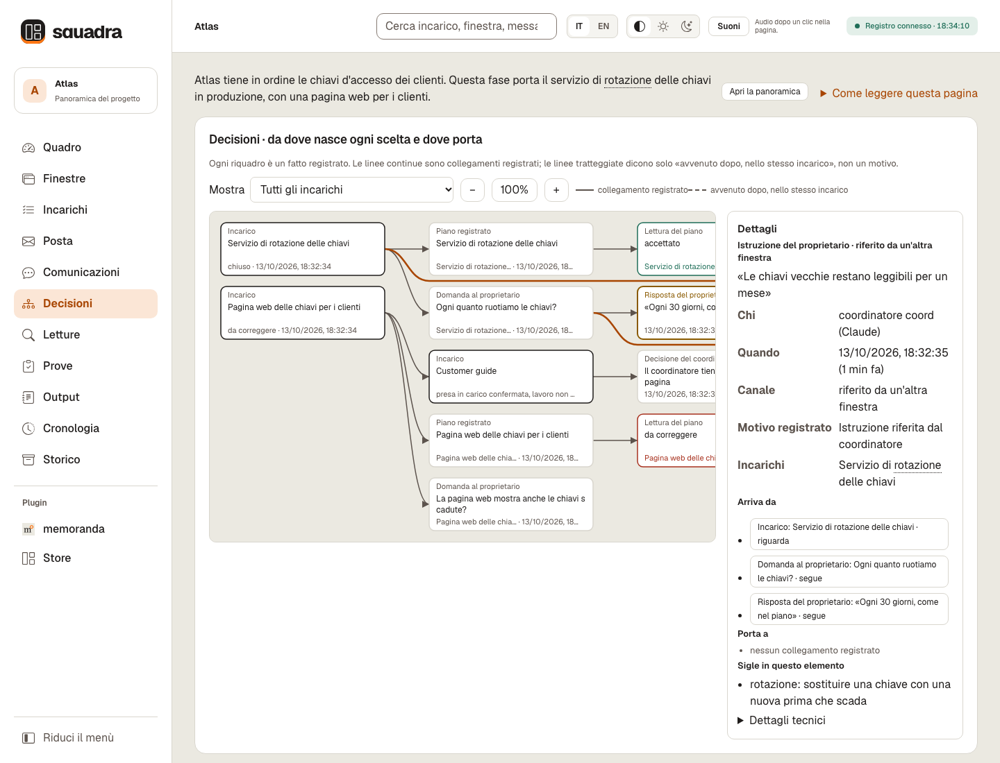

*Il riquadro selezionato è un'istruzione del proprietario riferita dal coordinatore: chi, quando, le parole esatte, il canale e i collegamenti registrati.*

I **briefing** sono brevi descrizioni in testo semplice scritte dal coordinatore, da leggere prima di qualunque identificativo.

```sh
squadra brief --actor coord --project --file /evidence/project.md
squadra brief --actor coord --task T1 --file /evidence/t1.md
```

```markdown
# Atlas
Atlas tiene in ordine le chiavi d'accesso dei clienti. Questa fase porta in produzione il servizio delle chiavi.

## Passi
- [x] Piano del servizio delle chiavi
- [ ] Servizio delle chiavi in produzione

## Glossario
- JEV: verifica del motore dei lavori
```

Il briefing del progetto comincia con il suo obiettivo; `## Passi` e `## Glossario` (o `## Steps`, `## Glossary`) sono facoltativi, e i passi restano un'affermazione del briefing, mostrata a parte rispetto alle chiusure che il registro registra. La prima riga del briefing di un incarico diventa il suo titolo in tutta la pagina, e il resto dice perché esiste, per chi è e quando sarà finito; senza briefing, l'incarico tiene il titolo registrato e compare come «descrizione non ancora scritta». Solo il coordinatore registra i briefing: UTF-8, al massimo 8192 byte, conservati come artefatti. Un briefing nuovo prende il posto del precedente sulla pagina, ogni versione resta nella storia, e un briefing non cambia mai lo stato di un incarico.

**Collegamenti registrati.**

```sh
squadra decision --actor coord --id D-SCOPE --task T1 \
  --follows ask:Q1 --follows decision:D-EARLIER \
  --owner-words "Teniamo leggibili le chiavi vecchie per un mese" --channel relayed \
  --reason "Istruzione del proprietario riferita dal coordinatore"
```

`--id` dà un nome alla decisione (altrimenti `dec-e<numero dell'evento>`, una forma riservata). `--task` collega incarichi esistenti; `--follows` indica un `ask:<id>` o una `decision:<id>` precedente, mai un nome senza prefisso, e viene fissato quando la decisione è scritta. Un'istruzione del proprietario senza domanda può portare `--channel typed-here` o `relayed` con `--owner-words` non vuoto; senza canale la pagina dice «canale non registrato». `--choice` richiede `--answers`, e un'istruzione, una menzione o un `--follows` non chiudono mai una domanda.

**Sostituire un incarico.** `task ... --supersedes T0` registra che un incarico nuovo sostituisce l'incarico aperto T0; `supersede --actor coord --task T0 --by T1 --reason "..."` la registra dopo, quando il lavoro si è già spostato su un T1 esistente, più recente, che non aspetta T0. T0 esce dai prossimi passi e dalle attese e conserva tutta la sua storia; gli incarichi che dipendono da T0 restano bloccati, e niente viene annullato, rilasciato, completato o riassegnato. Entrambi sono rifiutati finché T0 ha un'esecuzione in corso o con un arresto non verificato, un responsabile che tiene una riserva o una domanda aperta, e un incarico non può dipendere da quello che sostituisce; `supersede` richiede anche una motivazione non vuota.

**Leggere il grafo.** Ogni riquadro è un fatto registrato, i più vecchi a sinistra. Le **linee continue** sono collegamenti registrati; le **linee tratteggiate** dicono solo «dopo, nello stesso incarico», mai una ragione. I riquadri del proprietario mostrano sempre il canale: «scritto qui», «riferito da un'altra finestra» o «canale non registrato»; i verdetti sono scritti a parole oltre che a colori. Seleziona un riquadro (clic, Invio o Spazio) per vedere chi, quando, le parole complete e i collegamenti nelle due direzioni; filtra per incarico e usa lo zoom. Gli aggiornamenti conservano selezione, filtro, zoom e fuoco, e dicono «elemento non più presente» quando un elemento non c'è più. Sul telefono il grafo diventa un elenco in ordine di tempo, rispettando la riduzione del movimento; i collegamenti circolari, possibili solo in un registro alterato, sono elencati sotto «Collegamenti non ordinabili». Le regole complete sono in [lavoro, prova e lettura](references/work.md).

<a id="workflow"></a>
## Incarico, prova, lettura indipendente e chiusura

**Scegli il percorso.** Alla creazione, e davanti a un rilievo o a un cambio di perimetro, il costruttore propone un percorso, il lettore non autore lo conferma o dissente, e il coordinatore decide con una motivazione registrata, rispondendo alle cinque domande della [pagina di triage IT/EN](references/work.md#triage-in-una-pagina): tocca sicurezza, dati dei clienti, chiavi, permessi, integrità delle prove o azioni difficili da annullare; ne capiamo tutto l'effetto e possiamo annullarla; è una correzione delimitata, dimostrata da una verifica mirata; quale comportamento richiesto potrebbe restare scoperto; un errore potrebbe restare nascosto. Nessuna regex, nessun modello di percorso e nessun punteggio scelgono il percorso; risposte e scelta si registrano in una riga del perimetro o del rapporto.

- **Correggi subito con prova:** reversibile, Q1 no e Q3 sì; un breve controllo di un non autore prima della chiusura.
- **Una lettura del codice:** una scelta ordinaria e delimitata, con perimetro, prova vincolata e una lettura indipendente.
- **Percorso completo:** Q1 sì o incerta, Q2 irrisolta, un danno silenzioso rilevante in Q5, o un mandato esistente: un piano accettato prima della costruzione, poi prova, lettura di un non autore e le verifiche richieste.

**Le regole della lettura.**
- **Blocca solo un rilievo grave**, comprese prove di sicurezza obbligatorie mancanti o non valide; il resto si corregge subito, con un controllo di un non autore sul cambiamento e sul caso originale, oppure, se medio o basso, diventa un'attività da seguire. Ognuna ha un suo incarico, o una decisione che nomina l'incarico responsabile, con un evento osservabile o una scadenza e una verifica di accettazione, ed è collegata dal rapporto finché non viene chiusa. Un requisito rimandato non è soddisfatto, e i requisiti di sicurezza obbligatori restano.
- **I lettori** sono non autori disponibili, scelti con `task --reviewer`, che lavorano in parallelo su copie congelate, con gate, porte e database condivisi riservati. Il passaggio generato da `deliver` è il via alla lettura assegnata una volta che il destinatario ne dà l'ACK; la CLI non invoca mai un client da sola. Una lettura correttiva consuma lo stesso budget, e nessun alias o incarico nuovo azzera i giri spesi.
- **I passi con browser o installazioni** richiedono prima una capacità dimostrata dalla ricevuta di una sonda nel contesto giusto (per il browser: una connessione DevTools con nome, timeout, risorse private, pulizia di ciò che si è avviato). Senza, dichiara il passo **non eseguito**, cita l'ultima esecuzione valida e avvisa il coordinatore. **Non passare mai comandi al proprietario**, e nessuna capacità scavalca i permessi di esecuzione.

**Contratto, prova, lettura e chiusura.** Tieni le prove fuori dal checkout consegnato: `scope.md` (comportamento, percorsi posseduti, dipendenze, risorse, verifiche, confini del rilascio), `argv.json` come elenco esatto di argomenti, non una stringa di shell (`["python3", "-B", "-m", "unittest", "discover", "-s", "tests", "-v"]`), e un `requirements.json` facoltativo (`[{"id": "R1", "text": "I valori si sommano correttamente"}]`).

```sh
squadra task --actor coord --id T1 --owner builder --reviewer reader \
  --title "Verificare la funzione di somma" --repo /path/to/builder-checkout \
  --scope-file /evidence/scope.md --proof-file /evidence/argv.json \
  --requirements-file /evidence/requirements.json
squadra ack --actor builder --message assign-T1
# Percorso completo: un piano letto da un non autore prima della costruzione.
squadra plan --actor coord --task T1 --file /evidence/plan.md
squadra review --actor reader --task T1 --stage plan \
  --verdict accepted --report /evidence/plan-read.md
squadra start --actor builder --task T1
# Implementa la modifica, poi congela i sorgenti.
squadra prove --actor builder --task T1 --covers R1 --covers R2 \
  --timeout 120 -- python3 -B -m unittest discover -s tests -v
squadra deliver --actor builder --task T1
squadra inbox --agent reader
# Usa l'ID esatto restituito da deliver; leggi il candidato congelato e scrivi prima il rapporto.
squadra ack --actor reader --message "review-ID-RETURNED-BY-DELIVER"
squadra review --actor reader --task T1 --covers R1 --covers R2 \
  --verdict accepted --report /evidence/code-read.md
squadra check --actor coord --task T1
squadra close --actor coord --task T1
```

- **Opzioni e budget:** `--depends T0` (incarichi da cui dipende, chiusi prima in modo indipendente), `--expected N` (numero di test riconosciuti), `--full-gate` (una prova marcata come gate); nessuna dimostra che una suite sia completa, quindi concorda con il progetto il comando davvero richiesto. Di base tre letture del piano, due letture del codice e tre tentativi di costruzione nel runner facoltativo (`init --plan-rounds/--review-rounds`); l'accettazione è legata ai byte dell'ultimo piano; i budget esauriti richiedono una decisione esplicita, mai un azzeramento. Le modifiche piccole ricevono verifiche proporzionate.
- **`prove`** conserva esito nativo, durata, output e impronte prima e dopo dei file tracciati e non ignorati; le dipendenze ignorate richiedono prove proprie. **`deliver`** richiede una prova superata sui sorgenti esatti attuali, congela un pacchetto immutabile, restituisce un ID `review-…` e non invoca mai un modello.
- **`review`** registra `accepted`, `changes-required` o `blocked`. `probe` registra test indipendenti e controlli negativi (`--expected-rc 1`; un negativo riuscito non è una prova superata del prodotto); i mutanti vanno in copie isolate. `--covers` registra la copertura, non l'adeguatezza dei test, che giudica il lettore.
- **`check`** ricollega candidato, piano, prova, artefatti e copertura prima di `close`. Una modifica ai sorgenti annulla la vecchia prova e la vecchia lettura. `advance` riconcilia un passaggio già consegnato senza costruire, approvare o svegliare client; senza `--reviewer` vale il protocollo manuale di lettura.

**Il completamento non dà l'autorità di pubblicare.** Il protocollo completo è in [lavoro, prova e lettura](references/work.md).

## Posta, output e cose da ricordare

```sh
squadra send --actor coord --to builder --id M1 \
  --task T1 --body-file /evidence/message.md
squadra inbox --agent builder
squadra ack --actor builder --message M1
squadra output --actor coord --task T1 --file /evidence/update.md \
  --next "Lettura indipendente del candidato congelato" --artifact /evidence/result.json
```

`--reply-to` risponde; `--to-new waiting-reader` crea un destinatario atteso, non un'identità: registra il posto vero prima del suo ACK. `transport --via manual` restituisce un'istruzione di passaggio in sospeso, e un successo con `--via codex-queue` vuol dire messo in coda, non letto né sveglio. Il protocollo non autorizza alcuna messaggistica esterna. Salva **un output sostanziale per ogni passo completato**: un esito, una decisione, un blocco o un passaggio che aggiunge informazioni (ometti `--task` per il coordinamento dell'intera area). Il prossimo passo dichiarato non dimostra che qualcosa sia avvenuto. Il normale avanzamento si legge nel registro, quindi niente messaggi manuali «pronto» e niente racconti di una prova già registrata; ACK reali, decisioni, pause e ricevute restano obbligatori.

| Finestra / ruolo | Incarico / candidato | Esito / prova | Skill | Traccia / prossimo passo |
|---|---|---|---|---|
| builder / esecutore | T1 / SHA esatto | Exit nativo + log | Hash della skill | Ricevuta salvata + azione successiva |

### Da ricordare alla chiusura (facoltativo)

**Da ricordare.** Questo incarico ha prodotto qualcosa che vale oltre la sua chiusura: una decisione e chi l'ha presa, un vincolo, una trappola già pagata? Se sì, una frase per ciascuna, la prova (numero di evento o rapporto registrato) e quanto ne sei sicuro (sicuro / probabile). La frase contiene segreti, dati personali o percorsi privati? Se sì, riscrivila senza; se non puoi, non scrivere la frase: indica solo la prova e `private_content: yes`.

Allega un artefatto chiamato esattamente `da-ricordare.json` (`form: "da-ricordare/1"`, ID dell'incarico, `answer: "yes"` oppure `"no"`, `items`) al consueto `squadra output --artifact ...` dell'agente che chiude; vedi [lo schema e gli esempi](references/work.md#da-ricordare-at-close). Non segue da sola alcuna proposta o approvazione. **Se usi un servizio di memoria, dichiara alla chiusura e non proporre lo stesso elemento attraverso un altro canale.** **Mai** segreti, dati personali o percorsi privati nella dichiarazione: gli artefatti registrati sono immutabili, e un segreto scritto per errore non si può rimuovere. Un plugin consumatore può trasformare le dichiarazioni in bozze; l'API delle azioni salva solo la scelta dell'utente, non la invia e non esegue plugin ([contratto delle azioni](references/plugins.md#action-requests)).

## Domande e decisioni del proprietario

`ask` registra una domanda prima che venga mostrata, con almeno due opzioni dai valori `id`, `label` e `say` distinti (`say` è la frase da dire); `buys`, `costs` ed `example` sono facoltativi.

```json
[
  {"id": "A", "label": "Tieni questo perimetro", "say": "Continua con il perimetro già letto"},
  {"id": "B", "label": "Prima il piano", "say": "Pianifica prima l'integrazione facoltativa"}
]
```

```sh
squadra ask --actor coord --id Q1 --task T1 --waiting builder \
  --question "Quale perimetro costruiamo?" \
  --options-file /evidence/choices.json --recommended A
# Solo dopo la risposta effettiva del proprietario:
squadra decision --actor coord --reason "Il proprietario ha scelto il perimetro A" \
  --answers Q1 --choice A --channel typed-here \
  --owner-words "Continua con il perimetro già letto"
```

`--channel relayed` conserva parole riportate da un'altra finestra. `decision --withdraws Q1` chiude una domanda superata senza inventare una risposta; un `decision --reason` senza collegamenti conserva una motivazione senza chiudere domande. Risposte e ritiri sono esclusivi e non si ripetono. Testo della chat, prosa della posta e `output.next` non vengono mai letti in silenzio come decisioni o come autorità.

## Attese, risorse e presenza

L'età delle attese si calcola quando una vista viene letta. Valori predefiniti, in secondi: **ACK 900**, **delivered 3600**, **reviewed 1800**, **heartbeat 1800**, **alive 300**; `cleanup-unknown` è sempre visibile. `settings --actor coord --file /evidence/thresholds.json` imposta le chiavi scelte, per esempio `{"ack": 600, "alive": 300}` (zero avvisa subito); sostituisce i valori personalizzati precedenti, e le chiavi omesse tornano ai predefiniti. Un avviso non ritenta, non riassegna e non rilascia mai nulla.

```sh
squadra resource acquire --actor builder --name gate --reason "Candidato congelato"
# Per un incarico full-gate, esegui la prova concordata con prove --gate.
# Rilascia solo dopo l'esito finale e la riconciliazione delle risorse.
squadra resource release --actor builder --name gate --reason "Esecuzione finita"
squadra ping --actor coord --to builder
# Inoltra ogni ID restituito (codex-queue richiede un posto Codex registrato con --session); ping non invoca alcun client.
squadra transport --actor coord --message PING-ID --via codex-queue
squadra standby --actor coord --agent builder --reason "Finestra non disponibile"
squadra standby --actor coord --agent builder --resume --reason "Disponibilità confermata"
```

- **Risorse:** riserva gate, porte e database prima di usarli, e rispetta le riserve delle altre finestre. Un segnale di vita vecchio o un timeout non dimostrano che un processo si sia fermato, né liberano le sue risorse.
- **Presenza:** `ping --all` chiama una volta ogni altra identità attiva, escluse quelle in stand-by; un ping in attesa viene riusato e non viene mai prorogato. `--to` può chiamare una finestra in stand-by, che con un ACK reale può tornare al controllo successivo del coordinatore; ACK vecchi, alias e nuove registrazioni non bastano.
- **Solo il coordinatore cambia la disponibilità**, con `ping --sweep` (ricontrollato dentro la transazione) o con `standby`. Tutti gli alias di una finestra ne condividono lo stand-by, durante il quale nuovi incarichi e passaggi di lettura verso quella finestra sono rifiutati.
- **Lo stand-by non ferma nulla:** **non annulla processi, non rilascia risorse, non trasferisce ruoli e non riassegna lavoro**; il ritorno non riavvia nulla; nessun timer e nessuna vista della pagina cambiano lo stato; un ping senza risposta non prova un'assenza.

Tutte le finestre che scrivono nello stesso registro dovrebbero usare la stessa versione di Squadra, altrimenti alcune regole potrebbero non essere applicate; portare una squadra al lavoro su un'altra versione è un passo esplicito e autorizzato.

<a id="checkpoints"></a>
## Checkpoint, ripristino e contesti puliti

**Gli agenti fanno i checkpoint senza aspettare che tu lo chieda.** È il modo di lavorare richiesto dalla skill, non un servizio in background né un contatore invisibile di token.

| Quando | Azione richiesta |
|---|---|
| Incremento completato o lettura accettata | Nuovo checkpoint durevole del registro e ricevuta registrata. |
| Prima di una pubblicazione o di un cambio di sessione | Checkpoint e passaggio di consegne preciso. |
| WIP a rischio, stop del proprietario o contesto sotto pressione | `save` completo, poi un vero `restore-check`. |

```sh
squadra checkpoint --to /durable/checkpoint-001
squadra save --actor coord --to /durable/recovery-001
squadra restore-check --from /durable/recovery-001 --to /durable/restore-test-001
squadra pause --actor coord --reason "Il proprietario ha chiesto lo stop"
squadra doctor
squadra resume --actor coord --reason "Il proprietario ha ripreso esplicitamente"
```

- **`checkpoint`** copia **solo il registro**, i suoi artefatti e le viste derivate. **`save`**, riservato al coordinatore, aggiunge ogni radice Git registrata (bundle della storia, HEAD, branch, patch di index e worktree, file non tracciati) in una destinazione nuova, fuori da registro e sorgenti (`--temporary` per quelle usa e getta); `--repo` crea un pacchetto dichiaratamente parziale e `--include` aggiunge file ignorati dentro un repository selezionato. Sorgenti che cambiano nel frattempo rifiutano un pacchetto verde. Costruttori e lettori lo chiedono al coordinatore nel perimetro già autorizzato, senza chiedere di nuovo al proprietario.
- **`restore-check`** verifica i checksum prima di aprire qualunque cosa, ripristina in una cartella nuova e confronta il risultato; la copia ripristinata è in pausa, le vecchie accettazioni sono storiche, niente riparte da solo, e `--root` con `--actor` registra la ricevuta nel registro vivo.
- **Quando il contesto si riempie**, a un vero segnale del client o quando i vincoli non si ricostruiscono più in modo affidabile, l'agente salva un passaggio di consegne **prima di continuare**: incarico, identità, branch e SHA, rilievi aperti, ACK in sospeso, budget, risorse e un solo prossimo passo, esatto. Non inventa mai percentuali di token. Una sessione nuova dà l'ACK, esegue `doctor` e riconcilia sorgenti e risorse prima di scrivere; un prompt preparato non dimostra che una finestra sia stata aperta. La stessa finestra conserva l'identità e aggiorna `agent --session`; una finestra diversa richiede un posto nuovo. **Non esiste un comando che passi un incarico a un altro responsabile**: tieni un solo scrittore, non duplicare mai un incarico per cancellarne il budget, e i costruttori precedenti restano autori.
- **Una pausa** blocca nuovo lavoro, letture, esecuzioni e consegne e lascia possibili consultazione e ripristino, mentre un checkpoint da solo non mette in pausa nulla. Ferma solo i processi che possiedi; si riprende solo su parola del proprietario, dopo aver riconciliato processi e stato. Le altre squadre non vengono mai migrate né riprese.

**Limiti del ripristino:** i filtri per i segreti sono parziali, **non** una scansione completa di storia e artefatti; una copia sullo stesso disco non sopravvive a un guasto del disco; `--declared-offsite` è una dichiarazione, non un archivio remoto verificato. Il contratto completo è in [ripristino e passaggio di contesto](references/recovery.md).

## Runner nativi facoltativi

```sh
squadra run --actor builder --task T1 --mode build \
  --prompt-file /evidence/build.txt --timeout 600
squadra run --actor reader --task T1 --mode read --stage code \
  --prompt-file /evidence/read.txt --timeout 180
squadra cancel --actor coord --run "RUN-ID"
```

`run` avvia un nuovo turno non interattivo di Codex o Claude e non si collega mai a una finestra aperta; i prompt passano da stdin, i modelli non sono mai scritti nel codice, e i turni reali consumano la quota del client entro il budget concordato. **Cursor è rifiutato:** il turno di un posto `cursor` si ferma prima di qualunque processo con «Squadra non avvia cursor-agent: Cursor esegue gli hook di team, utente e azienda senza sandbox. Le finestre Cursor lavorano in modo interattivo» (lo stesso messaggio riporta anche il testo inglese), finché una versione di Cursor non documenterà un interruttore che disattiva tutti gli hook e MCP, confermato da una lettura di un non autore e da una vera sonda. Un esito valido richiede una sessione reale, un turno completato, l'uscita attesa e una lettura strutturata: un'uscita 0 da sola non basta, e il verdetto di un client non è la lettura registrata. Pausa, interruzione e timeout agiscono sul gruppo di processi posseduto; un segnale rifiutato lascia `cleanup-unknown`, da riconciliare prima di rilasciare le risorse. Discendenti staccati, Windows e compatibilità con i client reali vanno qualificati a parte. Leggi [i contratti dei runner](references/runtime.md) prima di invocarli in automatico.

## Self-test, sfide ai difetti e banco comparativo

Per un incarico dichiarato con `task --defect-fix`, la chiusura richiede la
prova che il test rilevi il difetto senza la modifica. Il coordinatore registra
i metodi unittest del fix e i loro file congelati con `challenge --task T1
--register --contract-file ... --reason ...`; l'esecutore lancia poi
`challenge --actor builder --task T1 --output /evidence/challenge-T1`.
Per esempio, un test che si aspetta il valore 2 fallisce sull'originale con
valore 1 e passa dopo la correzione. Gli stessi byte del test girano sulla base
registrata e sul candidato esatto, anche prima del commit. Errori, test saltati,
ID mancanti e test che passano in entrambe le versioni non valgono come prova.

Il risultato e i log compaiono accanto alla prova. Il coordinatore può dichiarare
un'eccezione motivata: il lettore indipendente la verifica e non appare mai come
una verifica riuscita. Modifiche ai sorgenti o all'accordo richiedono nuovi legami;
anche i fix nel percorso leggero conservano l'obbligo. Restano la prova normale
e la lettura indipendente. I vecchi incarichi continuano a funzionare; le squadre
con protocollo congelato devono aggiornare esplicitamente tutti gli scrittori,
senza garanzia di applicazione delle regole con versioni miste. Vedi
[l'esempio completo e i limiti](references/work.md#defect-fixes-show-that-the-regression-detects-the-original).

```sh
squadra selftest --output /durable/selftest-001
squadra challenge --actor reader --oracle /evidence/oracle.py \
  --original /checkouts/original --remedy /checkouts/remedy \
  --positive /checkouts/positive --output /evidence/challenge-001 --timeout 30
squadra bench-example --to /evidence/benchmark-example
squadra bench-run --actor coord \
  --manifest /evidence/benchmark-example/manifest.json --output /evidence/benchmark-run
squadra bench-score --actor coord --from /evidence/benchmark-run \
  --oracle /evidence/benchmark-example/oracle.json
```

- **`selftest`** controlla Git, SQLite, HTTP locale, JavaScript e client finti, conserva i log nativi e `RESULT.json`, e non chiama alcun modello: mette alla prova il toolkit, non il tuo prodotto né un modello.
- **`challenge` autonomo** esegue una sonda immutabile `check(repo)` su tre radici Git pulite, senza modifiche fuori dai commit, in copie private che non modificano mai gli originali. `matched` richiede un vero fallimento di asserzione sull'originale ed esiti positivi su rimedio e controllo positivo; gli errori dello strumento non sono difetti. È una sfida delimitata, non un audit né una sandbox per codice ostile.
- **Il confronto offline** esegue **client finti** inclusi e fissati, non modelli installati, in quattro combinazioni autore/lettore su quattro casi preparati a mano, con un manifesto registrato in anticipo e una sonda che l'esecuzione non vede mai; non dichiara mai un vincitore. Una prova con modelli reali richiede un'autorizzazione separata del proprietario, un budget esplicito e `bench-run --allow-models --budget-file`, senza nuovi tentativi automatici né consumi o costi inventati; un'esecuzione offline non dimostra mai la superiorità di un modello.

Vedi [i contratti di sfide e confronti](references/benchmark.md).

## Stato durevole e integrità

| File | A cosa serve |
|---|---|
| `registry.sqlite3` | Stato di riferimento; eventi transazionali, WAL, synchronous FULL. |
| `artifacts/` | Copie delle prove indirizzate per contenuto. |
| `events.jsonl` | Vista completa degli eventi con catena SHA-256. |
| `state.json`, `stato.md` | Stato strutturato e leggibile, rigenerabile. |
| `squadra-posta.md` | Vista della posta comune. |
| `posta/exchange-YYYY-MM-DD.md` | Vista giornaliera in UTC, comune a tutte le finestre. |

Scrivi sempre attraverso la CLI, mai nei file generati. `export` rigenera le viste, `status` mostra incarichi, richieste per il proprietario e attese, e `doctor` controlla catena e artefatti e segnala ACK in sospeso o esecuzioni incerte. L'integrità non è una prova che le affermazioni siano vere, né un'autenticazione crittografica delle identità. `legacy --actor coord --path /old/packet` importa i record come **copie storiche non verificate**, senza toccare gli originali, creare incarichi o ACK, o concedere un'accettazione.

### Piccole modifiche: il percorso leggero

Il coordinatore può dichiarare `task --route light` per una modifica circoscritta e reversibile, dopo il consueto triage a domande. La policy **light-v1 / P2** ammette al massimo **80 righe aggiunte più cancellate in quattro file**, dalla base Git originaria pulita, inclusi test e documenti. Sostituire una riga conta due; un commit durante l'incarico non azzera il conteggio. File binari, symlink, cambi di tipo/modo, base mancante, sorgenti instabili e modifiche vuote sono rifiutati. Niente compressione per rientrare.

P2 ammette Markdown descrittivo in docs/references, README IT/EN, test e `assets/dashboard.html`. Script, bundle plugin, configurazioni client/CI/build/dipendenze, file d'istruzioni e contratti normativi restano protetti; anche i percorsi sconosciuti sono protetti. Le esclusioni esatte sono nel [metodo](references/work.md#light-route). Impatti di sicurezza o gate completi obbligatori richiedono il percorso completo: dimensione e percorsi non danno permessi.

Il percorso leggero salta la lettura del piano e usa la prova mirata concordata invece della suite intera; consente un solo giro di lettura del codice. Restano lettore non autore, ACK di incarico/passaggio, binding esatti a sorgenti e contratto, risultati nativi, copertura esplicita dei requisiti, pause, riserve, budget e prove richieste. Non cambiano le letture finali del rilascio né la parola del proprietario digitata per pubblicare. Esempio: il fix del refresh stabile modificava **23 righe aggiunte/cancellate in due file**, compreso il test; poteva usare i sei test del caricamento, conservando la misura browser richiesta.

Il registro rimisura prima del processo di prova, alla consegna, al check e alla chiusura, anche nelle scritture dirette Store. Un eccesso o percorso protetto produce un codice `light_*` e “Full route required”; anche una seconda lettura leggera è rifiutata. Solo il coordinatore promuove con `route --full --scope-file ... --proof-file ... --reason ...` (e `--full-gate` o `--expected` quando richiesti). La promozione conserva base, autori, storia e contatori spesi, invalida i vecchi binding di prova/lettura e non si può invertire. Non azzera budget esauriti.

Gli incarichi senza route conservano il comportamento precedente. Una squadra congelata deve coordinare esplicitamente l'aggiornamento di **tutti gli scrittori** prima di registrare incarichi leggeri; installare la release non la migra. Le vecchie CLI ignorano i nuovi metadati: nessuna promessa di enforcement tra versioni miste, e in una squadra mista una finestra 3.6.x mostra ancora come leggero un incarico promosso al percorso completo. Policy future sconosciute restano leggibili ma non possono qualificare il lavoro.

<a id="commands"></a>
## Comandi di squadra

Ogni comando, raggruppato per scopo: **47 sottocomandi**, più `--version`. Usa `squadra <comando> --help` per le opzioni; i comandi del registro accettano `--root` o `SQUADRA_ROOT`. «Solo il coordinatore» segna ciò che solo il coordinatore può registrare: `task`, `route`, `supersede`, `brief`, `close`, `ask`, `decision`, `settings`, `pause`, `resume`, `save`, `standby`, `ping --sweep`, e la ricevuta che `restore-check` scrive nel registro vivo. Senza installare, gli stessi comandi girano come `python3 -B scripts/squadra.py <comando>`.

### Avvio e squadra

| Comando | Cosa fa |
|---|---|
| `--version` | Stampa la versione installata. |
| `init` | Crea il registro di un progetto, con nome, lingua e budget di lettura. |
| `agent` | Registra una finestra: identità, ruolo, client, checkout e le skill che ha letto davvero. |
| `census` | Trova le finestre Codex, Claude e Cursor del progetto senza scrivere nulla; prima di `init` serve `--project`. |
| `ping` | Manda una chiamata di presenza a una finestra (`--to`) o a tutte (`--all`); `--sweep` (solo il coordinatore) registra lo stand-by per una chiamata senza risposta, e il ritorno dopo un ACK nuovo. |
| `standby` | Solo il coordinatore: mette una finestra in stand-by, o la fa tornare con `--resume`; lavoro, esecuzioni e riserve restano suoi. |
| `settings` | Solo il coordinatore: imposta le soglie di attesa in secondi: `ack`, `delivered`, `reviewed`, `heartbeat`, `alive`. |

### Incarichi e piani

| Comando | Cosa fa |
|---|---|
| `task` | Solo il coordinatore: assegna un incarico: responsabile, lettore, checkout, perimetro, prova, requisiti, dipendenze; `--supersedes` sostituisce un incarico aperto. |
| `route` | Solo coordinatore: promuove con `--full`, conservando base/storia/budget; nuove prova e lettura. |
| `supersede` | Solo il coordinatore: registra dopo che un incarico esistente e più recente sostituisce uno aperto, con lo stesso effetto di `--supersedes`. |
| `brief` | Solo il coordinatore: descrive in parole semplici il progetto (`brief --project`) o un incarico (`brief --task ID`), da un file UTF-8 di al massimo 8192 byte. |
| `plan` | Registra un piano prima della costruzione, da far leggere a un non autore. |
| `start` | Segna che un incarico confermato è in costruzione. |
| `resource` | Riserva o rilascia un gate, una porta o un database condivisi (`acquire`, `release`). |

### Messaggi

| Comando | Cosa fa |
|---|---|
| `send` | Scrive un messaggio a una finestra, eventualmente su un incarico o in risposta a un altro. |
| `inbox` | Legge i messaggi di una finestra e le loro conferme. |
| `ack` | Conferma un messaggio ricevuto davvero; può farlo solo il destinatario. |
| `transport` | Consegna un messaggio a mano o tramite la coda di Codex (per un posto registrato con `--session`), e ne registra l'esito. |

### Prova, lettura e chiusura

| Comando | Cosa fa |
|---|---|
| `prove` | Esegue la prova concordata sui file esatti congelati e ne conserva l'esito nativo. |
| `probe` | Registra un test indipendente, compreso un controllo negativo che deve fallire. |
| `deliver` | Consegna al lettore un pacchetto immutabile del candidato provato. |
| `advance` | Riconcilia un passaggio già consegnato, senza costruire né approvare. |
| `review` | Registra il verdetto di un non autore su un piano o sul codice: accettato, correzioni richieste o bloccato. |
| `check` | Controlla che prova, lettura e candidato corrispondano ancora. |
| `close` | Solo il coordinatore: registra la fine di un incarico controllato. |
| `challenge` | Dimostra che un fix dichiarato fallisce senza la modifica, oppure esegue la sonda autonoma a tre input. |
| `lesson` | Registra quello che un esito negativo ha insegnato (errata), segna una lezione come inefficace o la ritira, oppure elenca le lezioni; briefing e avvio mostrano quelle pertinenti. |

### Proprietario e output

| Comando | Cosa fa |
|---|---|
| `ask` | Solo il coordinatore: registra una domanda per il proprietario, con opzioni e una raccomandazione, prima di mostrarla. |
| `decision` | Solo il coordinatore: registra una risposta, un ritiro, un'istruzione del proprietario (`--owner-words`, `--channel`) o una motivazione, collegate con `--task` e `--follows`. |
| `output` | Salva un aggiornamento sostanziale: testo, prove e prossimo passo. |
| `board` | Mostra l’avanzamento per finestra con il tempo trascorso misurato e arrotondato, in italiano o in inglese con `--lang`; il coordinatore aggiunge le stime, indicate come tali, del tempo rimanente o dell’intera attività. |

### Continuità

| Comando | Cosa fa |
|---|---|
| `pause` | Solo il coordinatore: ferma nuovo lavoro, letture ed esecuzioni, lasciando possibili consultazione e ripristino. |
| `resume` | Solo il coordinatore: riprende dopo la parola esplicita del proprietario e una riconciliazione. |
| `checkpoint` | Copia il registro, i suoi artefatti e le viste derivate in una cartella nuova. |
| `save` | Solo il coordinatore: impacchetta il registro con ogni repository Git registrato e il lavoro in corso. |
| `restore-check` | Dimostra un pacchetto ripristinandolo davvero in una cartella nuova; registrare la ricevuta nel registro vivo spetta solo al coordinatore. |

### Runner nativi

| Comando | Cosa fa |
|---|---|
| `run` | Avvia un turno non interattivo del client Codex o Claude registrato, per leggere o per costruire. |
| `cancel` | Chiede di fermare un'esecuzione posseduta. |

### Stato e storico

| Comando | Cosa fa |
|---|---|
| `status` | Mostra incarichi, richieste per il proprietario, attese e le tabelle dell'avanzamento. |
| `doctor` | Controlla la catena di hash e gli artefatti; segnala ACK in sospeso ed esecuzioni incerte. |
| `export` | Rigenera dal registro le viste leggibili. |
| `legacy` | Importa vecchi record come copie storiche non verificate. |
| `plugin` | Elenca i plugin inclusi o ne installa uno da questa release; non scarica né esegue codice. |
| `dash` | Apre la dashboard locale, in sola lettura salvo impostazioni e selezioni dichiarate dei plugin installati. |

### Verifiche del toolkit

| Comando | Cosa fa |
|---|---|
| `selftest` | Esegue i controlli sintetici del toolkit (serve Node.js), senza chiamate ai modelli. |
| `bench-example` | Scrive l'esempio del confronto offline con client finti. |
| `bench-run` | Esegue un confronto registrato in anticipo. |
| `bench-score` | Assegna i punteggi a un confronto con la sua sonda separata. |

## Confini operativi

**Cosa Squadra non può fare.**
- **Solo finestre affidabili:** Squadra coordina finestre locali affidabili.
- **Non garantito:** che una finestra si svegli, la visione di ogni finestra di token, il controllo di client non registrati, o l'autenticazione delle identità contro un attaccante che condivide il tuo account.
- **Il giudizio resta tuo:** i legami nativi non sostituiscono il giudizio su asserzioni, correttezza o autorità di pubblicare.
- **Non un backup:** il ripristino locale non è una copia fuori sede.
- **Non un'accettazione:** le verifiche sintetiche non sono un'accettazione per la produzione né per la qualità dei modelli.
- **Nessun pulsante della dashboard** pubblica qualcosa o esegue comandi.

## Guide del protocollo

[Skill](SKILL.md) · [Avvio](references/start.md) · [Lavoro/prova/lettura](references/work.md) · [Runner nativi](references/runtime.md) · [Ripristino/passaggio di contesto](references/recovery.md) · [Sfide/confronto](references/benchmark.md) · [Plugin](references/plugins.md) · [Creare un plugin](references/plugin-authoring.md)

I riferimenti dettagliati del protocollo sono in inglese. Questo README e [l'edizione inglese](README.md) descrivono le stesse funzioni e gli stessi confini.

<a id="community"></a>
## Sponsor, sostenitori e contributori

Squadra è gratuita e open source, e cresce grazie a chi la usa, la estende e la fa conoscere.

### Sponsor

<p><a href="https://memoranda.dev/it/"></a></p>

**[memoranda](https://memoranda.dev/it/)** sostiene lo sviluppo di Squadra. memoranda è la memoria condivisa dei tuoi agenti AI, con fonti, approvazioni e una storia verificabile delle decisioni.

### Sostenitori e contributori

Fa parte di Squadra chiunque costruisca un plugin, segnali un problema, migliori la documentazione o aiuti qualcuno a cominciare. Chi contribuisce al codice compare nella [pagina dei contributori](https://github.com/dagoSte/squadra/graphs/contributors) di GitHub; chi pubblica ogni plugin è indicato nella sua scheda dello Store, accanto a versione e licenza.

Le organizzazioni che vogliono sostenere Squadra possono scriverlo in una [issue](https://github.com/dagoSte/squadra/issues). Non c'è ancora un programma di sponsorizzazione, quindi la forma si decide insieme.

### Partecipa

Squadra è un progetto della community: migliora con ogni plugin, ogni segnalazione e ogni idea condivisa.

- **Costruisci un plugin e mettilo a disposizione degli altri.** La [panoramica italiana](docs/plugin-authoring.it.md) introduce la [guida tecnica](references/plugin-authoring.md) (in inglese), che costruisce passo per passo un plugin funzionante e lo prova con la dashboard; la [sezione 9](references/plugin-authoring.md#submitting-your-plugin) spiega come proporlo per lo Store.
- **Segnala un problema o proponi un'idea** nelle [issue](https://github.com/dagoSte/squadra/issues).
- **Migliora il codice o la documentazione** con una [pull request](https://github.com/dagoSte/squadra/pulls). Ogni proposta viene letta prima di essere accolta.
- **Aiuta Squadra a farsi conoscere.** Metti una stella al repository, condividilo con il tuo gruppo di lavoro e racconta come lavora la tua squadra: un prompt o un breve resoconto aiutano qualcuno a cominciare.
- **Usala e raccontaci come va.** Cosa funziona, cosa ti ostacola, cosa aggiungeresti: è l'uso reale a orientare le prossime versioni.

---

Sviluppato da Stefano D'Agostino · [GitHub](https://github.com/dagoSte/squadra)
