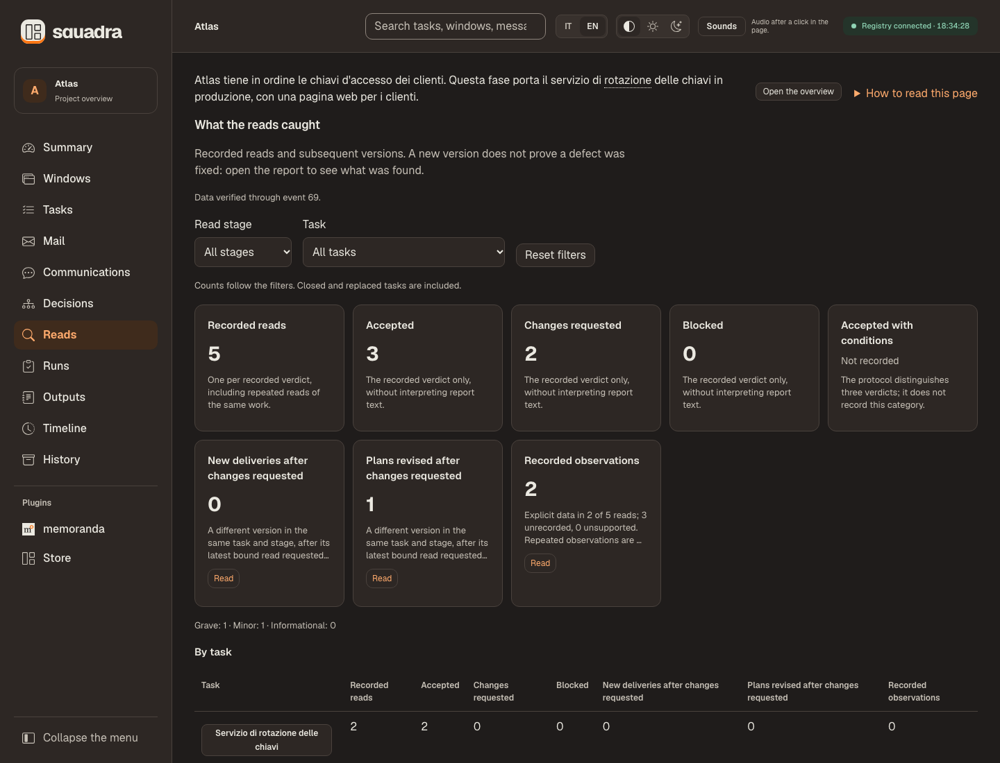
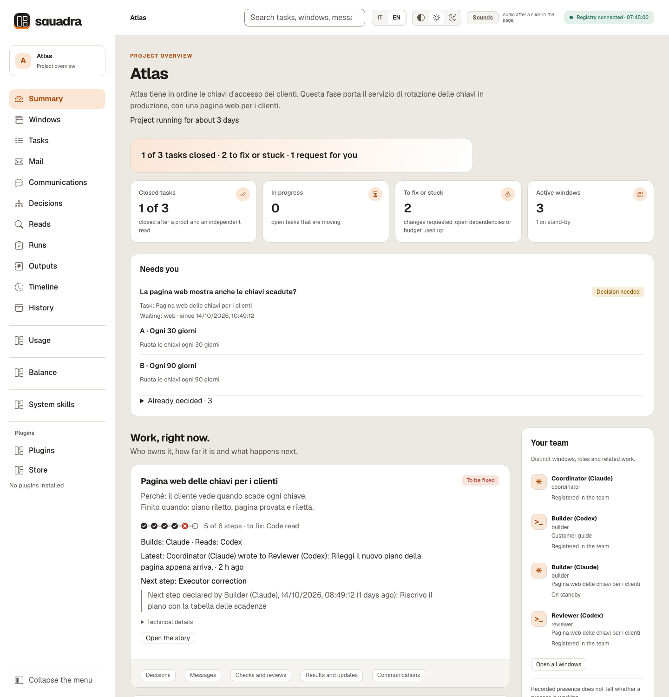
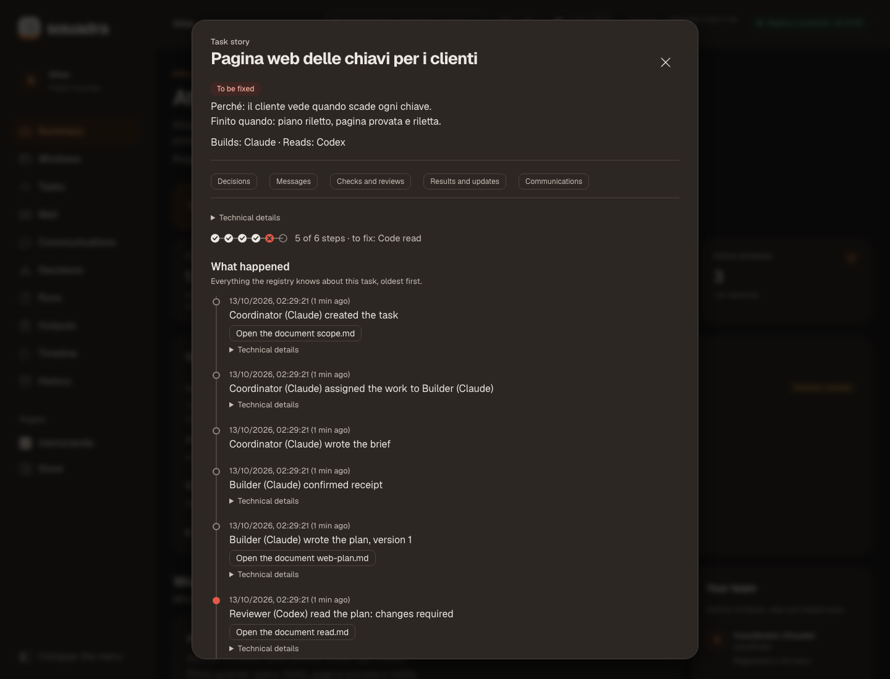
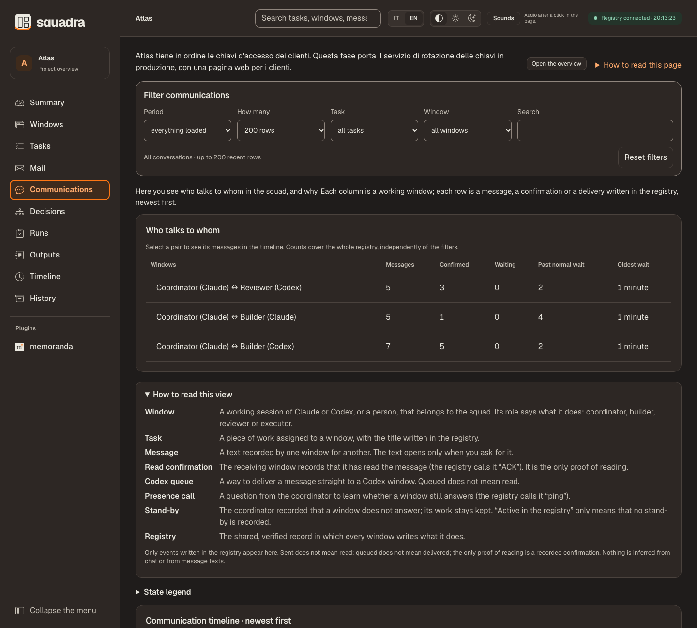
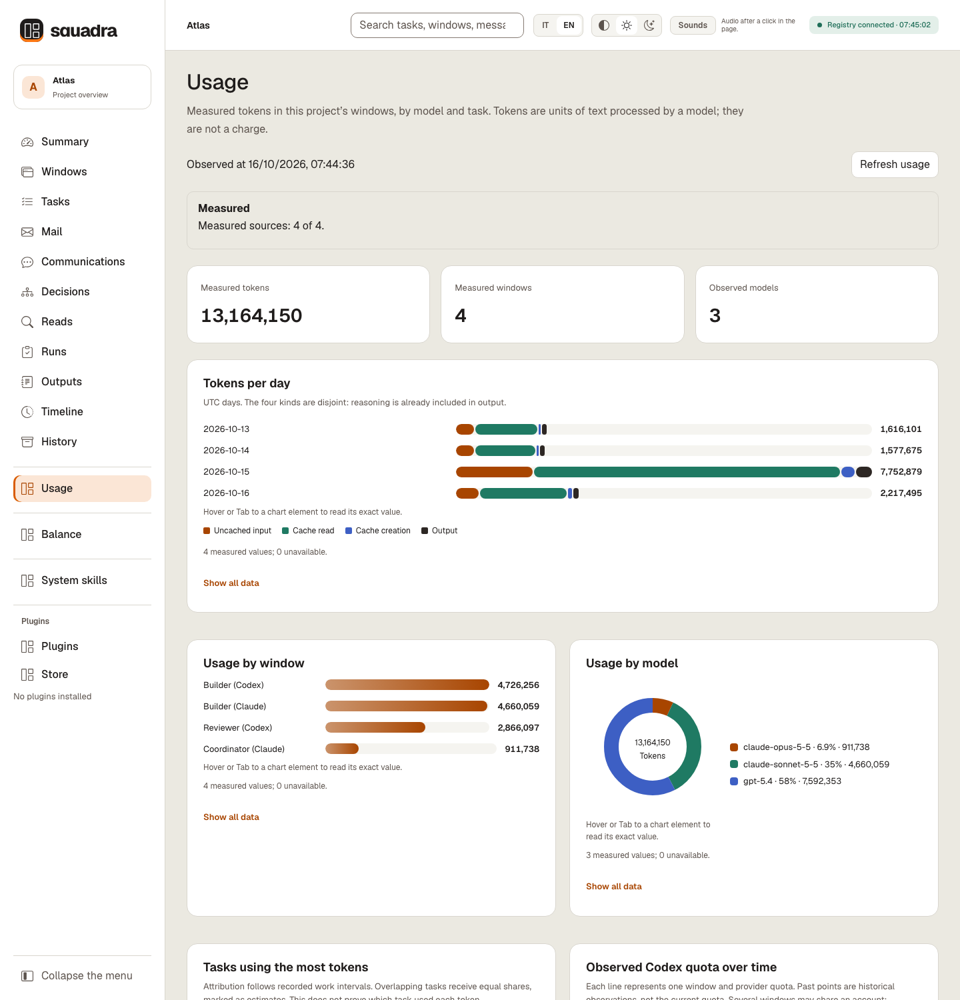
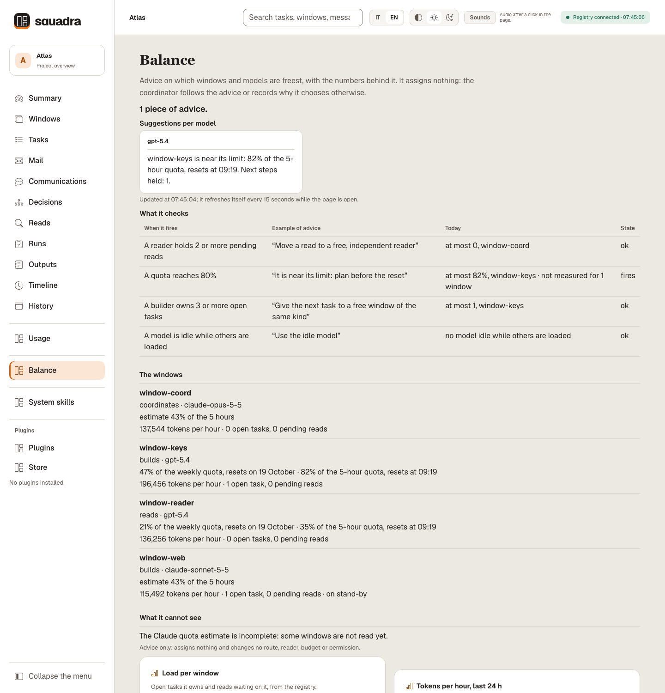
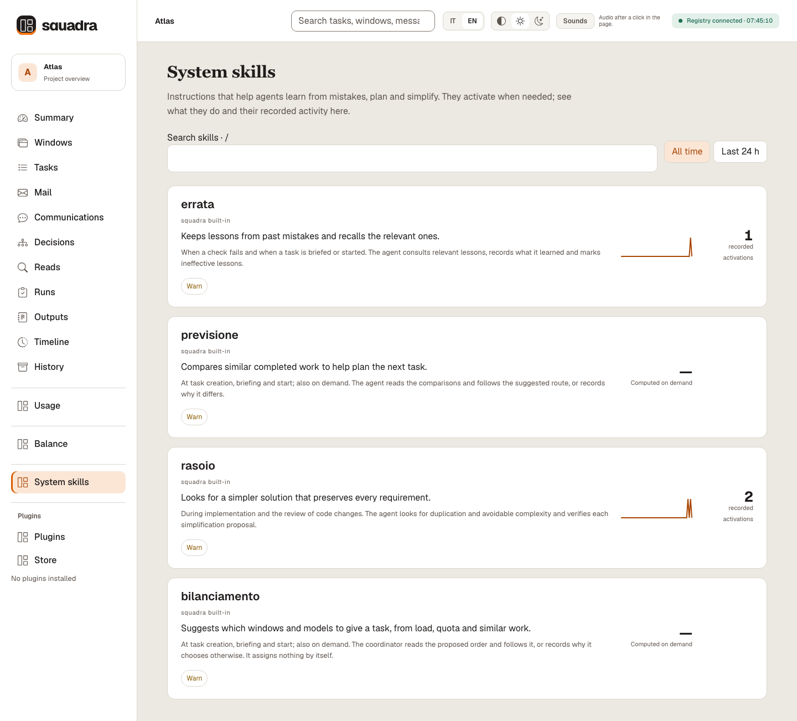
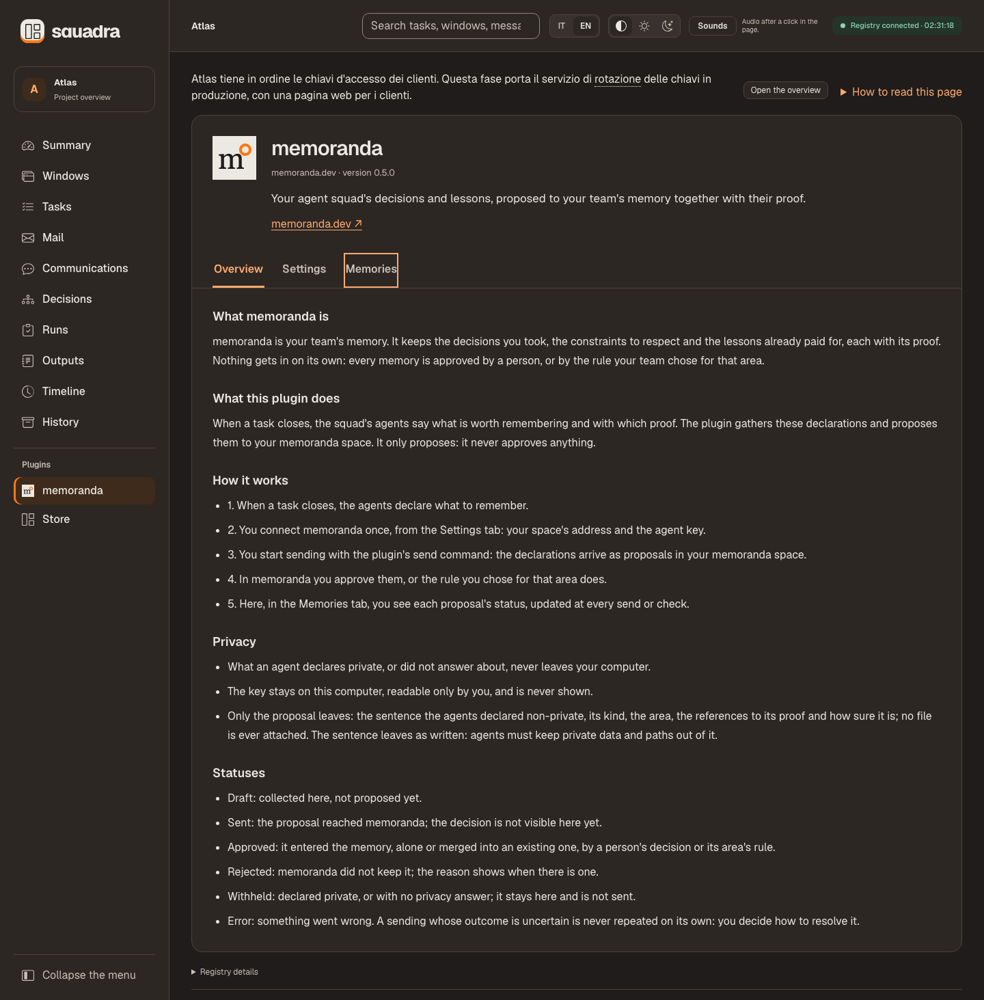
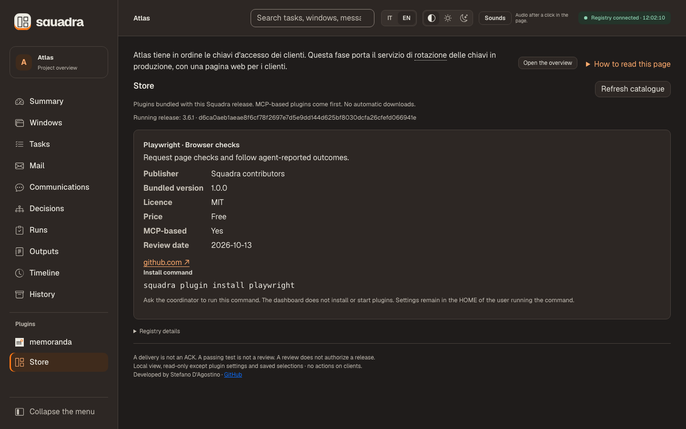
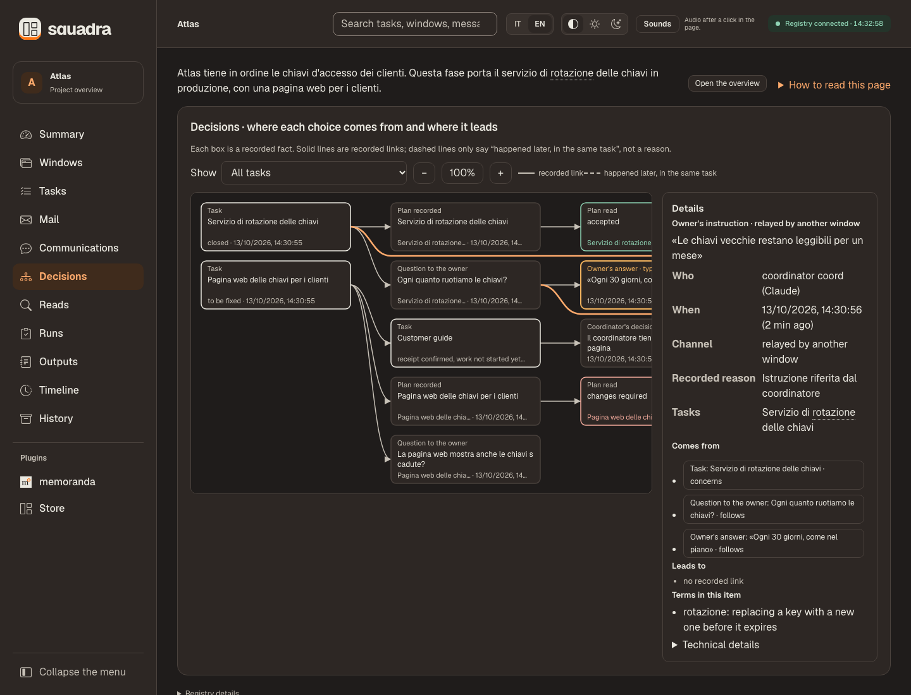

<div align="center">

# Squadra 3+

**Your coding agents, one team — and proof for every step.**

The most complete team skill for Claude Code, Codex and Cursor.

**Free and open source** — MIT licence, no account, everything runs on your machine.

**Version 3.10.2** · Free · MIT · Local toolkit · Python 3.12+ · macOS / POSIX

**English** · [Italiano](README.it.md) · [Privacy](PRIVACY.md)

[What's new](#news) · [Get started](#start) · [Example prompts](#prompts) · [First steps](#first-steps) · [Dashboard](#dashboard) · [Plugins](#plugins) · [Decisions](#decisions) · [Workflow](#workflow) · [Checkpoints](#checkpoints) · [Commands](#commands) · [Community](#community)

</div>

[](https://github.com/dagoSte/squadra/actions/workflows/cisco-skill-scan.yml) [](https://github.com/dagoSte/squadra/releases/latest) [](https://github.com/dagoSte/squadra/blob/main/LICENSE) [](#start) [](#start) [](#start) [](#start) [](#start) [](https://github.com/dagoSte/squadra/stargazers) [](https://github.com/dagoSte/squadra/commits/main)

Static, behavioral and dependency checks, excluding `tests/`. Passing means no HIGH or CRITICAL findings; lower-severity findings remain in the report. Click the badge for results.

**Watch the 80-second tour — turn the sound on in the player:**

https://github.com/user-attachments/assets/69f512be-775c-40ae-95c2-e1e403b3f5d1

It installs with `/plugin` in Claude Code and Codex. **Install:** see [Installation](#start).

<a id="news"></a>
## What's new

**3.10.2 — messages that always arrive, and a dashboard that keeps up with a working squad**

The coordinator can deliver every message to its window, the dashboard updates only what changed, and the search box finds past work by the words people wrote. The registry format does not change.

**Watch the two-minute film of what's new — turn the sound on in the player:**

https://github.com/user-attachments/assets/6ea747a5-a993-4aa7-a58d-1b2b7f908720

- **Messages always find their way.** The coordinator can deliver any message, including one written by a sandboxed Codex window, and every delivery attempt is recorded. A Claude window receives its own mail as it arrives with `squadra inbox --follow`. A message to a Codex window that nobody has delivered yet is listed first, as «to forward», with how long it has been waiting.
- **Waits that tell the truth.** The waits list only what is still open: a closed task's confirmations leave it, and a plan waiting for its reader shows up there.
- **Search.** The search box finds past work by the words people wrote, in any order and with or without accents, including decisions, questions and reviews. The dropdown shows the newest results first and ends with a ready-made question for your agent.
- **Newest first, everywhere.** Every list and task picker shows the latest items on top.
- **A dashboard that keeps up.** After a new event the page updates only what changed; an idle page costs almost nothing, and a search sends only its results.
- **Shorter answers.** `task`, `brief` and `start` print a short summary. Plain `inbox` shows the messages waiting for you plus the latest 10; `--all` shows everything.
- **A safer registry.** A new registry folder is ignored by Git, so it cannot be committed by accident. A slow write holds the other windows only briefly. `doctor` is read-only and reports a damaged cache; `doctor --repair` fixes it and `--quick` is a fast check. Commands explain errors in plain words. A file leaked into the registry can be removed with a recorded decision.
- **Save and restore you can rely on.** `save` works on large projects and on repositories that track `.env.example`; the way back to an older version works with either version; a save package restores after you open it, and stashed work comes back.
- **Usage and Balance measure every window registered as the guide shows** (`--session`), also on machines with many saved conversations.
- **Install anywhere.** The installer works under a shared-group umask and with a linked home folder. On Python older than 3.12 it refuses with one clear line.
- **English stays English.** An English workspace gets English in every command.
- **Joining and presence.** A new window can answer its first presence call, and the coordinator's own sweep keeps the coordinator active.
- **Waiting in line.** `resource acquire --wait SECONDS` keeps your place in line for a busy resource, such as the test gate, instead of failing until it is free: windows that wait with `--wait` get it in the order they asked, and nothing is recorded while they wait. `prove` checks before it starts that the run covers the task's requirements, so a long proof is never thrown away for a missing `--covers`.
- **One proof for both final reads.** `prove --also <task>` lets one run of the suite serve several tasks on the same frozen code, such as a release's Claude and Codex final reads; each task still checks its own requirements. Use it when every reader's Squadra lists `--also` in `squadra prove --help`; otherwise prove each task on its own.
- **Windows that are gone stop filling the waits.** Mail to a window you put in stand-by shows as one line per window, for example «12 messages to core-A on stand-by (window closed)», and comes back as soon as the window returns.
- **A registry that stays small.** The registry's journal file goes back to a small size after writes, even with a dashboard open; `doctor` reports its size and `doctor --repair` compacts it. Nothing is deleted.
- **The coordinator coordinates, and releases leave sooner.** The coordinator builds only the integration and the release, and gives the lanes to the builders. Every lane is read once in full; its fixes are read together in the release's final read, with one fix round.
- Plugins: memoranda 1.0.7, Playwright 1.0.8, Sentry 0.1.5.

**Measured on our own squad.** Our coordinator ran the same script against the dashboard of published 3.10.1 and then of 3.10.2, on the same copy of this squad's registry (11,488 events), on an 8-core machine under moderate load (load average 5 to 11 during the runs): five updates, each after one new message, and three searches. Time is the dashboard's own processing time for one request. Here the dashboard was already open on the copy before its first write, so the first update paid one more full read (8.5 s): a copied or moved registry has its cache re-bound by its first write in the new place, and a dashboard already open there pays one full read on the next update. The table shows the updates after it.

| What we measured | 3.10.1 | 3.10.2 |
|---|---|---|
| Page update after a new message | 4.7–5.3 s, 8.2 MB | 0.17 s, 0.56 MB |
| A search | 3.1–6.6 s, 8.3 MB | 0.4 s, at most 0.13 MB |
| Page update when nothing changed | 0.02 s | about 0.001 s |

<details>
<summary><strong>Earlier versions</strong></summary>

**3.10.1 — see what every AI window really spends, and where the next task should go**

A squad mixes Claude Code and Codex windows, and each provider shows you only its own usage. Squadra 3.10.1 puts all of them in one view, for every task: which window spent how many tokens, with which model, against which quota, and which window or model should take the next task. You can see why each piece of advice is given. It is computed on your computer from the session files the clients already keep; no text of the conversations is stored, shown or sent anywhere.

- **Balance (new system skill).** Advice on windows and models by load, quota and history, with the numbers each piece of advice rests on. It assigns nothing. The page says in plain words what it checks, today's values, and why there is no advice when there is none.
- **Usage totals stay stable while session files grow.** Saved calculations let a dashboard restart reuse earlier counts; a file that was rewritten is counted again, and a missing or damaged cache is rebuilt. If a folder on the cache's path is a symbolic link, the cache stays off and the Usage page says so: the figures stay correct, but every dashboard restart reads the session files again.
- **Commands that cost the windows fewer tokens.** Every command used to print the whole list of open waits into the window that ran it; now it prints a short answer, and `squadra status --all` prints the full list. `task`, `brief` and `start` add the forecast and a short balance, the first window for building and for reading with its reason; `squadra balance --task` prints the whole ranking (the figures are in the table below).
- **A registry that stays fast as the history grows.** A command now reads and writes what changed, not the whole history; on a copy of our 8,500-event registry, sending a message to another window went from 27 s to 3.2 s. Integrity checks still cover the whole chain at the moments listed in the guide.
- **A lighter dashboard** that downloads only what changed, and **animated charts** on the Usage and Balance pages.
- **Information messages** (`send --info`) that expect no reply no longer stay open as waits.
- Plugins: memoranda 1.0.6, Playwright 1.0.7, Sentry 0.1.4.

**Measured on our own squad.** Our coordinator took these figures on this squad's registry (about 9,980 events) after installing 3.10.1. The two «before» times come from the same commands timed on an earlier copy of the same registry, before the change. A missing or moved cache needs verified reconstruction on the first write; its cost depends on the registry and machine. Read-only commands use verified replay until a cache is available. The times below describe subsequent warm commands, not a guaranteed cold start.

| What we measured | Before | With 3.10.1 |
|---|---|---|
| «Where are we» (`squadra status`) | 8.6 s | 0.85 s |
| Saving an output (`squadra output`) | 10.7 s | 0.86 s |
| Answer printed by a command | 75–95 KB | about 2.2 KB; `task`, `brief` and `start` about 2.0 KB with 10 windows (synthetic squad), forecast and balance included |
| Dashboard refresh when nothing changed | 8 MB | 0.2 KB |
| Usage totals while windows work | went up and down | only grow (50 samples, none lower) |

**3.10.0**
- **Usage page: tokens spent by the models.** Squadra reads the session files Claude Code and Codex already keep on your computer and keeps only the token counts, with the model, time and session and message identifiers needed to count each message once; it never stores, shows or sends the text of the conversations. It shows them per window, day, model and task, with charts and suggestions per model. Codex quota is shown as measured, for each provider window; an estimated cost appears only if you enter your own prices. `squadra usage` prints the same data.
- Plugins: memoranda 1.0.5, Playwright 1.0.6, Sentry 0.1.3.

**3.9.1**
- **Interface fixes.** More room on the System skills page and between its blocks; bold text in skill descriptions shows as bold; the project goal and the reading help appear on the overview only; more badges at the top of this page.
- Plugins: memoranda 1.0.4, Playwright 1.0.5, Sentry 0.1.2.

**3.9.0**
- **System skills that activate on their own.** *errata* brings back the lessons the squad recorded after a failed proof, a read that asked for changes or a closed defect fix, when a new task touches the same files or words. *rasoio* is a lean-code lens for code reads that declares how many lines could go. *previsione* compares a new task with similar finished ones and suggests a route. errata and rasoio record each activation in the registry; previsione is computed on demand and records nothing.
- **A System skills page in the dashboard** lists the three skills with what they do, their recorded activity and the security scan result for their files.
- **Faster whole-suite proofs.** `tools/parallel_tests.py` runs the suite across processes and fails if any collected test did not run: about three times faster on our test machine.
- **Reviewer pool.** A task can name up to four readers; the first to confirm takes the read. Small light changes can be read once at the release gate, and they show as closed but not yet read until then.
- **Quick checks before proof and delivery.** A project can declare fast checks, such as mirrored files being identical, that run on the exact files before `prove` and `deliver`.
- **A lighter README.** Same sections, about half the reading; the details moved to the guides.
- **The release leaves on time.** A rule, not a choice: the cut-off is two hours after the scope is fixed; final reads look only at how the lanes were joined when each lane was already read; a read nobody picks up moves to a free reader.
- Plugins: memoranda 1.0.3, Playwright 1.0.4, Sentry 0.1.1.

**3.8.0**
- **Defect fixes show that their test fails without them.** Declare a fix with `task --defect-fix`; before it closes, `challenge` runs the agreed tests on the original and on the delivered code.
- **Sentry plugin (preview).** It brings sanitised error summaries into Squadra. FREE · Sponsored by memoranda. Tested with a synthetic connection only.
- **A friendlier Reads view.** It keeps the table's scroll position, shows cards on phones and loses the blank band; numbered plugin steps show one marker.
- Plugins: memoranda 1.0.2, Playwright 1.0.3, Sentry 0.1.0.

</details>

## What makes it different

- **One registry for every window.** Assignments, proofs and decisions stay on your computer, not in a chat's memory.
- **Whoever writes it does not review it.** Every change is checked by a window that did not write it.
- **Proof bound to the exact code.** If the code changes after the proof, proof and review no longer count.
- **Confirmed before work starts.** A task starts only when its recipient confirms receiving it.
- **Questions with the sentence ready.** When a decision is yours, you get the options, a recommendation and the exact words to answer.
- **A dashboard in plain words**, in Italian or English, to follow everything live.
- **Claude, Codex and Cursor together**, and open to community plugins.
- **One view of what every AI window spends.** Tokens per window, model and task across Claude Code and Codex, with advice on which window or model should take the next task, computed on your computer.

## What Squadra does

Squadra lets several AI agent windows work on one project as a team you can follow: one window coordinates, another makes the change, and a third, never the author, checks it. It is built for where agent work usually goes wrong: an author reviewing its own work, a green test that ran on different code, a decision lost in a long conversation. Three parts work together: **the skill**, which the agents follow; **the CLI**, which records each step; **the dashboard**, where you read the record. Each window can work in its own copy of the code, a *checkout*, while all of them share one registry.

**Cursor windows work interactively only:** you open the Cursor agent (`cursor-agent`) yourself, and it uses the squadra CLI like any other window. Squadra never starts it, because Cursor runs team, user and enterprise hooks outside any sandbox and cannot switch them off.

**How it works.**
1. **Install** and tell the first window: “Use squadra for this project. Use the registry at `/path/to/registry`. Find the other windows and introduce yourself; describe the work in plain words.”
2. **Open the other windows** on that registry. The first one coordinates; each window confirms its assignment before starting.
3. **Open the dashboard** with `squadra dash --root /path/to/registry --open` (with the plugin install, ask the agent to open it) and follow each task: confirmation → work → executed check → another window's review → coordinator closure.
4. **When Needs you asks for your input**, answer the coordinator; elapsed time is not an answer. Closed work is never published automatically.

**Words used below.**

| Term | Meaning |
|---|---|
| ACK | The recipient's explicit confirmation; a queued message is not yet confirmed. |
| Candidate / review | A fixed version of the work / a check by someone who did not write it. |
| Checkpoint / WIP | A copy of the registry for recovery / unfinished code changes. A checkpoint alone does not copy the code. |
| Brief | A short plain-words description of the project or of a task, written by the coordinator; a task's brief gives it its name on the page. |
| Ping / stand-by | A presence call asking a window to confirm it still answers / the coordinator's record that a window gets no new assignments for now. Stand-by stops nothing that is running. |

More terms, such as log and exit, UTC, PID and cwd: [the page guide](references/recovery.md#dashboard-page).

<a id="start"></a>
## Installation and first workspace

**Requirements:** Python 3.12+, Git and the Python standard library. **Node.js** runs the dashboard's JavaScript checks in the test suite and in `selftest`: without it they fail, they are never skipped. A browser for the dashboard; the Codex or Claude CLI only for the native runners. macOS/POSIX is the tested process environment; Windows process controls and recovery with submodules, LFS or sparse checkouts are not qualified.

### With /plugin (recommended)

In Claude Code:

```text
/plugin marketplace add dagoSte/squadra
/plugin install squadra@squadra
```

In a terminal, for Codex:

```sh
codex plugin marketplace add dagoSte/squadra
codex plugin add squadra@squadra
```

The plugin brings the skill, its scripts, references and dashboard. It does not put the `squadra` shell command on your PATH: agents run `python3 <skill folder>/scripts/squadra.py`, also for the instructions Squadra prints, such as `squadra ack …`. To have the `squadra` command itself, use the standalone installer below instead of the plugin. Use either the plugin or the standalone installer, not both, so the skill is not registered twice.

### Standalone installer (adds the `squadra` command)

```sh
git clone https://github.com/dagoSte/squadra.git
cd squadra
python3 -B scripts/install.py \
  --backup "$HOME/.local/state/squadra/install-backup-001"
export PATH="$HOME/.local/bin:$PATH"
squadra --version
```

Install from a clean, committed checkout with a **new backup directory** each time; the installer keeps your previous skills and launcher, so you can roll back. The `export PATH` line lasts for that terminal only: add it to your shell profile (for example `~/.zshrc` or `~/.bashrc`) so new terminals find `squadra`. Without installing, run `python3 -B scripts/squadra.py <command>`. [Details and rollback](references/start.md#install-and-join-details).

### Updating

**With /plugin.** In Claude Code, run `/plugin marketplace update squadra`, then `/plugin update squadra@squadra`, then restart Claude Code. For Codex, run `codex plugin marketplace upgrade`, then `codex plugin add squadra@squadra` again.

**If you installed 3.10.2 before the afternoon of 17 October 2026,** the improvements listed under 3.10.2 in What's new, published under the same version number, reach Claude Code only through a reinstall, because `/plugin update` answers that 3.10.2 is already the latest: run `/plugin marketplace update squadra`, then `/plugin uninstall squadra@squadra` and `/plugin install squadra@squadra`, then restart Claude Code. Codex and the standalone installer pick them up with the usual steps. To check, ask the window «Show me the help of squadra's `resource` command»: the refresh lists `--wait`.

**With the standalone installer.** From 3.6.1 on, releases keep their history: run `git pull`, then the installer again, with a new backup folder each time. A checkout of 3.6.0 or earlier needs `git fetch origin` and `git reset --hard origin/main` instead, which discards any local edit in that checkout.

```sh
git pull
python3 -B scripts/install.py \
  --backup "$HOME/.local/state/squadra/install-backup-002"
squadra --version
```

Every release raises the version number, except a refresh of the same release announced in What's new, as for 3.10.2 on 17 October 2026. Plugins installed from the Store keep their version until `squadra plugin install <name>` runs again from the new release ([Plugins bundled in your release](#plugin-store)). Open windows keep the version they read until they restart, and a running squad keeps its protocol until you switch it explicitly.

**Updating from 3.10.1 to 3.10.2: the registry stays as it is.**
- **Windows can move one at a time.** 3.10.1 and 3.10.2 windows share the same registry while you update them; nothing is converted.
- **Two things wait for the last window.** A settings change made from a 3.10.1 window puts the two new wait thresholds (`to-forward` and `plan`) back to their defaults. And removing a leaked file with a recorded decision makes a 3.10.1 window's full audit and dashboard fail on the missing file, so update every window before you remove one.
- **Plugins from the Store:** run `squadra plugin install <name>` again, as after every release.

**Updating from 3.10.0 or earlier to 3.10.1: less repeated history work, and every window must move together.**
- **Before you update,** the coordinator saves the squad: `squadra save --actor <coordinator> --to <a new folder>`. It is your way back.
- **Your registry is read as it is.** Nothing is converted and the history already written is not touched. From the first command on 3.10.1, new events are written in the lighter format.
- **Update every window at once,** Claude Code and Codex. A window still on 3.10.0 stops at the first new event with `Event integrity failure at sequence N`. That is on purpose: an old version stops rather than accept events it cannot read. Nothing is lost: update that window and it carries on.
- **No way back on the same registry.** After the update, 3.10.0 cannot use that registry. To go back, restore the save you made before updating, with either version, then keep using the old version on the restored copy: the first command of 3.10.1 or later on it writes the newer format again.
- **If in doubt,** run `squadra doctor` on 3.10.1: it says when a registry needs 3.10.1 or later.
- **Plugins from the Store:** run `squadra plugin install <name>` again, as after every release.
- **If you installed Squadra from the Claude directory,** you get the version the directory lists until it moves to 3.10.1.

The first window to write an older or moved registry builds its cache; other windows wait. If a command says `registry busy, retry`, retry after that first write finishes.

### Rule 0: find the windows and introduce yourself

The first window that applies the skill becomes the coordinator: it finds every Codex, Claude or Cursor window of the project and introduces itself to each one. An existing coordinator in the same registry that answers a ping keeps the role; a pending or expired ping never transfers leadership or resources. The full rule is in [the skill](SKILL.md); census limits and joining in detail are in [startup and presentation](references/start.md#install-and-join-details).

Then create one durable registry, outside temporary folders:

```sh
export SQUADRA_ROOT="$HOME/.local/state/squadra/my-project"
squadra init --name "My project" --project /path/to/project --lang en
squadra agent --id coord --identity window-01 --session CLAUDE-SESSION-ID \
  --role coordinator --client claude --repo /path/to/project
squadra agent --id builder --identity window-02 --session CLAUDE-SESSION-ID \
  --role builder --client claude --repo /path/to/builder-checkout
squadra agent --id reader --identity window-03 --session CODEX-THREAD-ID \
  --role reviewer --client codex --repo /path/to/reader-checkout
squadra status
squadra dash --open
```

`--session` is the window's own session ID: the file name of its transcript under `~/.claude/projects/<project>/`, without
`.jsonl`, for Claude Code, the UUID at the end of its `~/.codex/sessions/…/rollout-…` file for Codex. Usage and Balance measure a
window only through it, and the Codex queue needs it.

<a id="rule-1"></a>
### Rule 1: work in parallel

The coordinator gives independent work to every available window at once (Codex, Claude, interactive Cursor), and no window waits idle while some exists: one builder per tree, reads on frozen copies, and a release's final read by a Claude reader and a Codex reader at the same time. The coordinator builds only the integration and the release, and gives the lanes to the builders, so it keeps its attention for mail and seams. The coordinator reads its registry mail at every step, because a window may get work directly from the owner and report it only there.

### Rule 2: the progress table is always visible

Every update to the owner shows the table from `squadra board`: **In progress**, **To do** and **Done**, columns **Window | Work | State | Time (approx.)**, «Done X of Y» at the end, then «Tu adesso: …» (what you do now). Times are measured; estimates are marked as estimates; no made-up percentages.

### Rules 3–10: method

Read before you cite; record a decision before a pinned test changes; parallel lanes own their files; state the cost and a cap before spending; every lane is read once in full and its fixes are read together in the release's final read, unless the owner chooses another mode; every close says how the next task can go faster; and a release leaves on time: a cut-off two hours after its scope is fixed, final reads scoped to the integration when every lane was already read, the parallel runner as release proof, and a stalled read moved to a free reader; a fix round fixes only the problem. Every rule in full: [the skill](SKILL.md).

<a id="prompts"></a>
## Example prompts

You talk to the agents in plain words; they run the commands. Copy a prompt into the window it is meant for and replace the paths and names. Every prompt works in Codex, Claude and interactive Cursor windows that have the squadra skill installed.

**Start a squad (the first window becomes the coordinator)**

```text
Use the squadra skill for this project. Shared registry: ~/.local/state/squadra/atlas.
Read the project mandate first. Find the other Codex, Claude and Cursor windows working on it,
introduce yourself to each one and wait for their confirmations.
Then write a plain-words brief of the project and show me the progress table.
```

**Join an existing squad**

```text
Use the squadra skill. Shared registry: ~/.local/state/squadra/atlas.
Register this window, introduce yourself to the coordinator and wait for a role.
Do not take any task or resource until your assignment is confirmed.
```

**Assign work (coordinator)**

```text
Create a task "Key rotation service" for the builder window, with the checkout at
/path/to/builder-checkout and the reviewer window as independent reader.
The proof is the whole test suite. Write a brief that says why the task exists,
for whom, and when it is finished. Then hand it over and wait for the builder's ACK.
```

**Where are we?**

```text
Show me the progress table from the registry: in progress, to do and done, with who is doing what.
Tell me in one sentence what is blocked and whether anything needs my decision.
```

<details>
<summary><strong>More prompts:</strong> build, review and close, dashboard, decisions, pause and resume, context handover, plugins, worth remembering, the rules in practice</summary>

**Build and deliver (builder window)**

```text
Confirm your assignment, then build it in your own checkout.
When the change is ready, freeze it, run the agreed proof on the exact files and deliver it
to the reviewer. Record one output with the result and the next step, then stop.
```

**Ask for an independent review (reviewer window)**

```text
Confirm the review handoff you received, then read the frozen candidate on a private copy.
Run your own probes, write the report first, and record your verdict with the requirements
it covers. Only grave findings block; list the rest as follow-ups with an owner.
```

**Close a task (coordinator)**

```text
Check that the proof and the review concern the same candidate, then close task T1.
Take a checkpoint and show me the progress table. Do not publish anything.
```

**Open the dashboard**

```text
Open the squadra dashboard for this registry in my browser.
```

A Codex window whose sandbox blocks network access cannot open the dashboard's local port: ask a Claude window.

**Record a decision (coordinator)**

```text
Record my decision in the registry, linked to task T1, as typed here:
"Keep the old keys readable for a month." Then tell the builder.
```

**Pause and resume (coordinator)**

```text
Pause the squad: stop only the processes you own, save the registry and the code, and prove
the save with a real restore check. I will tell you when to resume.
```

```text
Resume the squad: re-read the mandate and the registry, reconcile sources and resources,
record the resume and tell me the next step.
```

**Before a session change or a full context**

```text
Your context is getting full. Save a checkpoint and a complete handover with task, identity,
branch, open findings and the exact next step, so a fresh session can continue.
```

**Plugins** (the second prompt is for the coordinator)

```text
Show me the plugin page for "memo" in the dashboard: what it is, its settings and its drafts.
```

```text
I selected drafts and pressed "Send for review" in the dashboard. Read the plugin's AGENTS.md
and run only its consumer for the pending request, within your existing permissions.
Then tell me the outcome.
```

**Worth remembering at close**

```text
Before closing T1, answer the "worth remembering" question. Write da-ricordare.json with one
sentence per decision, constraint or trap, each with its evidence and how sure you are,
and no secrets, personal data or private paths. Attach it to your closing output.
```

**The rules in practice (coordinator)**

```text
We just closed T4. Look at where its time went in the dashboard and tell me, in one line,
how the next task can go faster. Then apply it when you assign the next one.
```

```text
Work in parallel: give every free window an independent task now, each with its own tree
and its own files, and merge the lanes yourself when they deliver.
```

```text
Show me the progress table with the time column: the board's measured times, plus your
estimate of what remains for each task, marked as an estimate.
```

```text
Before you report a number, an id or a path, read it from a command's output, not from memory.
```

```text
If a test pins something I asked to change, record my decision first, then change the test
and the code together.
```

```text
Before any paid call (models, voice, images), tell me the expected cost and a cap, and stop at the cap.
```

```text
For this release use one final review only: merge the lanes as they deliver, then a Claude
reader and a Codex reader read everything together.
```

</details>

## What the reads caught

Open **Reads** in the dashboard to see recorded plan and code verdicts, in total and by task, and changed versions submitted after a request for changes, each linked to its report and task story. These are counts of reads and later versions, not of prevented defects or successful fixes; repeated reads stay separate records, and closed and replaced tasks stay included.



Readers can add bounded observations with `review --findings-file`; see [the details](references/work.md#readme-protocol-details).

<a id="first-steps"></a>
## First steps

New to Squadra? Try these twelve steps once, end to end, on a test project. A **window** is one working session: a Codex, Claude or Cursor agent, or a person. Every window uses the same registry.

1. **Install** and set `export SQUADRA_ROOT=...` in every window.
2. **Create the registry and register each window** with `init` and `agent`.
3. **Find the windows and introduce yourself:** `census` lists them without writing; `send` and `transport` deliver the introduction; each window answers with `ack`.
4. **Say what the project is** in plain words with `brief --project`.
5. **Assign and explain the first task** with `task` and `brief --task`.
6. **The builder confirms and starts:** `ack`, then `start`.
7. **The builder proves and delivers:** `prove` runs the agreed check on the exact files; `deliver` hands them over.
8. **Someone else reads:** a reader who did not write the work records a verdict with `review`.
9. **The coordinator closes:** `check`, then `close`.
10. **Check who still answers:** the coordinator runs `ping --all`; `ping --sweep` puts an unanswered window in stand-by, which stops nothing it runs.
11. **Open the dashboard** with `dash --open`; «How to read this page» explains every term.
12. **Record what the owner says** with `decision`, `--owner-words`, `--channel` and `--task`.

Each step in more detail: [startup and presentation](references/start.md#install-and-join-details).

<details>
<summary><strong>The twelve steps as commands</strong></summary>

```sh
squadra census --project /path/to/project
squadra send --actor coord --to builder --id HELLO-builder --body-file /evidence/introduction.md
squadra transport --actor coord --message HELLO-builder --via manual
squadra ack --actor builder --message HELLO-builder
squadra brief --actor coord --project --file /evidence/project.md
squadra task --actor coord --id T1 --owner builder --reviewer reader \
  --title "Key rotation" --repo /path/to/builder-checkout \
  --scope-file /evidence/scope.md --proof-file /evidence/argv.json
squadra brief --actor coord --task T1 --file /evidence/t1.md
squadra ack --actor builder --message assign-T1
squadra start --actor builder --task T1
squadra prove --actor builder --task T1 -- python3 -B -m unittest discover -s tests -v
squadra deliver --actor builder --task T1
squadra ack --actor reader --message "review-ID-RETURNED-BY-DELIVER"
squadra review --actor reader --task T1 --verdict accepted --report /evidence/code-read.md
squadra check --actor coord --task T1
squadra close --actor coord --task T1
squadra ping --actor coord --all
squadra ack --actor builder --message "PING-ID-RETURNED-BY-PING"
squadra ping --actor coord --sweep
squadra decision --actor coord --reason "Owner instruction" --task T1 \
  --owner-words "Keep the old keys readable for a month" --channel typed-here
squadra dash --open
```

</details>

<a id="dashboard"></a>
## Dashboard: the work at a glance



*The Summary on a synthetic Atlas registry ([Italian](docs/images/dashboard-overview-it.png), [dark theme](docs/images/dashboard-overview-dark-en.png)). Recorded texts such as briefs, the owner's words and messages stay as written, here in Italian. The examples contain no customer data and do not measure model quality.*

`squadra dash --open` opens on the **Summary**: one sentence and four tiles say where the work stands, **Needs you** appears only when something waits for the owner, and one card per task shows its steps, who builds and who reads, and the next step. Each card opens the task's **story** in time order.



Charts, sortable tables, a «Read» dialog for long texts, sounds and notices when a step closes, IT / EN and light / dark: [every part of the page, view by view](references/recovery.md#dashboard-page), with every screenshot in both languages.

Views: **Summary**, **Windows**, **Tasks**, **Mail**, **Communications**, **Decisions**, **Runs**, **Outputs**, **Timeline** and **History**; what each one shows is in [the page guide](references/recovery.md#dashboard-page). **Usage**, **Balance** and **System skills** have their own menu entries, shown below.

**Communications** shows who talks to whom, in plain sentences. Sent is not read: only a recorded confirmation proves reading.



**Usage** shows the tokens each window spent, by day, window, model and task, read from the session files Claude Code and Codex already keep; it keeps the token counts, with the model, time and the session and message identifiers needed to count each message once, and never stores, shows or sends the text of the conversations ([details](references/usage.md)).



**Balance** suggests which window or model should take the next task, by load, quota and similar work, with the numbers behind each suggestion; it assigns nothing ([details](references/skills/bilanciamento.md)).



**System skills** lists the four built-in skills ([errata](references/skills/errata.md), [previsione](references/skills/previsione.md), [rasoio](references/skills/rasoio.md), [bilanciamento](references/skills/bilanciamento.md)), with what each does, its recorded activity and the security scan result for its files.



*The Usage, Balance and System skills pages on the same synthetic Atlas registry, with synthetic session files that contain no conversation text ([Italian](docs/images/dashboard-usage-it.png), [Balance in Italian](docs/images/dashboard-balance-it.png), [System skills in Italian](docs/images/dashboard-system-skills-it.png)).*

**Refresh and safety.** The page refreshes every two seconds, pauses while the tab is hidden, and refreshes immediately when you return. Search finds recorded tasks, runs, messages, outputs, decisions, questions and reads by word prefix, ignoring accents; its dropdown shows the newest first and offers a prompt to copy for your agent. Registered artifacts open in a dialog. It is **read-only except declared settings and selections of installed plugins**; registry actions use the CLI. It listens on `127.0.0.1`, checks Host and token, checks Origin for settings and selection writes, and loads no remote scripts or CDN. `--port` picks a port (by default a free one); `Ctrl-C` closes the dashboard server, not the agents; a disconnected page keeps its last view with a warning.

<a id="plugins"></a>
### Local data plugins

A **plugin** brings another tool's data into the dashboard: a folder `$HOME/.squadra/plugins/<name>/` with a `plugin.json` manifest, where a separate program, the plugin's *producer*, writes data panels. The **Plugins** menu group lists every installed manifest, or says «No plugins installed» and explains where plugins go; select one to see its data for the open registry.

Plugin folders must belong to you and must not be writable by group or others; the Store creates private ones.

**Build your own.** The contract is open: anyone in the community can publish a squadra plugin, free or paid. A plugin is data plus a separate program. The dashboard and CLI never run plugin code; agents run it only as its `AGENTS.md` says, under the [file's trust conditions and the user's existing permissions](references/plugins.md#agent-instructions). Start from the [plugin contract](references/plugins.md).

**Step by step:** the [plugin authoring guide](references/plugin-authoring.md) builds a working plugin, tests it with the dashboard and explains how to publish it, free or paid.



Settings, results for each service, selecting drafts and the Store's update rules: [the plugin page in detail](references/plugins.md#plugin-page).

<a id="plugin-agent-instructions"></a>
**Who runs the request?** An installed plugin may ship `$HOME/.squadra/plugins/<name>/AGENTS.md` with instructions for agents. The coordinator window reads it at start and resume and runs only the commands it specifies, within existing permissions: the producer after a close, the consumer when the dashboard shows a pending request, then reports the outcome. This requires a regular file owned by the user, not group- or other-writable and not a symlink. Without a valid file, the request stays pending and the coordinator says so; you have no command to run. The dashboard never reads, writes or runs this file. This file never widens permissions and never authorizes installation, push, publication or decisions reserved for the user; for anything beyond running that plugin’s producer or consumer, stop and report.

Exact schemas, sizes, limits and refusal codes: [plugin contract](references/plugins.md), [about metadata](references/plugins.md#optional-about-metadata), [homepage and icon](references/plugins.md#homepage-and-local-icon).

<a id="plugin-store"></a>
### Plugins bundled in your release

Open **Plugins → Store** to see the running release's catalogue, its install commands and local installation status. It refreshes only when opened or when you choose **Refresh catalogue**; there is no install button. Homepage links open on a click in a new tab. Ask the coordinator to run the displayed command, which targets this installation of Squadra.



`squadra plugin list` shows the release's catalogue and `squadra plugin install <name>` copies a bundled plugin; nothing is downloaded or run. With a `/plugin` installation, ask the coordinator to run them through `python3 <release root>/scripts/squadra.py`.

Submit plugins by PR or the maintainer's contact email for analysis; MCP plugins come first. Inclusion and its review date refer only to the accepted version. This is a release-local catalogue, not a remote marketplace or automatic execution service.

The [memoranda Store plugin](plugins/memoranda/README.md) collects declared lessons
and proposes them to memoranda.dev; it never approves them. Installation is free;
the connected service starts with a free trial, then is paid.

**Try browser checks:** the optional [Playwright MCP plugin](plugins/playwright/README.md) prepares checks for a task, saves your selection and lets an authorized agent use its connected browser tools and report the outcome. Installing the data plugin does not install or activate MCP.

**Bring app errors in (preview):** the optional [Sentry plugin](plugins/sentry/README.md) brings sanitised summaries of errors from your authorised Sentry connection into Squadra, so you can select issues for analysis and follow their tasks. FREE · Sponsored by memoranda: development funded by memoranda, free for all users. Tested with a synthetic connection only; a live Sentry connection is not yet verified.

**Publish your own plugin:** follow the [authoring and distribution guide](references/plugin-authoring.md) for a working example, tests, permissions and version compatibility. These data plugins are separate from installing Squadra itself with `/plugin`; publishing a package does not automatically list, install or approve it.

<a id="decisions"></a>
## Decision graph and briefs



*The selected box is an owner instruction relayed by the coordinator: who, when, the exact words, the channel and the recorded links.*

**Briefs** are short plain-text descriptions written by the coordinator, read before any identifier.

```sh
squadra brief --actor coord --project --file /evidence/project.md
squadra brief --actor coord --task T1 --file /evidence/t1.md
```

```markdown
# Atlas
Atlas keeps customers' access keys in order. This phase puts the key service in production.

## Steps
- [x] Key service plan
- [ ] Key service in production

## Glossary
- JEV: job engine verification
```

**Recorded links.**

```sh
squadra decision --actor coord --id D-SCOPE --task T1 \
  --follows ask:Q1 --follows decision:D-EARLIER \
  --owner-words "Keep the old keys readable for a month" --channel relayed \
  --reason "Owner instruction relayed by the coordinator"
```

Each box in the graph is a recorded fact; solid lines are recorded links, dashed lines only mean «later, in the same task». The rules for briefs, decision links, replacing a task and reading the graph are in [the details](references/work.md#readme-protocol-details).

<a id="workflow"></a>
## Assignment, proof, independent read, closure

**Choose the path.** The builder proposes a path, the non-author reader confirms or disagrees, and the coordinator settles it with a recorded reason, answering the five questions of [the IT/EN triage page](references/work.md#triage-in-una-pagina). No regex, path pattern or score chooses the path.

- **Fix now with proof:** reversible, Q1 no and Q3 yes; a brief non-author check before closure.
- **One code read:** an ordinary bounded choice, with scope, bound proof and an independent review.
- **Full path:** Q1 yes or unknown, Q2 unresolved, material silent harm under Q5, or an existing mandate: an accepted plan before construction, then proof, a non-author read and the required checks.

**The rules of the read:** only a grave finding blocks; the rest is fixed now with a non-author check or recorded as a follow-up with an owner and a trigger. **Never hand commands to the owner.** All the rules: [details](references/work.md#readme-protocol-details).

**Contract, proof, review and close.** Keep evidence outside the delivered checkout: `scope.md` (behaviour, owned paths, dependencies, resources, checks, release boundaries), `argv.json` as an exact argument list, not a shell string (`["python3", "-B", "-m", "unittest", "discover", "-s", "tests", "-v"]`), and an optional `requirements.json` (`[{"id": "R1", "text": "Values add up correctly"}, {"id": "R2", "text": "An empty list adds up to zero"}]`).

```sh
squadra task --actor coord --id T1 --owner builder --reviewer reader \
  --title "Verify the total function" --repo /path/to/builder-checkout \
  --scope-file /evidence/scope.md --proof-file /evidence/argv.json \
  --requirements-file /evidence/requirements.json
squadra ack --actor builder --message assign-T1
# Full path: a plan read by a non-author before construction.
squadra plan --actor coord --task T1 --file /evidence/plan.md
squadra review --actor reader --task T1 --stage plan \
  --verdict accepted --report /evidence/plan-read.md
squadra start --actor builder --task T1
# Implement the change, then freeze the source.
squadra prove --actor builder --task T1 --covers R1 --covers R2 \
  --timeout 120 -- python3 -B -m unittest discover -s tests -v
squadra deliver --actor builder --task T1
squadra inbox --agent reader
# Use the exact message ID from deliver; read the frozen candidate and write the report first.
squadra ack --actor reader --message "review-ID-RETURNED-BY-DELIVER"
squadra review --actor reader --task T1 --covers R1 --covers R2 \
  --verdict accepted --report /evidence/code-read.md
squadra check --actor coord --task T1
squadra close --actor coord --task T1
```

Options, budgets and what `prove`, `deliver`, `review` and `check` record: [details](references/work.md#readme-protocol-details).

**Completion does not grant publication authority.** The complete protocol is in [work, proof and review](references/work.md).

## Mail, outputs and what to remember

```sh
squadra send --actor coord --to builder --id M1 \
  --task T1 --body-file /evidence/message.md
squadra inbox --agent builder
squadra ack --actor builder --message M1
squadra output --actor coord --task T1 --file /evidence/update.md \
  --next "Independent read of the frozen candidate" --artifact /evidence/result.json
```

Save **one substantive output per completed step**; its declared next step is not evidence that anything happened. A progress notice that needs no reply goes with `send --info`: it stays visible without waiting for an ACK. Replies, expected recipients and transports: [details](references/work.md#readme-protocol-details).

| Window / role | Task / candidate | Result / evidence | Skills | Trace / next step |
|---|---|---|---|---|
| builder / executor | T1 / exact SHA | Native exit + log | Skill hash | Saved receipt + next action |

### Worth remembering at close (optional)

At close, record what is worth remembering (a decision and who took it, a constraint, a trap already paid for) in `da-ricordare.json`, attached to the closing output, each with its evidence and how sure you are. **Never** put secrets, personal data or private paths in it: registered artifacts are immutable, so an accidental secret cannot be removed. If a memory service is in use, declare at close and do not propose the same item through another channel; nothing is proposed or approved by itself. See [the schema and examples](references/work.md#da-ricordare-at-close).

## Owner questions and decisions

`ask` records a question before it is shown, with at least two options of distinct `id`, `label` and `say` (the sentence to say); `buys`, `costs` and `example` are optional.

```json
[
  {"id": "A", "label": "Keep this scope", "say": "Continue with the reviewed scope"},
  {"id": "B", "label": "Plan first", "say": "Plan the optional integration first"}
]
```

```sh
squadra ask --actor coord --id Q1 --task T1 --waiting builder \
  --question "Which scope should we build?" \
  --options-file /evidence/choices.json --recommended A
# Only after the actual owner's answer:
squadra decision --actor coord --reason "Owner chose scope A" \
  --answers Q1 --choice A --channel typed-here \
  --owner-words "Continue with the reviewed scope"
```

Relayed words, withdrawals and what never counts as a decision: [details](references/work.md#readme-protocol-details).

## Waits, resources and presence

Waits are computed when a view is read; defaults in seconds: **ACK 900**, **delivered 3600**, **reviewed 1800**, **heartbeat 1800**, **alive 300**. A warning never retries, reassigns or releases anything. Commands print the waits grouped, at most five; `squadra status --all` prints every one. Reserve gates, ports and databases before use. **Stand-by stops nothing:** it does not cancel processes, release resources, transfer roles or reassign work.

Thresholds, presence calls and why every window should run the same version: [details](references/work.md#readme-protocol-details).

<a id="checkpoints"></a>
## Checkpoints, recovery and clean contexts

**Agents checkpoint without waiting for you to ask.** This is the skill's required agent workflow, not a background service or an invisible token meter.

| Trigger | Required action |
|---|---|
| Completed increment or accepted review | New durable registry checkpoint and recorded receipt. |
| Before publication or a session change | Checkpoint and precise handover record. |
| WIP at risk, owner stop, or context pressure | Complete `save`, then an actual `restore-check`. |

```sh
squadra checkpoint --to /durable/checkpoint-001
squadra save --actor coord --to /durable/recovery-001
squadra restore-check --actor coord --from /durable/recovery-001 --to /durable/restore-test-001
squadra pause --actor coord --reason "Owner requested stop"
squadra doctor
squadra resume --actor coord --reason "Owner explicitly resumed"
```

`checkpoint` copies **only the registry**; `save`, coordinator only, adds every registered Git repository and its unfinished work; `restore-check` proves a package by actually restoring it into a new folder. When context fills up, the agent saves a handover **before continuing**. [Details](references/recovery.md#checkpoint-details).

**Limits of recovery:** the secret filters are partial, **not** a full scan of history and artifacts; a copy on the same disk does not survive a disk failure; `--declared-offsite` is a declaration, not verified remote storage. The complete contract is in [recovery and context handover](references/recovery.md).

## Optional native client runners

`run` starts a new non-interactive Codex or Claude turn and never attaches to an open window; exit 0 alone is not a valid result. **Cursor is refused:** Squadra does not launch `cursor-agent`. See [the summary](references/runtime.md#readme-runner-summary) and [runtime contracts](references/runtime.md) before invoking runners automatically.

## Self-test, defect challenges and comparison harness

For a task declared with `task --defect-fix`, closure requires proof that the regression fails without the change: the same test bytes fail by assertion on the registered base and pass on the exact candidate. A coordinator may declare an exception with a reason; the independent reader checks it, and it never appears as a passed challenge. See the [complete example and limits](references/work.md#defect-fixes-show-that-the-regression-detects-the-original).

```sh
squadra selftest --output /durable/selftest-001
```

`selftest` tests the toolkit with no model calls, not your product or a model; the offline comparison uses fake clients and never claims a winner. See [the summary](references/benchmark.md#readme-selftest-summary) and [challenge and benchmark contracts](references/benchmark.md).

## Durable state and integrity

| File | Purpose |
|---|---|
| `registry.sqlite3` | Authoritative state; transactional events, WAL, synchronous FULL. |
| `artifacts/` | Content-addressed evidence and source-file manifests; manifests preserve the original source fingerprint. |
| `events.jsonl` | Event projection extended with committed events; may lag after an interrupted update. |
| `state.json` | Complete structured export, refreshed in the live registry by `export`; `checkpoint` and `save` write it into their copy. |
| `stato.md`, `squadra-posta.md` | Readable status and mailbox projections; use the CLI for current work and inbox. |
| `posta/exchange-YYYY-MM-DD.md` | Shared daily UTC projection; ordinary writes update affected days. |

Read-only commands do not write the registry or its projections. Use `squadra export` when you need complete file exports, including mail/history. Before relying on a projection as complete, compare its recorded sequence/head with the current Store view; a committed event can be newer than its exported files. The cache keeps calculated state and indexes; its anchor is the last event already incorporated into that state.

| Operation | What is verified |
|---|---|
| Other ordinary commands, including `check` and an ordinary task's `close`; dashboard refresh after startup | The anchor event and its hash, all newer events and links, and authenticated proofs for each cache value or index read. |
| Quick resume check (`doctor --quick`) | Anchor, suffix and demanded cache values; explicitly limited, without a full historical/artifact audit or replay-root comparison. |
| Explicit `usage`/`balance` calculations, a lesson's source check, and the lesson hint after a failed proof | The complete event hash chain and the requested historical evidence. These reads do not perform a full artifact audit. |
| `doctor`, `export`, `checkpoint`, `save`, `restore-check`, and a release-gate task's `close` | The complete chain, referenced artifacts/manifests, and full replay to compare or rebuild the derived cache. |
| Dashboard startup | The ordinary verified path serves data while a full chain/artifact/replay audit runs in the background. A visible status marks the pending audit; failure stops data responses and removes the displayed data. |

The other ordinary reads above do not reverify earlier events, untouched cache leaves, or the cached root against a complete replay of the reducer. A missing or foreign cache requires verified reconstruction. A full audit that finds cache/journal disagreement reports a mismatch: read-only `doctor` refuses, and the dashboard fails closed. Use explicit `doctor --repair` in a writable workspace to rebuild the derived cache; saved packages and checkpoints refuse repair. A failed verification never becomes a cached success. Derived indexes can increase disk use; the new event format does not promise a smaller database. Upgrade every window together before the first new-format write. Events written by this version include a format marker in their hash: Squadra 3.10.0 stops with an integrity error at that marker, including on status/check/close. That refusal is intentional, not lost data; use the upgraded CLI. Older events stay unchanged. Always write through the CLI, never into generated files. Integrity does not prove that claims are true or authenticate identities cryptographically. [Details](references/recovery.md#registry-verification).

### Small changes: the light route

The coordinator may declare `task --route light` for a bounded, reversible change: at most **80 added plus deleted lines in four files** (policy **light-v1 / P2**), counted from the original clean Git base. Scripts, plugin bundles, instruction files and normative contracts stay protected, and a security impact or a required whole gate still takes the full route. The light route skips the plan read and uses the agreed targeted proof; a non-author read, the bindings and the budgets remain. Only the coordinator can promote a task to the full route, and promotion never resets a budget. See [the light route](references/work.md#light-route) and [the details](references/work.md#readme-protocol-details).

<a id="commands"></a>
## Squadra commands

You do not have to type these commands: **asking your window in plain words is the recommended way**, as in the *Or just ask* column and the [example prompts](#prompts), and the window runs the command for you. The commands are what the windows run, and what you can type yourself to check.

Every command, grouped by purpose: **50 subcommands**, plus `--version`. Use `squadra <command> --help` for the flags; registry commands accept `--root` or `SQUADRA_ROOT`. «Coordinator only» marks what only the coordinator can record: `task`, `route`, `supersede`, `brief`, `close`, `ask`, `decision`, `settings`, `pause`, `resume`, `save`, `standby`, `ping --all`, `ping --sweep`, and the receipt that `restore-check` writes into the live registry. Without installing, the same commands run as `python3 -B scripts/squadra.py <command>`.

<details>
<summary><strong>All 50 commands and their prompts, grouped by purpose</strong></summary>

### Start and team

| Command | What it does | Or just ask |
|---|---|---|
| `--version` | Print the installed version. | “Which version of Squadra is installed?” |
| `init` | Create the registry for a project, with its name, language and review budgets. | “Use the squadra skill and create the registry for this project in ~/.local/state/squadra/atlas.” |
| `agent` | Register a window: identity, role, client, checkout, and the skills it actually read. | “Register this window in the squad, with the skills you actually read.” |
| `census` | Find the project's Codex, Claude and Cursor windows without writing anything; `--project` is required before `init`. Run it from a Claude window: inside a Codex sandbox it cannot see the other windows, and says so. | “Find the Codex, Claude and Cursor windows working on this project, without writing anything.” |
| `ping` | Send a presence call to one window (`--to`) or, coordinator only, to all (`--all`); `--sweep` (coordinator only) records stand-by for an unanswered call that a transport delivered, and the return after a fresh ACK. | To the coordinator: “Check which windows are still there: send a presence call to all of them.” |
| `standby` | Coordinator only: put a window in stand-by, or bring it back with `--resume`; its work, runs and reservations stay its own. | To the coordinator: “Put the reviewer window in stand-by until I say otherwise.” |
| `settings` | Coordinator only: set the wait thresholds in seconds: `ack`, `delivered`, `reviewed`, `heartbeat`, `alive`. | To the coordinator: “Show a missing ACK as a wait after 10 minutes instead of 15.” |

### Tasks and plans

| Command | What it does | Or just ask |
|---|---|---|
| `task` | Coordinator only: assign a task: owner, reviewer, checkout, scope, proof, requirements, dependencies; `--supersedes` replaces an open task. | To the coordinator: “Assign ‘Key rotation service’ to the builder window, with the reviewer window as independent reader and the whole test suite as proof.” |
| `route` | Coordinator only: promote with `--full`, keeping the base/history/budgets; new proof and read. | To the coordinator: “T3 is no longer a small change: move it to the full route.” |
| `supersede` | Coordinator only: record afterwards that an existing, later task replaces an open one, with the same effect as `--supersedes`. | To the coordinator: “T7 replaces T5: record it, keeping the history of T5.” |
| `brief` | Coordinator only: describe the project (`brief --project`) or a task (`brief --task ID`) in plain words, from a UTF-8 file of at most 8192 bytes. | To the coordinator: “Write a plain-words brief of T1: why it exists, for whom, and when it is finished.” |
| `plan` | Record a plan before building, to be read by a non-author. | “Write your plan for T1 and have a non-author read it before you build.” |
| `start` | Mark a confirmed task as being built. | “Confirm your assignment and start building it.” |
| `resource` | Reserve or release a shared gate, port or database (`acquire`, `release`). | “Reserve the test database before you run the gate, and release it when you are done.” |

### Messages

| Command | What it does | Or just ask |
|---|---|---|
| `send` | Write a message to a window, optionally about a task or in reply to another; `--info` marks a notice that needs no ACK (not with `--to-new`). | “Tell the builder that the old keys must stay readable for a month.” |
| `inbox` | Read the messages still waiting for your ACK plus the latest 10 (`--all` for every message, `--message ID` for one in full); `--follow [--since SEQ]` watches repeated `--agent` names read-only and resumes without replaying older mail; `--until-first` exits after the first mail, for a background command that wakes its window. | “Read your messages; keep watching mail for all this window's names, act on arrivals and re-arm with the last cursor when the watch expires.” |
| `ack` | Confirm a message you actually received; only the recipient can do it. | “Confirm the messages you have actually read.” |
| `transport` | Deliver a message by hand or through the Codex queue (for a seat registered with `--session`), and record the outcome. | “The reviewer has not seen my message: prepare the manual handoff and record that it still has to be forwarded.” |

### Proof, review and closure

| Command | What it does | Or just ask |
|---|---|---|
| `prove` | Run the agreed proof on the exact frozen files and keep its native result. | “Freeze your change and run the agreed proof on it.” |
| `probe` | Record an independent test, including a negative control that must fail. | To the reviewer: “Run your own test on the candidate, with a negative control that must fail, and record it.” |
| `deliver` | Hand over an immutable packet of the proven candidate to its reviewer. | “Deliver the proven candidate to its reviewer.” |
| `advance` | Reconcile a handoff that was already delivered, without building or approving. | “T1 was already delivered: reconcile the handoff, without building or approving anything.” |
| `review` | Record a non-author verdict on a plan or on the code: accepted, changes required or blocked. | To the reviewer: “Read the frozen candidate of T1 and record your verdict.” |
| `check` | Check that proof, review and candidate still match. | “Check that the proof, the review and the candidate of T1 still match.” |
| `close` | Coordinator only: record the end of a checked task. | To the coordinator: “Close T1 if its check passes, then show me the progress table.” |
| `challenge` | Prove a declared fix fails without the change, or run a standalone three-input oracle. | “Show that the fix in T2 matters: its test must fail without the change.” |
| `lesson` | Record what a red taught (errata), mark a lesson ineffective or retire it, or list lessons; brief and start show the matching ones. | “Record what this failed test taught us, so the next briefs show it.” |

### Owner and outputs

| Command | What it does | Or just ask |
|---|---|---|
| `ask` | Coordinator only: record a question for the owner, with options and a recommendation, before showing it. | To the coordinator: “Before you ask me, record the question with its options and your recommendation.” |
| `decision` | Coordinator only: record an answer, a withdrawal, an owner instruction (`--owner-words`, `--channel`) or a reason, linked with `--task` and `--follows`. | To the coordinator: “Record my decision on T1, as typed here: ‘Keep the old keys readable for a month.’” |
| `output` | Save one substantive update: text, evidence and the next step. | “Save this update with its evidence and the next step before you show it to me.” |
| `board` | Show progress by window with measured approximate elapsed time, in Italian or English with `--lang`; the coordinator adds labelled estimates of remaining or total task time. | “Show me the progress by window, with the time spent.” |
| `forecast` | Compare an open task with similar completed work: observed elapsed times and a route suggestion; read-only, no figures below three complete samples. | “How long did work like T5 take before, and does the light route suit it?” |
| `balance` | Suggest windows and models by load, quota and similar work, with the numbers behind each suggestion; read-only, assigns nothing, Claude quota only as a labelled estimate. | “Which window or model should take the next task?” |
| `usage` | Read local token usage by window, model and task, with coverage and optional user-priced estimates; [details](references/usage.md). | “How many tokens has each window and model used?” |

### Continuity

| Command | What it does | Or just ask |
|---|---|---|
| `pause` | Coordinator only: stop new work, reviews and runs, keeping consultation and recovery. | To the coordinator: “Pause the squad: no new work until I say so.” |
| `resume` | Coordinator only: resume after the owner's explicit word and a reconciliation. | To the coordinator: “Resume the squad: reconcile first, then tell me the next step.” |
| `checkpoint` | Copy the registry, its artifacts and projections to a new folder. | “Take a checkpoint of the registry in a new folder.” |
| `save` | Coordinator only: package the registry with every registered Git repository and its unfinished work. | To the coordinator: “Save the registry and the code of every repository, unfinished work included.” |
| `restore-check` | Prove a package by actually restoring it into a new folder; recording the receipt in the live registry is coordinator only. | “Prove the save works by restoring it into a new folder.” |

### Native runners

| Command | What it does | Or just ask |
|---|---|---|
| `run` | Start a non-interactive turn of the registered Codex or Claude client, to read or to build. | “Start a non-interactive Codex turn to read the candidate of T1.” |
| `cancel` | Ask for an owned run to stop; with `--abandon`, `--reason` and `--evidence`, the window that started a run declares it orphaned, with no process and no results; with `--reconcile`, it ends an orphaned run that left a receipt or output, from the receipt or as interrupted with its logs. | “Stop the run you started for T1.” |

### Status and history

| Command | What it does | Or just ask |
|---|---|---|
| `status` | Show tasks, what needs the owner, the grouped waits and the progress tables; `--all` prints every wait and the full detailed table. | “Where are we? Show me the progress table and what needs my decision.” |
| `doctor` | Check the hash chain and the artifacts; report pending ACKs and uncertain runs. | “Check that the registry is intact and tell me which ACKs are pending.” |
| `export` | Regenerate complete structured, readable and mail/history exports from the registry. | “Export the registry in readable form, mail history included.” |
| `legacy` | Import old records as historical, unverified copies. | “Import our old records as historical, unverified copies.” |
| `plugin` | List bundled plugins or install one from this release; no download or execution. | To the coordinator: “Which plugins come with this release? Install the Playwright one.” |
| `dash` | Open the local dashboard, read-only except declared settings and selections of installed plugins. | “Open the squadra dashboard for this registry in my browser.” |

### Toolkit checks

| Command | What it does | Or just ask |
|---|---|---|
| `selftest` | Run the synthetic checks of the toolkit (Node.js required), with no model calls. | “Run the Squadra self-test and tell me the result.” |
| `bench-example` | Write the offline comparison example with fake clients. | “Write the offline comparison example, with fake clients.” |
| `bench-run` | Run a preregistered comparison. | “Run the comparison we registered in advance.” |
| `bench-score` | Score a comparison run against its separate oracle. | “Score the comparison run against its separate oracle.” |

</details>

## Operating boundaries

**What Squadra cannot do.**
- **Trusted windows only:** Squadra coordinates trusted local windows.
- **Not guaranteed:** that a window wakes up, a view of every token window, control of unregistered clients, or authenticated identities against an attacker who shares your account.
- **Judgment stays yours:** native bindings do not replace judgment about assertions, correctness or the authority to publish.
- **Not a backup:** local recovery is not an offsite copy.
- **Not acceptance:** synthetic checks are not acceptance for production or for model quality.
- **No dashboard button** publishes anything or runs commands.

## Protocol guides

[Skill](SKILL.md) · [Setup](references/start.md) · [Work/proof/review](references/work.md) · [Native runners](references/runtime.md) · [Recovery/context handover](references/recovery.md) · [Challenges/benchmark](references/benchmark.md) · [Plugins](references/plugins.md) · [Plugin authoring](references/plugin-authoring.md)

The detailed protocol references are in English. This README and [the Italian edition](README.it.md) describe the same functions and the same boundaries.

<a id="community"></a>
## Sponsors, supporters and contributors

Squadra is free and open source, and it grows with the people who use it, extend it and talk about it.

### Sponsor

<p><a href="https://memoranda.dev"></a></p>

**[memoranda](https://memoranda.dev)** supports the development of Squadra. memoranda is shared memory for your AI agents, with sources, approvals and a record of every decision.

### Supporters and contributors

Everyone who builds a plugin, reports a problem, improves the docs or helps someone get started is part of Squadra. Code contributors appear on GitHub's [contributors page](https://github.com/dagoSte/squadra/graphs/contributors); each plugin's publisher is named on its Store card, next to its version and licence.

Organisations that would like to support Squadra can say so in an [issue](https://github.com/dagoSte/squadra/issues). There is no sponsorship programme yet, so the form is agreed together.

### Get involved

Squadra is a community project: it gets better with every plugin, report and shared idea.

- **Build a plugin and offer it to others.** The [plugin authoring guide](references/plugin-authoring.md) builds a working plugin step by step and tests it with the dashboard; [section 9](references/plugin-authoring.md#submitting-your-plugin) explains how to propose it for the Store.
- **Report a problem or suggest an idea** in the [issues](https://github.com/dagoSte/squadra/issues).
- **Improve the code or the docs** with a [pull request](https://github.com/dagoSte/squadra/pulls). Every proposal is read before anything is merged.
- **Help Squadra spread.** Star the repository, share it with your team and tell others how your squad works: a prompt or a short write-up helps someone start.
- **Use it and tell us how it goes.** What works, what gets in the way, what you would add: real use is what shapes the next releases.

---

Developed by Stefano D'Agostino · [GitHub](https://github.com/dagoSte/squadra)
