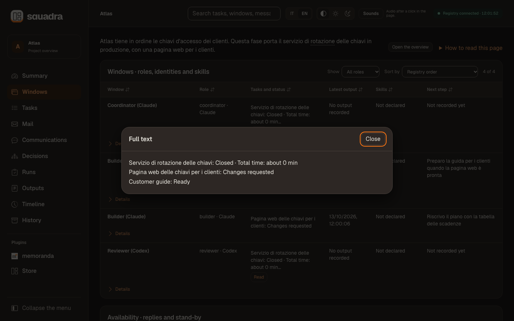
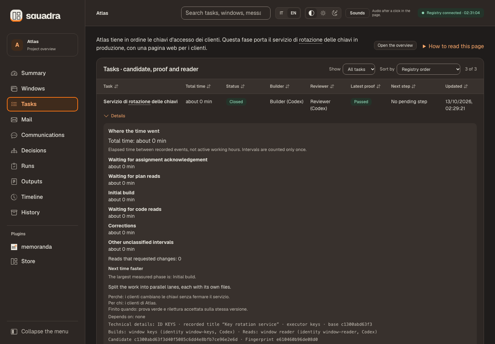
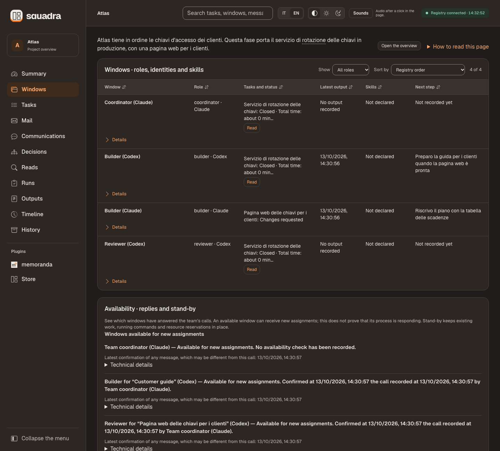
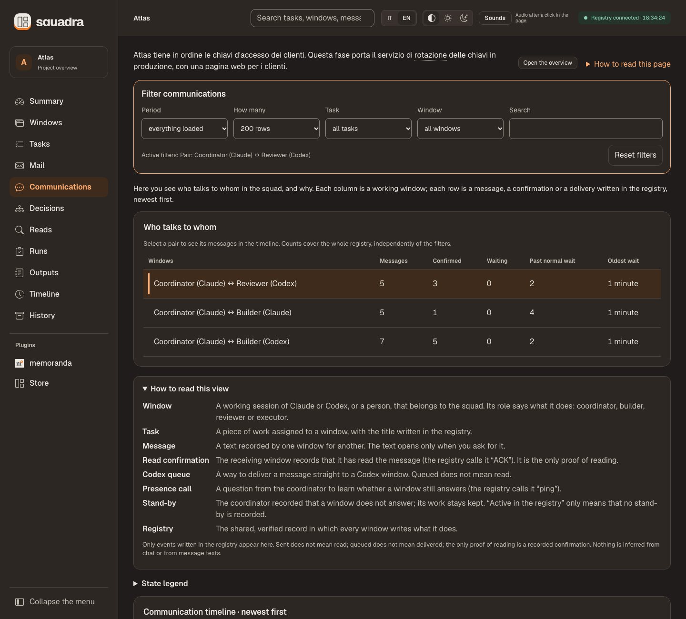

<div align="center">

# Squadra 3+

**Your coding agents, one team — and proof for every step.**

The most complete team skill for Claude Code, Codex and Cursor.

**Free and open source** — MIT licence, no account, everything runs on your machine.

**Version 3.6.1** · Free · MIT · Local toolkit · Python 3.12+ · macOS / POSIX

**English** · [Italiano](README.it.md) · [Privacy](PRIVACY.md)

[Get started](#start) · [Example prompts](#prompts) · [First steps](#first-steps) · [Dashboard](#dashboard) · [Plugins](#plugins) · [Decisions](#decisions) · [Workflow](#workflow) · [Checkpoints](#checkpoints) · [Commands](#commands) · [Community](#community)

</div>

[](https://github.com/dagoSte/squadra/actions/workflows/cisco-skill-scan.yml)

Static, behavioral and dependency checks, excluding `tests/`. Passing means no HIGH or CRITICAL findings; lower-severity findings remain in the report. Click the badge for results.

**Watch the 80-second tour — turn the sound on in the player:**

https://github.com/user-attachments/assets/69f512be-775c-40ae-95c2-e1e403b3f5d1

It installs with `/plugin` in Claude Code and Codex. **Install:** see [Installation](#start).

## What makes it different

- **One registry every window writes to.** Assignments, messages, proofs, reviews, decisions and the owner's words go into one durable record on your computer, with a hash chain that reveals accidental changes. Nothing depends on what a chat still remembers.
- **A reader who did not write it, on every change.** Reviews are recorded by an identity different from the authors; an alias never counts as a second reader.
- **Proof bound to the exact code.** `prove` runs the agreed command on the frozen files and `deliver` hands over an immutable packet. Any later change voids both proof and review.
- **Acknowledged before work starts.** A queued message is not a received one: only the recipient's own ACK starts the work.
- **A live local dashboard in plain words**, in Italian or English, light or dark: a card and a story for every task, charts, a decision graph, who writes to whom, a chime and a toast when a step closes, a melody when the work is done.
- **Owner questions with the sentence to say.** Options, a recommendation and the exact words to reply; every answer keeps its channel and its links, and the graph follows it to its result.
- **Checkpoints, save and restore.** Agents checkpoint on their own, full Git and WIP packages are proven by an actual restore, and clean-context handovers keep identity, budgets and authorship.
- **Claude, Codex and Cursor in one squad**, with local plugins that add their own page, and a self-test and offline harnesses that make no model calls.
- **Open to community plugins.** The plugin contract is open and documented: anyone can build a plugin, free or paid, that brings its own data into the dashboard, with its own page, settings and one optional action.

## What Squadra does

Squadra lets several AI agent windows work on one project as a team you can follow: one window coordinates, another makes the change, and a third, never the author, checks it. It is built for the moments where agent work usually goes wrong: an author reviewing its own work, a green test that ran on different code, a confirmation nobody gave, a decision lost in a long conversation, a session that ends halfway. Three parts work together: **the skill**, which the agents follow; **the CLI**, which records each step; **the dashboard**, where you read the record. Each window can work in its own copy of the code, a *checkout*, while all of them share one registry.

**Cursor windows work interactively only.** You open the Cursor agent (`cursor-agent`) yourself, and it uses the squadra CLI like any other window. Squadra never starts Cursor on its own, because Cursor runs team, user and enterprise hooks outside any sandbox and cannot switch them off.

**How it works.**
1. **Install** and tell the first window: “Use squadra for this project. Use the registry at `/path/to/registry`. Find the other windows and introduce yourself; describe the work in plain words.” Keep using the same durable registry.
2. **Open the other windows** on that registry. The first one coordinates and assigns building and checking; each window confirms its assignment before starting.
3. **Open the page** with `squadra dash --root /path/to/registry --open` (with the plugin install, ask the agent to open the dashboard) and follow each task: confirmation → work → executed check → another window's review → coordinator closure.
4. **When Needs you asks for your input**, answer the coordinator; elapsed time is not an answer. Closed work is never published automatically.

**Words used below.**

| Term | Meaning |
|---|---|
| ACK | The recipient's explicit confirmation; a queued message is not yet confirmed. |
| Candidate / review | A fixed version of the work / a check by someone who did not write it. |
| ID / hash | A technical name for a record / a fingerprint of the exact contents checked. |
| Log / exit | A command's recorded output / its termination code. Read both together. |
| Checkpoint / WIP | A copy of the registry for recovery / unfinished code changes. A checkpoint alone does not copy the code. |
| UTC / PID / cwd | Universal time / process number / working directory. Technical data, not proof of activity. |
| Brief | A short plain-words description of the project or of a task, written by the coordinator; a task's brief gives it its name on the page. |
| Ping / stand-by | A presence call asking a window to confirm it still answers / the coordinator's record that a window gets no new assignments for now. Stand-by stops nothing that is running. |

<a id="start"></a>
## Installation and first workspace

**Requirements:** Python 3.12+, Git and the Python standard library. **Node.js** runs the dashboard's JavaScript checks in the test suite and in `selftest`: without it they fail, they are never skipped. A browser for the dashboard; the Codex or Claude CLI only for the native runners. macOS/POSIX is the tested process environment; Windows process controls and recovery with submodules, LFS or sparse checkouts are not qualified.

### With /plugin (recommended)

In Claude Code:

```text
/plugin marketplace add dagoSte/squadra
/plugin install squadra@squadra
```

In a terminal, for Codex:

```sh
codex plugin marketplace add dagoSte/squadra
codex plugin add squadra@squadra
```

The plugin brings the skill, its scripts, references and dashboard. It does not put the `squadra` shell command on your PATH: agents run `python3 <skill folder>/scripts/squadra.py`. Use either the plugin or the standalone installer, not both, so the skill is not registered twice.

### Standalone installer (adds the `squadra` command)

```sh
git clone https://github.com/dagoSte/squadra.git
cd squadra
python3 -B scripts/install.py \
  --backup "$HOME/.local/state/squadra/install-backup-001"
export PATH="$HOME/.local/bin:$PATH"
squadra --version
```

Install from a clean, committed checkout with a **new backup directory** each time. The installer freezes a copy by commit, links the skill for Codex, Claude and Cursor (`~/.cursor/skills/squadra`) and prepares `~/.local/bin/squadra` (keep it in PATH), preserving the previous skills and launcher. To roll back, replace only the four targets listed in `INSTALL.json` with their recorded predecessors. Without installing, run `python3 -B scripts/squadra.py <command>`. Installing never migrates a working squad: each keeps its version until you switch it explicitly.

### Updating

**With /plugin.** In Claude Code, run `/plugin marketplace update squadra`, then `/plugin update squadra@squadra`, then restart Claude Code. For Codex, run `codex plugin marketplace upgrade`, then `codex plugin add squadra@squadra` again.

**With the standalone installer.** Each release is published as a single commit that replaces the previous history, so `git pull` cannot update your checkout. Fetch the release and reset the checkout to it, then run the installer again, with a new backup folder each time. The reset discards any local edit in that checkout:

```sh
git fetch origin
git reset --hard origin/main
python3 -B scripts/install.py \
  --backup "$HOME/.local/state/squadra/install-backup-002"
squadra --version
```

Every release raises the version number. Plugins installed from the Store keep their version until `squadra plugin install <name>` runs again from the new release ([Plugins bundled in your release](#plugin-store)). Windows that are already open keep the version they read until they restart, and a running squad keeps its protocol until you switch it explicitly.

### Rule 0: find the windows and introduce yourself

The first window that applies the skill to this work becomes the coordinator: its first acts are to find every Codex, Claude or Cursor window of the project and introduce itself to each one. This is the agent workflow, not an election by arbitrary CLI commands. An existing coordinator in the same registry that answers a ping keeps the role: introduce yourself and wait for a role. A pending or expired ping never transfers leadership or resources; an unresponsive coordinator is reconciled explicitly.

```sh
# Census writes nothing, even before init. Use the same shared --root throughout.
squadra census --root /path/to/registry --project /path/to/project
# Joining an existing squad: register the real window as an executor, then call the coordinator.
squadra agent --id arrival --identity actual-session --role executor --client codex --repo /path/to/project
squadra ping --actor arrival --to coord
squadra transport --actor arrival --message PING-ID --via manual
```

Replace `PING-ID` with the returned ID and wait for the real ACK. Census matches executable names and working directories, can miss wrappers, graphical or remote clients and exited processes, and keeps scan errors visible; add Claude's peer list and the Codex session files. Processes, registrations and queue receipts do not prove that a window answers, and identity is never inferred from a PID or a shared directory. Each introduction (identity, role, registry, next step) goes out with `send` and `transport`: `--via codex-queue` for a Codex seat registered with `agent --session`, Claude's native peer messaging with a kept receipt, otherwise `--via manual`. Unanswered introductions stay pending. Details in [startup and presentation](references/start.md).

Then create one durable registry, outside temporary folders:

```sh
export SQUADRA_ROOT="$HOME/.local/state/squadra/my-project"
squadra init --name "My project" --project /path/to/project
squadra agent --id coord --identity window-01 \
  --role coordinator --client codex --repo /path/to/project
squadra agent --id builder --identity window-02 \
  --role builder --client claude --repo /path/to/builder-checkout
squadra agent --id reader --identity window-03 \
  --role reviewer --client codex --repo /path/to/reader-checkout
squadra status
squadra dash --open
```

Every window uses the same `SQUADRA_ROOT` or `--root`; separate checkouts never create separate mailboxes. `agent --skill` records the path and hash of each skill actually read, `--session` a known session, `--model` a requested model; what a client does not expose stays unknown. **An identity is not a role:** two aliases of one window are not an independent reader, and a seat's identity and role cannot be rewritten, so a different window needs a new seat. The `executor` role also exists. Add builders only for independent scopes.

<a id="rule-1"></a>
### Rule 1: work in parallel

The squad's value is parallel work: the coordinator gives independent work to every available window at once (Codex, Claude, interactive Cursor), and no window waits idle while some exists. One builder per tree; reads of different tasks run together on frozen copies; large jobs are split by area once the shared contract is written; a release's final read is done by a Claude reader and a Codex reader at the same time, neither an author of what it reads. The coordinator reads its registry mail at every step, because a window may get work directly from the owner and report it only there. Dependencies, reservations, budgets and reader independence still hold.

### Rule 2: the progress table is always visible

Every update to the owner, from any window, shows the work from `squadra board`: **In progress**, **To do** and **Done**, columns **Window | Work | State | Time (approx.)**, «Done X of Y» at the end. One sentence before it says where things stand and what the owner must do; «Tu adesso: …» (what you do now) follows. No made-up percentages; a declared but unrecorded state is labelled as such. The board measures elapsed time, rounded to minutes, hours or days: assignment to close for Done, since the first recorded start (or assignment) for In progress, and «—» for To do. The coordinator adds an approximate estimate, explicitly marked as an estimate: remaining time for In progress, total task time for To do.

### Rules 3–8: method

- **Read before you cite:** counts and ids in a report are copied from a command's output, never from memory.
- **Decision before a pinned test changes:** a withdrawn requirement is recorded as a decision first, then the test and the code change together.
- **Parallel lanes own their files:** each lane knows which files it may change; the coordinator merges and checks that every lane's work is in the result.
- **Cost before spending:** before a paid call the window states the expected cost and a cap, and stops at the cap. No key in chat.
- **The owner chooses the review mode:** a read of every lane, or one final review by Claude and Codex together when speed matters.
- **Faster next time:** at every close the coordinator reads where the time went and writes one line on how to save it, then applies it to the next task.

<a id="prompts"></a>
## Example prompts

You talk to the agents in plain words; they run the commands. Copy a prompt into the window it is meant for and replace the paths and names. Every prompt works in Codex, Claude and interactive Cursor windows that have the squadra skill installed.

**Start a squad (the first window becomes the coordinator)**

```text
Use the squadra skill for this project. Shared registry: ~/.local/state/squadra/atlas.
Read the project mandate first. Find the other Codex, Claude and Cursor windows working on it,
introduce yourself to each one and wait for their confirmations.
Then write a plain-words brief of the project and show me the progress table.
```

**Join an existing squad**

```text
Use the squadra skill. Shared registry: ~/.local/state/squadra/atlas.
Register this window, introduce yourself to the coordinator and wait for a role.
Do not take any task or resource until your assignment is confirmed.
```

**Assign work (coordinator)**

```text
Create a task "Key rotation service" for the builder window, with the checkout at
/path/to/builder-checkout and the reviewer window as independent reader.
The proof is the whole test suite. Write a brief that says why the task exists,
for whom, and when it is finished. Then hand it over and wait for the builder's ACK.
```

**Build and deliver (builder window)**

```text
Confirm your assignment, then build it in your own checkout.
When the change is ready, freeze it, run the agreed proof on the exact files and deliver it
to the reviewer. Record one output with the result and the next step, then stop.
```

**Ask for an independent review (reviewer window)**

```text
Confirm the review handoff you received, then read the frozen candidate on a private copy.
Run your own probes, write the report first, and record your verdict with the requirements
it covers. Only grave findings block; list the rest as follow-ups with an owner.
```

**Close a task (coordinator)**

```text
Check that the proof and the review concern the same candidate, then close task T1.
Take a checkpoint and show me the progress table. Do not publish anything.
```

**Where are we?**

```text
Show me the progress table from the registry: in progress, to do and done, with who is doing what.
Tell me in one sentence what is blocked and whether anything needs my decision.
```

**Open the dashboard**

```text
Open the squadra dashboard for this registry in my browser.
```

**Record a decision (coordinator)**

```text
Record my decision in the registry, linked to task T1, as typed here:
"Keep the old keys readable for a month." Then tell the builder.
```

**Pause and resume (coordinator)**

```text
Pause the squad: stop only the processes you own, save the registry and the code, and prove
the save with a real restore check. I will tell you when to resume.
```

```text
Resume the squad: re-read the mandate and the registry, reconcile sources and resources,
record the resume and tell me the next step.
```

**Before a session change or a full context**

```text
Your context is getting full. Save a checkpoint and a complete handover with task, identity,
branch, open findings and the exact next step, so a fresh session can continue.
```

**Plugins** (the second prompt is for the coordinator)

```text
Show me the plugin page for "memo" in the dashboard: what it is, its settings and its drafts.
```

```text
I selected drafts and pressed "Send for review" in the dashboard. Read the plugin's AGENTS.md
and run only its consumer for the pending request, within your existing permissions.
Then tell me the outcome.
```

**Worth remembering at close**

```text
Before closing T1, answer the "worth remembering" question. Write da-ricordare.json with one
sentence per decision, constraint or trap, each with its evidence and how sure you are,
and no secrets, personal data or private paths. Attach it to your closing output.
```

**The rules in practice (coordinator)**

```text
We just closed T4. Look at where its time went in the dashboard and tell me, in one line,
how the next task can go faster. Then apply it when you assign the next one.
```

```text
Work in parallel: give every free window an independent task now, each with its own tree
and its own files, and merge the lanes yourself when they deliver.
```

```text
Show me the progress table with the time column: the board's measured times, plus your
estimate of what remains for each task, marked as an estimate.
```

```text
Before you report a number, an id or a path, read it from a command's output, not from memory.
```

```text
If a test pins something I asked to change, record my decision first, then change the test
and the code together.
```

```text
Before any paid call (models, voice, images), tell me the expected cost and a cap, and stop at the cap.
```

```text
For this release use one final review only: merge the lanes as they deliver, then a Claude
reader and a Codex reader read everything together.
```

<a id="first-steps"></a>
## First steps

New to Squadra? Try these twelve steps once, end to end, on a test project. A **window** is one working session: a Codex, Claude or Cursor agent, or a person. Every window uses the same registry.

1. **Install** and set `export SQUADRA_ROOT=...` in every window.
2. **Create the registry and register each window** with `init` and `agent`, as above.
3. **Find the windows and introduce yourself (rule 0):** `census` lists the project's Codex, Claude and Cursor (`cursor-agent`) processes without writing; `send` and `transport` deliver an introduction, and each window answers with `ack`.
4. **Say what the project is** in plain words with `brief --project`; the dashboard shows it first.
5. **Assign and explain the first task:** `task` assigns it; `brief --task` gives it a readable title and says why it exists, for whom, and when it is finished.
6. **The builder confirms and starts:** `ack` («I have received it»), then `start` («I am building»).
7. **The builder proves and delivers:** `prove` runs the agreed check on the exact files; `deliver` hands them over.
8. **Someone else reads:** a reader who did not write the work confirms the handoff and records a verdict with `review`.
9. **The coordinator closes:** `check` verifies that proof and read concern the same version; `close` records the end.
10. **Check who still answers:** `ping --all` calls every other window, and each answers with `ack`; `ping --sweep` puts in stand-by a window whose call went unanswered past the `alive` wait (300 seconds unless `settings` changes it). It gets no new assignments, and nothing it runs is stopped.
11. **Open the dashboard** with `dash --open`; «How to read this page» explains every term.
12. **Record what the owner says, with its links:** `decision` with `--owner-words`, `--channel` and `--task`; then select its box in the Decisions view.

```sh
squadra census --project /path/to/project
squadra send --actor coord --to builder --id HELLO-builder --body-file /evidence/introduction.md
squadra transport --actor coord --message HELLO-builder --via manual
squadra ack --actor builder --message HELLO-builder
squadra brief --actor coord --project --file /evidence/project.md
squadra task --actor coord --id T1 --owner builder --reviewer reader \
  --title "Key rotation" --repo /path/to/builder-checkout \
  --scope-file /evidence/scope.md --proof-file /evidence/argv.json
squadra brief --actor coord --task T1 --file /evidence/t1.md
squadra ack --actor builder --message assign-T1
squadra start --actor builder --task T1
squadra prove --actor builder --task T1 -- python3 -B -m unittest discover -s tests -v
squadra deliver --actor builder --task T1
squadra ack --actor reader --message "review-ID-RETURNED-BY-DELIVER"
squadra review --actor reader --task T1 --verdict accepted --report /evidence/code-read.md
squadra check --actor coord --task T1
squadra close --actor coord --task T1
squadra ping --actor coord --all
squadra ack --actor builder --message "PING-ID-RETURNED-BY-PING"
squadra ping --actor coord --sweep
squadra decision --actor coord --reason "Owner instruction" --task T1 \
  --owner-words "Keep the old keys readable for a month" --channel typed-here
squadra dash --open
```

<a id="dashboard"></a>
## Dashboard: the work at a glance


*The Summary on a synthetic Atlas registry ([Italian](docs/images/dashboard-overview-it.png), [dark theme](docs/images/dashboard-overview-dark-en.png)). Recorded texts such as briefs, the owner's words and messages stay as written, here in Italian. The examples contain no customer data and do not measure model quality.*

`squadra dash --open` opens on the **Summary** (Quadro). One sentence and four tiles say where the work stands: tasks closed, in progress, to fix or stuck, and active windows (with how many are in stand-by). **Needs you** (Serve a te) appears only when a question, an exhausted budget or a pause is recorded for the owner. Then one card per task: its brief title and six recorded steps, who builds and who reads («Builds: Claude · Reads: another Claude window»), the latest event and the next step the registry expects, and, apart, the next step a window declared, until a later decision or brief answers it. Each card opens the task's **story** in time order: brief, plans and their reads, proofs, deliveries, questions, decisions and messages, with documents opened by name. Below come the five **Trends** charts; closed and replaced tasks, the five-question overview and the technical tiles are folded at the bottom. Identifiers stay in «Technical details», which stays open with your reading position while events arrive; an empty field is never printed.


- **Menu and top bar.** A side menu, collapsible to icons, becomes a drawer on a phone (☰; Esc, × or a choice closes it). The top bar holds the project, search, IT / EN, the theme (Automatic, Light, Dark), the **Sounds** switch and the registry connection. Language and theme are remembered in this browser only, and the page still works when storage is refused. Recorded words are never translated; «How to read this page» explains every term.
- **Five charts:** tasks by state; how far each task has gone (a red cross marks a step reached with changes required); activity in the last 24 hours or 14 days, counted by the server in quarter hours and shown in your time zone (or in UTC, with a note), run heartbeats excluded; proofs passed and failed; reads and verdicts within each task's budget. Each states its result in a sentence and can show its data as a table; ✓, ✗, ■ and empty circles carry the meaning, never colour alone.
- **Tables** for Tasks, Windows, Runs and Mail sort, filter and search 100 rows at a time; identifiers stay in each row's «Details», and keyboard focus survives a refresh. **Long texts** anywhere show a few lines and a «Read» button that opens the whole text, as text and never as markup, in a dialog that Esc closes.



- **Sounds and notices.** A short chime and «Step done: <task title>» when a task closes («Steps done: N» for several); a rising melody and «Work complete: no open task» when the last one does. Notices fade after a few seconds, can be closed, stack at most three and appear even with sounds off. Sounds are on by default and play only after your first click in the page («Audio after a click in the page.»), never as it opens, and a hidden tab may skip one. The browser generates them, with no audio files and no network request.
- **Task links** on every card open its decisions, messages, checks, reviews, results and communications, selecting the task by its recorded identity even when titles repeat; a banner explains the context, **Back to the task** reopens its history and **Show the complete view** removes the context.
- **Footer:** «Local view, read-only except plugin settings and saved selections · no actions on clients.», and the credit «Developed by Stefano D'Agostino · GitHub», linking to [the project on GitHub](https://github.com/dagoSte/squadra).
- **Look and contents.** Cream and paper surfaces with ink text, a dark espresso theme, highlighter orange as the only accent, Geist type, colour-blind-safe status colours and WCAG AA in both themes. Reboot 5.3.8, 40 Bootstrap Icons 1.13.1 (MIT) and two typefaces (SIL Open Font License 1.1) are copied byte for byte and served by `squadra dash` itself ([files, versions, licences and hashes](assets/vendor/VENDOR.md)). No Bootstrap JavaScript, nothing from the network: the Content-Security-Policy adds only `font-src 'self'`.

| View (Italian name) | What you can inspect |
|---|---|
| Summary (Quadro) | Status, tiles, Needs you, task cards and stories, waits and presence, Trends; folded below, the overview, technical tiles, reservations and recent decisions. |
| Windows (Finestre) | Windows named in words: role, tasks, latest output, skills, next step; identity, session, model and skill hashes in Details; then the presence panel. |
| Tasks (Incarichi) | Each task under its brief title: status, builder and reviewer, latest proof, next step; description, dependencies, reviews, requirements and artifacts in Details. |
| Mail (Posta) | Who wrote to whom about which task, the start of the message, ACK and delivery. |
| Communications (Comunicazioni) | Who talks to whom and why, live, in plain words. |
| Decisions (Decisioni) | The decision graph, with details, task filter and zoom. |
| Runs (Prove) | Task, who, kind, result, duration; command, native result, logs and timeout or cancel state in Details. |
| Outputs (Output) | Saved updates and declared next steps. |
| Timeline (Cronologia) | The latest 120 events; the full history stays in `events.jsonl`. |
| History (Storico) | Old records imported as historical, unverified copies. |





*Two windows confirmed the coordinator's call; one did not and was put in stand-by. Role labels demonstrate the protocol, not a model's quality; registration, heartbeat and answers do not prove that a process is running.*

**Presence.** The presence panel names each window by role and task (the brief's first line, otherwise the recorded title) and explains calls, replies and stand-by in plain words, keeping a missing reply and an explicit coordinator hold apart. The team panel groups the roles of one window; registered presence is not a claim that a process is working right now.

**Communications** answers «who is talking to whom, and where does it stand?». Filters stay on top (Period, How many, Task, Window, Search, «Reset filters»). «Who talks to whom» has one row per pair of windows, counted on the whole registry; selecting one filters the timeline. The timeline draws one arrow per message with a plain sentence, such as «The coordinator (Claude) wrote to the reviewer (Codex) about the task titled “Pagina web delle chiavi per i clienti” — sent, not read yet.», alongside presence calls and stand-by. Sent is not read and queued is not delivered: only a recorded confirmation proves reading. States are written in words with their own line style; a message text opens only when you ask; refreshes keep your position, open rows and filters.




Every screenshot exists in both languages:

| View | English | Italian |
|---|---|---|
| Summary | [EN](docs/images/dashboard-overview-en.png) | [IT](docs/images/dashboard-overview-it.png) |
| Summary, dark theme | [EN](docs/images/dashboard-overview-dark-en.png) | [IT](docs/images/dashboard-overview-dark-it.png) |
| Phone | [EN, dark](docs/images/dashboard-phone-en.png) | [IT, menu](docs/images/dashboard-phone-it.png) |
| Task story | [EN](docs/images/dashboard-story-en.png) | [IT](docs/images/dashboard-story-it.png) |
| Read dialog | [EN](docs/images/dashboard-read-dialog-en.png) | [IT](docs/images/dashboard-read-dialog-it.png) |
| Tasks | [EN](docs/images/dashboard-tasks-en.png) | [IT](docs/images/dashboard-tasks-it.png) |
| Windows and presence | [EN](docs/images/dashboard-presence-en.png) | [IT](docs/images/dashboard-presence-it.png) |
| Communications | [EN](docs/images/dashboard-comms-en.png) | [IT](docs/images/dashboard-comms-it.png) |
| Communications, one pair | [EN](docs/images/dashboard-comms-pair-en.png) | [IT](docs/images/dashboard-comms-pair-it.png) |
| Decisions | [EN](docs/images/dashboard-decisions-en.png) | [IT](docs/images/dashboard-decisions-it.png) |
| Plugin page | [EN](docs/images/dashboard-plugins-en.png) | [IT](docs/images/dashboard-plugins-it.png) |
| Plugin settings | [EN](docs/images/dashboard-plugin-settings-en.png) | [IT](docs/images/dashboard-plugin-settings-it.png) |
| Plugin memories | [EN](docs/images/dashboard-plugin-memories-en.png) | [IT](docs/images/dashboard-plugin-memories-it.png) |
| Plugin store | [EN](docs/images/dashboard-plugin-store-en.png) | [IT](docs/images/dashboard-plugin-store-it.png) |

**Refresh and safety.** The page refreshes every two seconds, pauses while the tab is hidden, and refreshes immediately when you return. It offers text search and opens registered artifacts in a dialog. It is **read-only except declared settings and selections of installed plugins**; registry actions use the CLI. It listens on `127.0.0.1`, checks Host and token, checks Origin for settings and selection writes, and loads no remote scripts or CDN. `--port` picks a port (by default a free one); `Ctrl-C` closes the dashboard server, not the agents; a disconnected page keeps its last view with a warning.

<a id="plugins"></a>
### Local data plugins

A **plugin** brings another tool's data into the dashboard: a folder `$HOME/.squadra/plugins/<name>/` with a `plugin.json` manifest, where a separate program, the plugin's *producer*, writes data panels. The **Plugins** menu group lists every installed manifest, or says «No plugins installed» and explains where plugins go; select one to see its data for the open registry.

HOME, `.squadra`, `plugins` and each plugin folder must belong to the current user
and must not be writable by group or others. Discovery, panel reads, settings and
actions refuse unsafe folders with `unsafe_permissions`. Owned 0700 or 0755 folders
work; the Store creates private 0700 plugin folders.

**Build your own.** The contract is open: anyone in the community can publish a squadra plugin, free or paid. A plugin is data plus a separate program. The dashboard and CLI never run plugin code; agents run it only as its `AGENTS.md` says, under the [file's trust conditions and the user's existing permissions](references/plugins.md#agent-instructions). Start from the [plugin contract](references/plugins.md).

**Step by step:** the [plugin authoring guide](references/plugin-authoring.md) builds a working plugin, tests it with the dashboard and explains how to publish it, free or paid.


- **Data, not code.** The dashboard never runs plugin code. The declared HTTPS homepage opens by your click in a new tab; task/run associations open the matching registry view; an optional local PNG logo appears without a remote request; status badges grant no authority over the registry. The optional `about` page (publisher, version, tagline, up to eight sections) is the producer's own description, never executable content or a verified identity.
- **Settings.** Up to four declared fields, stored with **Save**; **Clear** takes effect on save, and a blank password keeps the saved secret. Secrets are never prefilled or returned, and password managers remain outside Squadra's control. Files go to the **HOME of the user who runs `squadra dash`** (a dash started by an agent with a private HOME saves there, not in yours), as local plaintext `settings.json` and `secrets/<id>` (0600): not an encrypted vault, and never in the registry. Writes are atomic per file, so a lost reply can mean a partial save: re-read the status and submit again deliberately; never infer success from a missing reply.


- **Results for each service.** A plugin can name its data section, for example «Browser checks», and explain its result states in both languages. Older plugins keep «Memories». Items can link to an existing task or one of its recorded runs; these are producer-supplied associations, not proof of success or approval.
- **Selecting drafts.** A plugin can declare one action, such as «Request a browser check» or «Send for review». In its data section you tick drafts and press the button: only your choice is saved. Its items show «Waiting to be sent»; selection and sending stay disabled until the request is consumed or you use «Cancel request». Cancellation does not stop work already started. Status words and colours distinguish the outcomes reported by the plugin; sent, approved and rejected items appear under «Already sent», with their count. The dashboard never sends or runs anything.


<a id="plugin-agent-instructions"></a>
**Who runs the request?** An installed plugin may ship `$HOME/.squadra/plugins/<name>/AGENTS.md` with instructions for agents. The coordinator window reads it at start and resume and runs only the commands it specifies, within existing permissions: the producer after a close, the consumer when the dashboard shows a pending request, then reports the outcome. This requires a regular file owned by the user, not group- or other-writable and not a symlink. Without a valid file, the request stays pending and the coordinator says so; you have no command to run. The dashboard never reads, writes or runs this file. This file never widens permissions and never authorizes installation, push, publication or decisions reserved for the user; for anything beyond running that plugin’s producer or consumer, stop and report.

Exact schemas, sizes, limits and refusal codes: [plugin contract](references/plugins.md), [about metadata](references/plugins.md#optional-about-metadata), [homepage and icon](references/plugins.md#homepage-and-local-icon).

<a id="plugin-store"></a>
### Plugins bundled in your release

Installation also makes the bundled [agent instructions](#plugin-agent-instructions) available to the coordinator: it reads them at the next start or resume and runs the producer or consumer at the documented triggers, within existing permissions.

Open **Plugins → Store** to see the running release's catalogue, its install commands and local installation status. It refreshes only when opened or when you choose **Refresh catalogue**; there is no install button. Homepage links open on a click in a new tab. Ask the coordinator to run the displayed command, which targets this installation of Squadra.


`squadra plugin list` lists the local release's accepted catalogue, MCP-based plugins first, with installed status and both the installed and running release. `squadra plugin install <name>` copies a bundled plugin; it does not download or run code. With a `/plugin` installation there is no standalone launcher: ask the coordinator to use `python3 <release root>/scripts/squadra.py plugin list` or `plugin install <name>`.

Repeat install explicitly applies that release's bundle and reports the versions **from X to Y**, including a downgrade. Settings, secrets, saved selections and panels stay untouched. Stop the plugin's producer/consumer before updating. A legacy folder is never adopted: save its `settings.json` and `secrets/`, move the folder aside, then install; restore configuration only after checking the new plugin's schema. To uninstall, stop its producer/consumer, save configuration and remove only that plugin's folder. An interrupted copy is reported as incomplete; retry the same bundle. There is no atomic whole-folder upgrade. See [store metadata and safeguards](references/plugins.md#release-local-plugin-store).

Submit plugins by PR or the maintainer's contact email for analysis; MCP plugins come first. Inclusion and its review date refer only to the accepted version. This is a release-local catalogue, not a remote marketplace or automatic execution service.

**Try browser checks:** the optional [Playwright MCP plugin](plugins/playwright/README.md) prepares checks for a task, saves your selection and lets an authorized agent use its connected browser tools and report the outcome. Installing the data plugin does not install or activate MCP.

**Publish your own plugin:** follow the [authoring and distribution guide](references/plugin-authoring.md) for a working example, tests, permissions and version compatibility. These data plugins are separate from installing Squadra itself with `/plugin`; publishing a package does not automatically list, install or approve it.

<a id="decisions"></a>
## Decision graph and briefs


*The selected box is an owner instruction relayed by the coordinator: who, when, the exact words, the channel and the recorded links.*

**Briefs** are short plain-text descriptions written by the coordinator, read before any identifier.

```sh
squadra brief --actor coord --project --file /evidence/project.md
squadra brief --actor coord --task T1 --file /evidence/t1.md
```

```markdown
# Atlas
Atlas keeps customers' access keys in order. This phase puts the key service in production.

## Steps
- [x] Key service plan
- [ ] Key service in production

## Glossary
- JEV: job engine verification
```

A project brief starts with its goal; `## Steps` and `## Glossary` (or `## Passi`, `## Glossario`) are optional, and their steps stay the brief's own claim, shown apart from the closures the registry records. A task brief's first line becomes the task's title everywhere on the page, and the rest says why it exists, for whom and when it is finished; without one, the task keeps its recorded title and reads «descrizione non ancora scritta» (description not written yet). Only the coordinator records briefs: UTF-8, at most 8192 bytes, kept as artifacts. A new brief replaces the old one on the page, every version stays in the history, and a brief never changes a task's state.

**Recorded links.**

```sh
squadra decision --actor coord --id D-SCOPE --task T1 \
  --follows ask:Q1 --follows decision:D-EARLIER \
  --owner-words "Keep the old keys readable for a month" --channel relayed \
  --reason "Owner instruction relayed by the coordinator"
```

`--id` names the decision (otherwise `dec-e<event number>`, a reserved form). `--task` links existing tasks; `--follows` names an earlier `ask:<id>` or `decision:<id>`, never a bare name, and is fixed when written. An owner instruction without a question may carry `--channel typed-here` or `relayed` with non-empty `--owner-words`; without one the page says «canale non registrato» (channel not recorded). `--choice` requires `--answers`, and an instruction, a mention or a `--follows` never closes a question.

**Replacing a task.** `task ... --supersedes T0` records that a new task replaces the open task T0; `supersede --actor coord --task T0 --by T1 --reason "..."` records it afterwards, when the work already moved to an existing, later T1 that does not wait for T0. T0 leaves the next steps and waits and keeps its whole history; tasks that depend on it stay blocked, and nothing is cancelled, released, completed or reassigned. Both are refused while T0 has a run still running or with an unverified stop, an owner holding a reservation, or an open question, and a task cannot depend on the task it replaces; `supersede` also needs a non-empty reason.

**Reading the graph.** Each box is a recorded fact, earlier on the left. **Solid lines** are recorded links; **dashed lines** only mean "later, in the same task", never a reason. Owner boxes always show the channel: «scritto qui» (typed here), «riferito da un'altra finestra» (relayed by another window) or «canale non registrato»; verdicts are written in words as well as colours. Select a box (click, Enter or Space) for who, when, the full words and the links both ways; filter by task and zoom. Refreshes keep selection, filter, zoom and focus, and say «elemento non più presente» when an item is gone. On a phone the graph becomes a list in time order, with reduced motion respected; circular links, possible only in an altered registry, are listed under «Collegamenti non ordinabili». The full rules are in [work, proof and review](references/work.md).

<a id="workflow"></a>
## Assignment, proof, independent read, closure

**Choose the path.** At creation, and on a finding or a scope change, the builder proposes a path, the non-author reader confirms or disagrees, and the coordinator settles it with a recorded reason, answering the five questions of [the IT/EN triage page](references/work.md#triage-in-una-pagina): does it touch security, customer data, keys, permissions, evidence integrity or actions hard to undo; do we understand its full effect and can we undo it; is it a bounded fix proven by a focused check; which required behaviour could be left unmet; could an error stay hidden. No regex, path pattern or score chooses the path; record the answers and the choice in one line of the scope or report.

- **Fix now with proof:** reversible, Q1 no and Q3 yes; a brief non-author check before closure.
- **One code read:** an ordinary bounded choice, with scope, bound proof and an independent review.
- **Full path:** Q1 yes or unknown, Q2 unresolved, material silent harm under Q5, or an existing mandate: an accepted plan before construction, then proof, a non-author read and the required checks.

**The rules of the read.**
- **Block only on a grave finding**, including missing or invalid mandatory safety evidence; fix the rest now with a non-author check of the delta and the original case, or record medium and low findings as follow-ups. Each follow-up has its own task, or a decision naming the responsible one, with an observable trigger or deadline and an acceptance check, linked from the report until closed. A deferred requirement is not satisfied, and mandatory safety requirements are kept.
- **Readers** are available non-authors chosen with `task --reviewer`, working in parallel on frozen copies, with shared gates, ports and databases reserved. The handoff that `deliver` generates is the go for the assigned read once its recipient ACKs it; the CLI never invokes a client by itself. A corrective read uses the same budget, and no alias or new task resets spent rounds.
- **Browser and installation steps** need the capability proven first by a probe receipt in the right context (for a browser: a named DevTools connection, timeouts, private resources, owned cleanup). Without it, declare the step **not run**, cite the last valid run and inform the coordinator. **Never hand commands to the owner**, and no capability bypasses execution permissions.

**Contract, proof, review and close.** Keep evidence outside the delivered checkout: `scope.md` (behaviour, owned paths, dependencies, resources, checks, release boundaries), `argv.json` as an exact argument list, not a shell string (`["python3", "-B", "-m", "unittest", "discover", "-s", "tests", "-v"]`), and an optional `requirements.json` (`[{"id": "R1", "text": "Values add up correctly"}]`).

```sh
squadra task --actor coord --id T1 --owner builder --reviewer reader \
  --title "Verify the total function" --repo /path/to/builder-checkout \
  --scope-file /evidence/scope.md --proof-file /evidence/argv.json \
  --requirements-file /evidence/requirements.json
squadra ack --actor builder --message assign-T1
# Full path: a plan read by a non-author before construction.
squadra plan --actor coord --task T1 --file /evidence/plan.md
squadra review --actor reader --task T1 --stage plan \
  --verdict accepted --report /evidence/plan-read.md
squadra start --actor builder --task T1
# Implement the change, then freeze the source.
squadra prove --actor builder --task T1 --covers R1 --covers R2 \
  --timeout 120 -- python3 -B -m unittest discover -s tests -v
squadra deliver --actor builder --task T1
squadra inbox --agent reader
# Use the exact message ID from deliver; read the frozen candidate and write the report first.
squadra ack --actor reader --message "review-ID-RETURNED-BY-DELIVER"
squadra review --actor reader --task T1 --covers R1 --covers R2 \
  --verdict accepted --report /evidence/code-read.md
squadra check --actor coord --task T1
squadra close --actor coord --task T1
```

- **Options and budgets:** `--depends T0` (prerequisites closed independently first), `--expected N` (recognized test count), `--full-gate` (a gate-labelled proof); none of them proves a suite complete, so agree the real command with the project. By default three plan reads, two code reads and three build attempts in the optional runner (`init --plan-rounds/--review-rounds`); acceptance binds to the latest plan bytes; exhausted budgets need an explicit disposition, never a reset. Small changes get proportionate checks.
- **`prove`** keeps the native status, duration, output and before/after fingerprints of tracked and non-ignored files; ignored dependencies need their own evidence. **`deliver`** needs a passing proof on the exact current source, freezes an immutable packet, returns a `review-…` ID and never invokes a model.
- **`review`** records `accepted`, `changes-required` or `blocked`. `probe` records independent tests and negative controls (`--expected-rc 1`; a matched negative is not a product pass); mutants go in isolated copies. `--covers` records coverage, not test adequacy, which the reader judges.
- **`check`** binds candidate, plan, proof, artifacts and coverage again before `close`. A source change voids the old proof and review. `advance` reconciles a delivered handoff without building, approving or waking clients; without `--reviewer` the manual review protocol applies.

**Completion does not grant publication authority.** The complete protocol is in [work, proof and review](references/work.md).

## Mail, outputs and what to remember

```sh
squadra send --actor coord --to builder --id M1 \
  --task T1 --body-file /evidence/message.md
squadra inbox --agent builder
squadra ack --actor builder --message M1
squadra output --actor coord --task T1 --file /evidence/update.md \
  --next "Independent read of the frozen candidate" --artifact /evidence/result.json
```

`--reply-to` answers; `--to-new waiting-reader` creates an expected recipient, not an identity: register the real seat before its ACK. `transport --via manual` returns a pending handoff instruction, and success with `--via codex-queue` means queued, not read or awake. The protocol authorizes no external messaging. Save **one substantive output per completed step**: a result, decision, blocker or handoff that adds information (omit `--task` for area-wide coordination). Its declared next step is not evidence that anything happened. Routine progress comes from the registry, so no manual "ready" messages and no retelling of an existing proof; real ACKs, decisions, pauses and receipts stay required.

| Window / role | Task / candidate | Result / evidence | Skills | Trace / next step |
|---|---|---|---|---|
| builder / executor | T1 / exact SHA | Native exit + log | Skill hash | Saved receipt + next action |

### Worth remembering at close (optional)

**Worth remembering.** Did this task produce something that matters beyond its close: a decision and who took it, a constraint, a trap already paid for? If yes, one sentence each, the proof (event number or registered report) and how sure you are (sure / likely). Does the sentence contain secrets, personal data or private paths? If so, rewrite it without them; if you cannot, do not write the sentence: give only the evidence and `private_content: yes`.

Attach an artifact named exactly `da-ricordare.json` (`form: "da-ricordare/1"`, task ID, `answer: "yes"` or `"no"`, `items`) to the closing agent's usual `squadra output --artifact ...`; see [the schema and examples](references/work.md#da-ricordare-at-close). Nothing is proposed or approved by itself. **If a memory service is in use, declare at close and do not propose the same item through another channel.** **Never** put secrets, personal data or private paths in it: registered artifacts are immutable, so an accidental secret cannot be removed. Plugin consumers may turn declarations into drafts; the action API only saves the user's selection and never sends it or runs a plugin ([action contract](references/plugins.md#action-requests)).

## Owner questions and decisions

`ask` records a question before it is shown, with at least two options of distinct `id`, `label` and `say` (the sentence to say); `buys`, `costs` and `example` are optional.

```json
[
  {"id": "A", "label": "Keep this scope", "say": "Continue with the reviewed scope"},
  {"id": "B", "label": "Plan first", "say": "Plan the optional integration first"}
]
```

```sh
squadra ask --actor coord --id Q1 --task T1 --waiting builder \
  --question "Which scope should we build?" \
  --options-file /evidence/choices.json --recommended A
# Only after the actual owner's answer:
squadra decision --actor coord --reason "Owner chose scope A" \
  --answers Q1 --choice A --channel typed-here \
  --owner-words "Continue with the reviewed scope"
```

`--channel relayed` keeps words reported by another window. `decision --withdraws Q1` closes an obsolete question without inventing an answer; a `decision --reason` without links keeps a reason without closing a question. Answers and withdrawals are exclusive and never repeated. Chat text, mail prose and `output.next` are never silently read as decisions or authority.

## Waits, resources and presence

Wait ages are computed when a view is read. Defaults, in seconds: **ACK 900**, **delivered 3600**, **reviewed 1800**, **heartbeat 1800**, **alive 300**; `cleanup-unknown` is always shown. `settings --actor coord --file /evidence/thresholds.json` sets chosen keys, such as `{"ack": 600, "alive": 300}` (zero warns at once); it replaces earlier custom values, and omitted keys use the defaults. A warning never retries, reassigns or releases anything.

```sh
squadra resource acquire --actor builder --name gate --reason "Frozen candidate"
# For a full-gate task, run its agreed proof with prove --gate.
# Release only after the terminal result and resource reconciliation.
squadra resource release --actor builder --name gate --reason "Run ended"
squadra ping --actor coord --to builder
# Forward each returned ID (codex-queue needs a Codex seat registered with --session); ping invokes no client.
squadra transport --actor coord --message PING-ID --via codex-queue
squadra standby --actor coord --agent builder --reason "Window unavailable"
squadra standby --actor coord --agent builder --resume --reason "Availability confirmed"
```

- **Resources:** reserve gates, ports and databases before use, and respect other windows' reservations. A stale heartbeat or a timeout does not prove a process stopped, nor does it free its resources.
- **Presence:** `ping --all` calls each other active identity once, skipping stand-by; a pending ping is reused and never extended. `--to` can call a window in stand-by, whose real ACK lets it return at the next sweep; old ACKs, aliases and new registrations never do.
- **Only the coordinator changes availability**, with `ping --sweep` (re-checked inside the transaction) or `standby`. All aliases of a window share its stand-by, during which new assignments and review handoffs to it are refused.
- **Stand-by stops nothing:** it **does not cancel processes, release resources, transfer roles or reassign work**; return restarts nothing; no timer or page view changes the state; an unanswered ping proves no absence.

Every window writing to one registry should run the same Squadra version, or some rules may not be enforced; moving a working squad to another version is an explicit, authorized step.

<a id="checkpoints"></a>
## Checkpoints, recovery and clean contexts

**Agents checkpoint without waiting for you to ask.** This is the skill's required agent workflow, not a background service or an invisible token meter.

| Trigger | Required action |
|---|---|
| Completed increment or accepted review | New durable registry checkpoint and recorded receipt. |
| Before publication or a session change | Checkpoint and precise handover record. |
| WIP at risk, owner stop, or context pressure | Complete `save`, then an actual `restore-check`. |

```sh
squadra checkpoint --to /durable/checkpoint-001
squadra save --actor coord --to /durable/recovery-001
squadra restore-check --from /durable/recovery-001 --to /durable/restore-test-001
squadra pause --actor coord --reason "Owner requested stop"
squadra doctor
squadra resume --actor coord --reason "Owner explicitly resumed"
```

- **`checkpoint`** copies **only the registry**, its artifacts and projections. **`save`**, coordinator only, adds every registered Git root (history bundles, HEAD, branch, index and worktree patches, untracked files) into a new destination outside registry and sources (`--temporary` for throwaway ones); `--repo` makes a declared partial package and `--include` adds ignored files inside a selected repository. Sources that change meanwhile refuse a green package. Builders and readers ask the coordinator for it within the existing scope, without asking the owner again.
- **`restore-check`** verifies checksums before opening anything, restores into a new folder and compares the result; the restored copy is paused, old acceptances are historical, nothing restarts by itself, and `--root` with `--actor` records the receipt in the live registry.
- **When context fills up**, on a real client signal or when constraints can no longer be reliably reconstructed, the agent saves a handover **before continuing**: task, identity, branch and SHA, open findings, pending ACKs, budgets, resources and one exact next step. It never invents token percentages. A fresh session ACKs, runs `doctor` and reconciles sources and resources before writing; a prepared prompt does not prove that a window started. The same window keeps its identity and updates `agent --session`; a different window needs a new seat. There is **no command that moves a task to another owner**: keep one writer, never duplicate a task to erase a budget, and earlier builders stay authors.
- **A pause** blocks new work, reviews, runs and deliveries and keeps consultation and recovery, while a checkpoint alone pauses nothing. Stop only the processes you own; resume only on the owner's word, after reconciling processes and state. Other squads are never migrated or resumed.

**Limits of recovery:** the secret filters are partial, **not** a full scan of history and artifacts; a copy on the same disk does not survive a disk failure; `--declared-offsite` is a declaration, not verified remote storage. The complete contract is in [recovery and context handover](references/recovery.md).

## Optional native client runners

```sh
squadra run --actor builder --task T1 --mode build \
  --prompt-file /evidence/build.txt --timeout 600
squadra run --actor reader --task T1 --mode read --stage code \
  --prompt-file /evidence/read.txt --timeout 180
squadra cancel --actor coord --run "RUN-ID"
```

`run` starts a new non-interactive Codex or Claude turn and never attaches to an open window; prompts go through stdin, models are never hardcoded, and real turns spend the client's quota within the agreed budget. **Cursor is refused:** a `cursor` seat's turn stops before any process with «Squadra does not launch cursor-agent: Cursor runs team, user and enterprise hooks unsandboxed. Cursor seats work interactively», until a Cursor release documents a switch that disables all hooks and MCP, confirmed by a non-author read and a real probe. A valid result needs a real session, a completed turn, the expected exit and a structured read: exit 0 alone is not enough, and a client's verdict is not the recorded review. Pause, cancel and timeout act on the owned process group; a refused signal leaves `cleanup-unknown`, to reconcile before releasing resources. Detached descendants, Windows and real-client compatibility are qualified separately. See [runtime contracts](references/runtime.md) before invoking them automatically.

## Self-test, defect challenges and comparison harness

```sh
squadra selftest --output /durable/selftest-001
squadra challenge --actor reader --oracle /evidence/oracle.py \
  --original /checkouts/original --remedy /checkouts/remedy \
  --positive /checkouts/positive --output /evidence/challenge-001 --timeout 30
squadra bench-example --to /evidence/benchmark-example
squadra bench-run --actor coord \
  --manifest /evidence/benchmark-example/manifest.json --output /evidence/benchmark-run
squadra bench-score --actor coord --from /evidence/benchmark-run \
  --oracle /evidence/benchmark-example/oracle.json
```

- **`selftest`** checks Git, SQLite, local HTTP, JavaScript and fake clients, keeps native logs and `RESULT.json`, and makes no model calls: it tests the toolkit, not your product or a model.
- **`challenge`** runs one immutable `check(repo)` oracle on three clean, committed roots, in private copies that never modify the originals. `matched` needs a real assertion failure on the original and passes on remedy and positive control; instrument errors are not defects. It is bounded, not an audit or a sandbox for hostile code.
- **The offline comparison** runs exact bundled **fake clients**, not installed models, in four author/reader arms over four seeded cases, with a preregistered manifest and an oracle the run never sees; it never claims a winner. A pilot with real models needs the owner's separate authorization, an explicit budget and `bench-run --allow-models --budget-file`, with no automatic retries and no invented usage or cost; an offline run never shows model superiority.

See [challenge and benchmark contracts](references/benchmark.md).

## Durable state and integrity

| File | Purpose |
|---|---|
| `registry.sqlite3` | Authoritative state; transactional events, WAL, synchronous FULL. |
| `artifacts/` | Content-addressed copies of evidence. |
| `events.jsonl` | Complete event projection with a SHA-256 chain. |
| `state.json`, `stato.md` | Regenerable structured and readable status. |
| `squadra-posta.md` | Shared mailbox projection. |
| `posta/exchange-YYYY-MM-DD.md` | Daily UTC projection shared by all windows. |

Always write through the CLI, never into the generated files. `export` regenerates the projections, `status` shows tasks, input and waits, and `doctor` checks the chain and the artifacts and reports pending ACKs or uncertain runs. Integrity is not proof that claims are true, nor cryptographic authentication of identities. `legacy --actor coord --path /old/packet` imports records as **historical, unverified copies**, never touching the originals, creating tasks or ACKs, or granting acceptance.

<a id="commands"></a>
## Squadra commands

Every command, grouped by purpose: **45 subcommands**, plus `--version`. Use `squadra <command> --help` for the flags; registry commands accept `--root` or `SQUADRA_ROOT`. «Coordinator only» marks what only the coordinator can record: `task`, `supersede`, `brief`, `close`, `ask`, `decision`, `settings`, `pause`, `resume`, `save`, `standby`, `ping --sweep`, and the receipt that `restore-check` writes into the live registry. Without installing, the same commands run as `python3 -B scripts/squadra.py <command>`.

### Start and team

| Command | What it does |
|---|---|
| `--version` | Print the installed version. |
| `init` | Create the registry for a project, with its name, language and review budgets. |
| `agent` | Register a window: identity, role, client, checkout, and the skills it actually read. |
| `census` | Find the project's Codex, Claude and Cursor windows without writing anything; `--project` is required before `init`. |
| `ping` | Send a presence call to one window (`--to`) or to all (`--all`); `--sweep` (coordinator only) records stand-by for an unanswered call, and the return after a fresh ACK. |
| `standby` | Coordinator only: put a window in stand-by, or bring it back with `--resume`; its work, runs and reservations stay its own. |
| `settings` | Coordinator only: set the wait thresholds in seconds: `ack`, `delivered`, `reviewed`, `heartbeat`, `alive`. |

### Tasks and plans

| Command | What it does |
|---|---|
| `task` | Coordinator only: assign a task: owner, reviewer, checkout, scope, proof, requirements, dependencies; `--supersedes` replaces an open task. |
| `supersede` | Coordinator only: record afterwards that an existing, later task replaces an open one, with the same effect as `--supersedes`. |
| `brief` | Coordinator only: describe the project (`brief --project`) or a task (`brief --task ID`) in plain words, from a UTF-8 file of at most 8192 bytes. |
| `plan` | Record a plan before building, to be read by a non-author. |
| `start` | Mark a confirmed task as being built. |
| `resource` | Reserve or release a shared gate, port or database (`acquire`, `release`). |

### Messages

| Command | What it does |
|---|---|
| `send` | Write a message to a window, optionally about a task or in reply to another. |
| `inbox` | Read a window's messages and their confirmations. |
| `ack` | Confirm a message you actually received; only the recipient can do it. |
| `transport` | Deliver a message by hand or through the Codex queue (for a seat registered with `--session`), and record the outcome. |

### Proof, review and closure

| Command | What it does |
|---|---|
| `prove` | Run the agreed proof on the exact frozen files and keep its native result. |
| `probe` | Record an independent test, including a negative control that must fail. |
| `deliver` | Hand over an immutable packet of the proven candidate to its reviewer. |
| `advance` | Reconcile a handoff that was already delivered, without building or approving. |
| `review` | Record a non-author verdict on a plan or on the code: accepted, changes required or blocked. |
| `check` | Check that proof, review and candidate still match. |
| `close` | Coordinator only: record the end of a checked task. |
| `challenge` | Run one assertion oracle against original, remedy and positive-control sources. |

### Owner and outputs

| Command | What it does |
|---|---|
| `ask` | Coordinator only: record a question for the owner, with options and a recommendation, before showing it. |
| `decision` | Coordinator only: record an answer, a withdrawal, an owner instruction (`--owner-words`, `--channel`) or a reason, linked with `--task` and `--follows`. |
| `output` | Save one substantive update: text, evidence and the next step. |
| `board` | Show progress by window with measured approximate elapsed time, in Italian or English with `--lang`; the coordinator adds labelled estimates of remaining or total task time. |

### Continuity

| Command | What it does |
|---|---|
| `pause` | Coordinator only: stop new work, reviews and runs, keeping consultation and recovery. |
| `resume` | Coordinator only: resume after the owner's explicit word and a reconciliation. |
| `checkpoint` | Copy the registry, its artifacts and projections to a new folder. |
| `save` | Coordinator only: package the registry with every registered Git repository and its unfinished work. |
| `restore-check` | Prove a package by actually restoring it into a new folder; recording the receipt in the live registry is coordinator only. |

### Native runners

| Command | What it does |
|---|---|
| `run` | Start a non-interactive turn of the registered Codex or Claude client, to read or to build. |
| `cancel` | Ask for an owned run to stop. |

### Status and history

| Command | What it does |
|---|---|
| `status` | Show tasks, what needs the owner, waits and the progress tables. |
| `doctor` | Check the hash chain and the artifacts; report pending ACKs and uncertain runs. |
| `export` | Regenerate the readable projections from the registry. |
| `legacy` | Import old records as historical, unverified copies. |
| `plugin` | List bundled plugins or install one from this release; no download or execution. |
| `dash` | Open the local dashboard, read-only except declared settings and selections of installed plugins. |

### Toolkit checks

| Command | What it does |
|---|---|
| `selftest` | Run the synthetic checks of the toolkit (Node.js required), with no model calls. |
| `bench-example` | Write the offline comparison example with fake clients. |
| `bench-run` | Run a preregistered comparison. |
| `bench-score` | Score a comparison run against its separate oracle. |

## Operating boundaries

**What Squadra cannot do.**
- **Trusted windows only:** Squadra coordinates trusted local windows.
- **Not guaranteed:** that a window wakes up, a view of every token window, control of unregistered clients, or authenticated identities against an attacker who shares your account.
- **Judgment stays yours:** native bindings do not replace judgment about assertions, correctness or the authority to publish.
- **Not a backup:** local recovery is not an offsite copy.
- **Not acceptance:** synthetic checks are not acceptance for production or for model quality.
- **No dashboard button** publishes anything or runs commands.

## Protocol guides

[Skill](SKILL.md) · [Setup](references/start.md) · [Work/proof/review](references/work.md) · [Native runners](references/runtime.md) · [Recovery/context handover](references/recovery.md) · [Challenges/benchmark](references/benchmark.md) · [Plugins](references/plugins.md) · [Plugin authoring](references/plugin-authoring.md)

The detailed protocol references are in English. This README and [the Italian edition](README.it.md) describe the same functions and the same boundaries.

<a id="community"></a>
## Sponsors, supporters and contributors

Squadra is free and open source, and it grows with the people who use it, extend it and talk about it.

### Sponsor

<p><a href="https://memoranda.dev"></a></p>

**[memoranda](https://memoranda.dev)** supports the development of Squadra. memoranda is shared memory for your AI agents, with sources, approvals and a record of every decision.

### Supporters and contributors

Everyone who builds a plugin, reports a problem, improves the docs or helps someone get started is part of Squadra. Code contributors appear on GitHub's [contributors page](https://github.com/dagoSte/squadra/graphs/contributors); each plugin's publisher is named on its Store card, next to its version and licence.

Organisations that would like to support Squadra can say so in an [issue](https://github.com/dagoSte/squadra/issues). There is no sponsorship programme yet, so the form is agreed together.

### Get involved

Squadra is a community project: it gets better with every plugin, report and shared idea.

- **Build a plugin and offer it to others.** The [plugin authoring guide](references/plugin-authoring.md) builds a working plugin step by step and tests it with the dashboard; [section 9](references/plugin-authoring.md#submitting-your-plugin) explains how to propose it for the Store.
- **Report a problem or suggest an idea** in the [issues](https://github.com/dagoSte/squadra/issues).
- **Improve the code or the docs** with a [pull request](https://github.com/dagoSte/squadra/pulls). Every proposal is read before anything is merged.
- **Help Squadra spread.** Star the repository, share it with your team and tell others how your squad works: a prompt or a short write-up helps someone start.
- **Use it and tell us how it goes.** What works, what gets in the way, what you would add: real use is what shapes the next releases.

---

Developed by Stefano D'Agostino · [GitHub](https://github.com/dagoSte/squadra)
