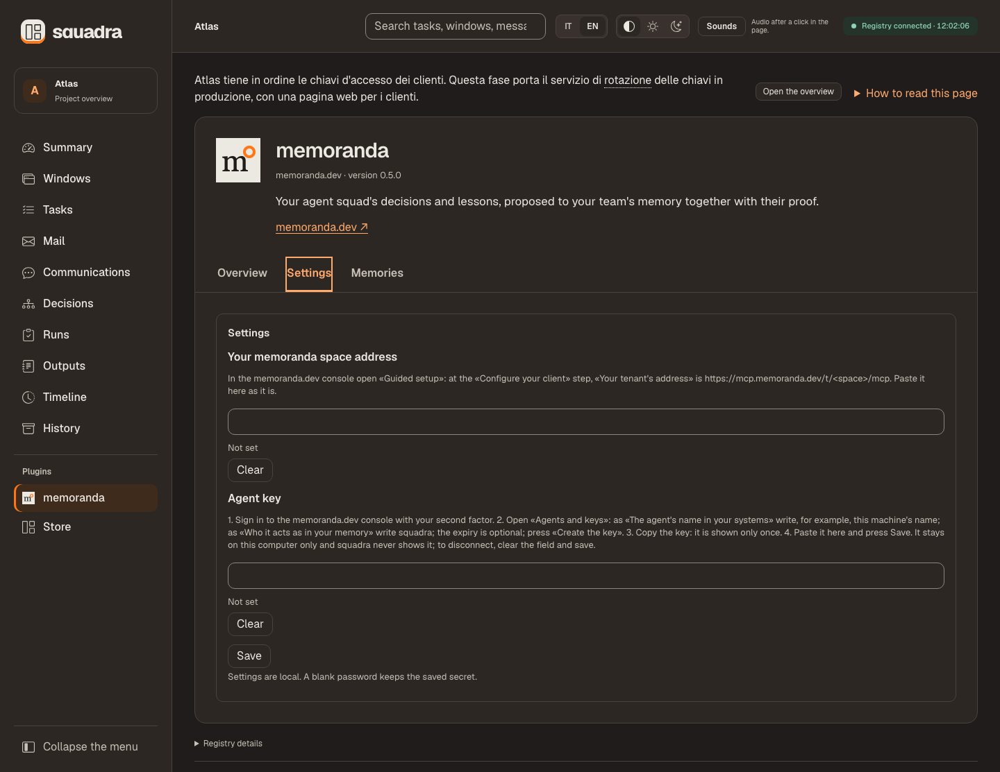
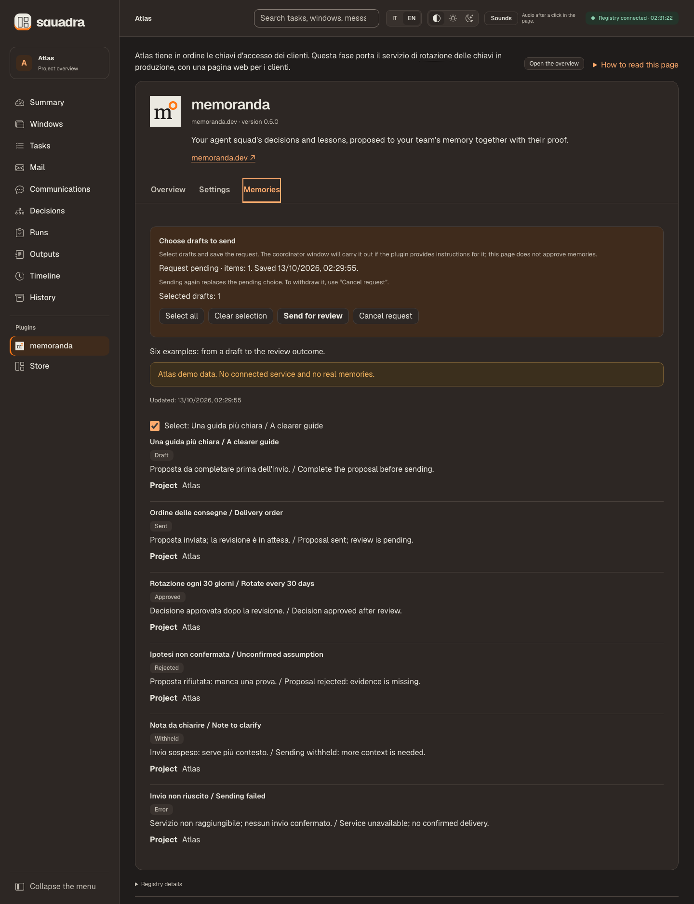

# Local data plugins

The dashboard reads data written by a separately operated producer. It never runs
plugin code. The declared HTTPS homepage opens in a new tab only on your click.
Optional task/run references navigate within the current registry; other content
URLs remain plain text. Its writes save declared
settings and user selections of an installed plugin; they never execute a request. Displayed
statuses are labels, not task approvals, registry events or proof that the producer
executed an action. No plugin is selected
automatically. The sidebar group, keyboard navigation, mobile drawer, language
switch and theme controls work as for the built-in views.

For a runnable example, see the [plugin authoring guide](plugin-authoring.md).
This document remains the exact schema and protocol reference.

## Files and registry identity

```text
$HOME/.squadra/plugins/<name>/plugin.json
$HOME/.squadra/plugins/<name>/icon.png                  # optional
$HOME/.squadra/plugins/<name>/panels/<key>.json
```

`name` matches `^[a-z0-9][a-z0-9-]{0,31}$`. The panel key is the lowercase
64-hex hash of **event #1 of the open registry**, verified by the dashboard.
Appending events does not change it. Obtain it from `plugins.key` in the
authenticated `/api/state` response; neither a path nor the latest event hash is
the panel key. A missing exact panel is never replaced with another registry's
file. The server does not accept a client-selected key.

The first-event identity does not certify that an exported history is current.
`events.jsonl` is extended after commits and may lag if an update is interrupted;
compare its recorded sequence/head with the current Store view before treating it
as complete. `state.json` and complete mail/history exports are refreshed by
`export`, `checkpoint` or `save`. A producer needing those files must request an
explicit `squadra export --root /path/to/registry`; a producer reading Store directly
uses that version's verified accessors. The [verification boundaries](recovery.md#registry-verification)
apply to both routes. Source bindings may reference immutable file manifests;
resolve them when comparing source files, without changing stored packet hashes.

Files must be regular files. Traversal from the trusted HOME directory uses
directory descriptors and no-follow opens for `.squadra` and every component
below it. Symlinks, directories in place of files, FIFOs and unsafe I/O are
refused. Writes by a producer should replace a complete JSON file atomically;
partially written or malformed data is refused, not repaired by the dashboard.
These checks do not authenticate the producer against someone who can already
write under the same local account.

For discovery, panel reads, settings and actions, HOME, `.squadra`, `plugins`
and each plugin folder must be owned by the current user and must not be
group- or other-writable. Owned 0700 and 0755 folders are accepted. An unsafe
plugin is excluded with `unsafe_permissions`; an unsafe parent gives an empty
plugin list with that refusal. Store installations still use private 0700 folders.

## JSON schemas, version 1

`plugin.json` is at most **64 KiB** (including optional `settings`, `about`,
`actions` and `results`):

```json
{
  "schema": 1,
  "name": "example",
  "title": {"it": "Esempio", "en": "Example"},
  "description": {"it": "Dati locali", "en": "Local data"}
}
```

The panel is at most **2 MiB**, with at most **500 items**:

```json
{
  "schema": 1,
  "updated": "2026-10-11T12:00:00Z",
  "summary": {"it": "Un elemento", "en": "One item"},
  "note": {"it": "Dati forniti dal produttore", "en": "Producer-supplied data"},
  "items": [{
    "id": "item-1",
    "title": "Example item",
    "text": "Plain text only",
    "status": "draft",
    "meta": [{"label": {"it": "Origine", "en": "Source"}, "value": "Local"}]
  }]
}
```

Within a panel, only `note` is optional. Every bilingual object requires exactly `it` and `en`.
Unknown fields at any depth, duplicate JSON keys, nonfinite numbers and invalid
UTF-8 are refused. Schema must be the integer `1`, not a boolean or string.
The base manifest and panel strings are at most **4096 UTF-8 bytes** each; the
optional `about`, settings, results and reference fields have their own limits below. `updated` must be an ISO timestamp
with a `T` separator and an explicit UTC offset (`Z` or `+00:00`). Manifest name
must equal its folder name. Keep item IDs stable across updates to retain focus.

Allowed status values are `draft`, `sent`, `approved`, `rejected`, `withheld` and
`error`; their default labels are translated by the dashboard. The optional
`results.status_labels` map changes their display labels, never their behavior. Item title, text and meta
values remain as recorded. Panel content is inert text: no HTML, Markdown or clickable URLs are interpreted.
Only the manifest’s declared HTTPS homepage becomes a link in the page header.

## Optional results section

A manifest can name its data section for its purpose: “Collaudi” / “Browser checks”,
“Segnalazioni” / “Issues”, or another short bilingual label. Example member:

```json
"results": {
  "label": {"it": "Collaudi", "en": "Browser checks"},
  "empty": {"it": "Nessun collaudo preparato", "en": "No browser checks prepared"},
  "status_labels": {
    "draft": {"it": "Da verificare", "en": "Ready to check"},
    "approved": {"it": "Esito positivo dichiarato", "en": "Reported success"}
  }
}
```

| Field | Bounds |
| --- | --- |
| `label` | Required, exactly `it` and `en`, each 1–80 Unicode characters |
| `empty` | Optional, exactly `it` and `en`, each 1–300 characters |
| `status_labels` | Optional object mapping any subset of the six existing status values to bilingual labels, each language 1–80 characters |

Unknown fields/status keys are refused. The whole manifest remains ≤64 KiB.
The section appears even without `about`; when `about` exists it sits alongside
Overview and any declared Settings. Existing manifests without `results` retain
the Memories wording and default labels. Missing overrides retain the translated
default. Item `title`, `text` and `meta` already carry the producer's result data;
this extension does not permit custom HTML, scripts, arbitrary widgets or new
status values. The producer must describe what a status measures: a label such
as “Reported success” is not a registry proof or independent review.

One action per plugin remains the limit. Only `draft` items can be selectable,
even if their visible label changes. Settings, pending selection, cancellation,
refresh and execution boundaries are unchanged.

## Task and run associations

Each panel item can optionally include `refs`, a list of **0–8** objects. An
object has exactly `task`, or exactly `task` and `run`:

```json
"refs": [
  {"task": "WEB-1"},
  {"task": "WEB-1", "run": "0123456789abcdef0123456789abcdef"}
]
```

A task ID is a nonempty string of at most **200 Unicode characters**, without
Unicode category C characters (controls, format characters, surrogates, private-use
or unassigned characters). A run ID is exactly **32 lowercase hexadecimal
characters**. The example run ID illustrates the shape; it must not be invented
for a real result. References contain no paths, URLs, artifact fields or approval
claims. They fit within the panel's existing 2 MiB limit.

The dashboard resolves references against the current registry's own task/run
keys on every refresh. A task link opens that task's history. A run link opens
the existing Runs view filtered to that exact task and run, only when the run
belongs to the named task. Unknown tasks/runs or mismatched ownership appear as
unavailable plain text. A later refresh cannot keep an obsolete link active.

These are **producer-supplied associations**, not attestations that the referenced
proof tested this item or succeeded. Run outcomes, artifacts and independent
review remain owned by the normal registry workflow. Register real evidence
through that workflow; never construct artifact links from plugin content.
No new endpoint, network poll, write or content-security-policy source is added.

## Optional about metadata

A manifest may include `about` to describe the plugin's publisher, version,
purpose and features. It is public, producer-supplied data, not a verified
publisher identity or permission to execute anything. Example member:

```json
"about": {
  "publisher": "Example publisher",
  "version": "1.2.0-preview+1",
  "homepage": "https://example.invalid/",
  "tagline": {"it": "Dati locali per il progetto", "en": "Local project data"},
  "sections": [{
    "id": "purpose",
    "title": {"it": "A cosa serve", "en": "Purpose"},
    "text": {"it": "Descrive i dati del progetto.", "en": "Describes project data."},
    "items": [{"it": "Funziona con dati locali", "en": "Works with local data"}]
  }]
}
```

| Field | Required bounds |
| --- | --- |
| `publisher` | String, 1–64 Unicode characters; no Unicode control characters (Cc, including C0/C1) |
| `version` | String, 1–32 characters, matching `[0-9A-Za-z][0-9A-Za-z.+-]*` in full; a label, not semantic-version validation |
| `homepage` | Optional https URL, 1–200 characters; host required; no userinfo, fragment, whitespace, control or bidi characters |
| `tagline` | Exactly `it` and `en`, each 1–200 characters |
| `sections` | List of 1–8 objects |
| Section `id` | Unique in this list, matching `[a-z][a-z0-9-]{0,31}` in full |
| Section `title` | Exactly `it` and `en`, each 1–80 characters |
| Section `text` | Optional, exactly `it` and `en`, each 0–2000 characters |
| Section `items` | Optional, list of 1–12 bilingual objects, each language 0–300 characters |

Every section must contain `text`, `items`, or both; a present field must satisfy
its own rules. Empty paragraph/bullet strings are allowed, empty titles/taglines
are not. Lengths here count Unicode characters, not UTF-8 bytes. All strings must
be valid Unicode; the complete serialized manifest still must fit in **64 KiB**.
Every `about` string refuses the bidi control characters U+202A–U+202E and
U+2066–U+2069 with `bad_value`; the homepage's control-character rule is stricter.
Unknown keys at every level, duplicate JSON keys and duplicate section IDs are
refused. Invalid values use `bad_value`, unknown keys `unknown_key`, malformed
JSON `invalid_json`, and an oversized manifest `too_large`.

The existing `/api/state` discovery carries the validated object unchanged in
`plugins.plugins[i].about`; `/api/plugins` also returns it with the manifest.
No extra endpoint or polling request is introduced. Manifests without `about`
keep their existing shape. HTML, Markdown, URLs and instructions in descriptive
text remain data. Only the declared HTTPS homepage is clickable; the dashboard
does not fetch it automatically.
The panel remains ≤2 MiB; saved settings and their POST body remain ≤16 KiB.
Filesystem no-follow, regular-file checks, authentication and settings secrecy
are unchanged.

## Homepage and local icon

The optional `about.homepage` is the only plugin-supplied external URL rendered
as a link. Task/run associations use existing internal registry navigation. It must be a valid Unicode string of 1–200 characters, with scheme `https`
and a host. Userinfo (including empty userinfo), fragments (including an empty
`#`), Unicode whitespace, control/format characters (Cc/Cf, including bidi
controls), backslashes, malformed hosts and invalid ports are refused with
`bad_value`. Escaped path/query characters remain URL data. Unknown fields are
still refused. The server preserves the validated URL exactly; it makes no DNS
query or request and does not attest to the destination's identity or content.
The page contract opens it on a user click in a new tab with `noopener noreferrer`.

`icon.png` is optional, independent of `about`. It is read relative to the same
open plugin directory with no-follow, regular-file and bounded-read checks.
It must be at most **32 KiB**, begin with the PNG signature and a complete first
**13-byte IHDR** chunk, and declare width and height each **1–256**. This is a
bounded signature/header check, not a full PNG decoder or CRC validation.
Malformed headers/dimensions use `invalid_icon`; unsafe paths, I/O and size use
the existing fixed codes (`symlink`, `not_regular`, `io_error`, `too_large`).
An absent icon is normal. Any icon refusal leaves the valid plugin listed without
`icon` and adds `{name, code}` to `refused`; it does not disable its panel/settings.

Discovery adds `plugins.plugins[i].icon` as `data:image/png;base64,…` containing
the exact admitted bytes; `/api/plugins` carries it too. `icon` is server-derived,
never accepted from `plugin.json`. No file-serving route, external image request,
extra poll or CSP source is added. A removal or refusal omits the old icon on the
next discovery; no usable icon is cached across reads.

## HTTP contract

All plugin APIs use the dashboard's existing loopback Host and
`X-Squadra-Token` checks. The only permitted POST routes save declared settings
or an action selection, as described below. Other POSTs and OPTIONS stay 405.
The Content-Security-Policy is unchanged.

| GET route | Response |
| --- | --- |
| `/api/state` | Existing state plus `plugins: {key, plugins: [manifest], refused: [{name, code}]}` from the same verified event read |
| `/api/plugins` | `{plugins: [manifest], refused: [{name, code}]}` |
| `/api/plugin/<name>` | `{name, key, panel}`; `panel: null` means the exact panel or its `panels` directory is absent |

Discovery uses the normal two-second state refresh, with no extra request while
built-in views are open. Only an open plugin view fetches a panel. Matching event
#1 reuses the identity established by the initial verified event read. The full
startup audit runs in the background with a visible pending status; an audit failure
refuses further data. Subsequent
registry reads follow the anchor/suffix/cache-proof boundary above. Responses for an old selection or registry key are
discarded. Refusal or removal clears the old panel. An unchanged panel retains
its DOM; changed cards preserve focus and the reading anchor where available.

No plugins shows “Nessun plugin installato” / “No plugins installed”. An installed
plugin without this registry's panel shows “Nessun dato per questo registro” /
“No data for this registry”. Invalid installations are listed as refused, alongside
valid ones. Plugin errors do not replace the main registry view.

| Fixed code | Meaning |
| --- | --- |
| `bad_name` | Invalid folder or route slug |
| `name_mismatch` | Manifest name differs from folder |
| `symlink` | Refused path component is a symbolic link |
| `not_directory`, `not_regular` | Wrong filesystem object type |
| `unsafe_permissions` | A checked folder has a foreign owner or allows group/other writes; settings and action files also retain their private-file rules |
| `too_large` | File exceeds its byte limit, including growth during reading |
| `invalid_json` | Malformed UTF-8/JSON, duplicate key, nonfinite value or parser depth refusal |
| `invalid_icon` | Icon has an invalid PNG signature, first IHDR header or dimensions; plugin remains listed without icon |
| `unknown_key` | Unspecified field at any schema level |
| `bad_schema` | Version is not the integer 1 |
| `bad_value` | Missing field or invalid type, size, status or timestamp |
| `io_error` | Safe file access could not complete |
| `not_found` | Installation or manifest absent |
| `registry_invalid` | Registry identity could not be verified |

Endpoint refusal bodies contain only `{error: code}`: invalid slug 400, missing
installation 404, other plugin/registry refusals 409. Discovery reports per-entry
codes; a root-level refusal has `name: null`. An absent plugin root is an empty
installation. Existing Host refusal is 403 and missing/incorrect token is 401.
No rejected file contents, absolute paths or backend exceptions are returned.

## Declared settings

The optional `settings` member of `plugin.json` declares **1–4** fields; old
manifests without it have no Settings card. Example declaration:

```json
"settings": [
  {"id":"endpoint","kind":"url","label":{"it":"Indirizzo","en":"Address"},
   "help":{"it":"Usa HTTPS","en":"Use HTTPS"}},
  {"id":"agent_key","kind":"secret","label":{"it":"Chiave","en":"Key"}},
  {"id":"name","kind":"text","label":{"it":"Nome","en":"Name"}}
]
```

IDs are unique and match `^[a-z][a-z0-9_]{0,31}$`; `kind` is exactly `url`,
`secret` or `text`. Only `help` is optional. Label/help require exactly `it` and
`en`, each at most **1024 UTF-8 bytes**. The whole manifest is ≤64 KiB.
Unknown fields/kinds are refused. Values have these limits:

- URL: ≤2048 characters, HTTPS with an authority, no userinfo, fragment,
  whitespace, controls or backslashes. No URL is fetched or resolved. The validator's
  explicit test-only option permits `http://127.0.0.1:<port>/`; HTTP requests
  never enable it.
- Secret: 1–4096 printable ASCII bytes **without spaces** (0x21–0x7e).
- Text: ≤256 Unicode characters, without control/format characters.

The Settings/Impostazioni card appears below the heading even without panel data.
Labels and help are inert text. Save is explicit and sends only changed fields; omitted fields keep their
values, Clear sends `null`, and a blank password keeps its saved secret. Empty
text is a saved value; empty URL/secret is refused. Inputs retain edits and focus
across polling; leaving the view or changing the schema clears typed secrets.
Secret inputs use `autocomplete="new-password"`, outside any form. Fetch submits
then clears them; they are never prefilled, cached as drafts or put in browser
storage. Browser extensions/password managers are not controlled by this hint.

### Storage and recovery

Paths use the **HOME of the user who runs `squadra dash`**, not the registry's
project directory. An agent-started dash with a private HOME saves to that private
installation; it does not configure the user's normal installation.

```text
$HOME/.squadra/plugins/<name>/settings.json       # 0600, ≤16 KiB
$HOME/.squadra/plugins/<name>/secrets/            # 0700
$HOME/.squadra/plugins/<name>/secrets/<id>        # 0600, exact bytes, no newline
$HOME/.squadra/plugins/<name>/.settings.lock      # 0600, no secret content
```

```json
{"schema":1,"updated":"2026-10-11T12:00:00Z","values":{"endpoint":"https://example.invalid/"},"secrets":["agent_key"]}
```

`values` contains only non-secret fields; `secrets` contains IDs, never values.
These are plaintext local files, not an encrypted credential vault. Ownership,
private modes, regular file type, size, single file link and no-follow traversal
are checked. Plugin directories must be owned and not writable by other users.
Unsafe existing permissions are refused, not silently repaired. The lock uses
nonblocking process-safe shared/exclusive locking; a concurrent operation can
return `busy`. A GET does not create files or read secret bytes: presence is
checked from metadata and must agree with `settings.json`.
Saved setting IDs must still be declared with a compatible kind. A saved value or
secret ID no longer declared in the manifest gives `settings_invalid`; it is not
silently ignored or removed.

All submitted/merged values and existing destinations are validated before
mutation. Each changed file uses an exclusive 0600 temporary file, fsync, atomic
replace and directory fsync; secret staging occurs only inside the private
`secrets/` directory. `settings.json` is published last. No backup or journal of
secret values is created. Successful cleanup removes staging files; a process
crash may leave a private `.tmp-*` file. This is **per-file atomicity**, not a
transaction over several files. I/O failure or a lost reply may follow partial
or complete application: do not infer success or automatically retry. Re-read
status, then deliberately resubmit/clear affected fields. A secret/metadata
presence mismatch stays unavailable; explicitly resubmitting/clearing that ID
can repair it. Malformed metadata or unsafe paths require local repair first.
Clear unlinks the file; it does not promise physical secure erasure. Same-account
writers are trusted; these checks do not isolate against a hostile process that
can replace the installation itself.

### Write endpoint and safe discovery

`POST /api/plugin/<name>/settings` accepts exactly
`{"values":{"declared_id":"value","other_id":null}}`. Checks run in order:
single exact loopback Host, single constant-time token, Origin absent or exactly
`http://127.0.0.1:<server-port>`, JSON Content-Type (optional UTF-8 charset), then
framing and length. Transfer-Encoding is refused. Content-Length must be a single
positive integer ≤16 KiB; body reading has a five-second total deadline. UTF-8/JSON
is strict, including duplicate/unknown keys. Only installed, declared fields can
be saved. No CORS headers or OPTIONS permission are provided. Apart from this
route and the declared-action route below, POSTs are 405.
The CSP is unchanged. No outbound connection or plugin execution occurs.

Success returns `{"settings":[{"id":"agent_key","set":true}]}` plus the other
fields in declaration order. Only set **non-secret** fields include `value`.
`/api/state.plugins.plugins[i].settings` (also discovery at `/api/plugins`)
adds `set` and optional non-secret `value` to each declaration. Old fieldless
manifests keep their shape and discovery adds no poll request. A read refusal
adds `settings_error`; `set:false` there is not evidence that the secret is absent.
The card shows unavailable, not a confirmed saved/unset claim.

| HTTP | Fixed settings refusal codes |
| --- | --- |
| 400 | `invalid_length`, `invalid_body`, `invalid_json`, `unknown_key`, `unknown_id`, `bad_value`, `bad_name` |
| 401 / 403 | `token_required` / `host_refused`, `origin_refused` |
| 404 / 408 / 411 | `not_found` / `body_timeout` / `length_required` |
| 413 / 415 | `too_large` / `content_type` |
| 409 | `not_configurable`, `settings_invalid`, `unsafe_permissions`, `busy`, existing filesystem/schema refusals |
| 500 | `save_failed` (application may be partial) |

Errors contain fixed codes only. The card uses fixed IT/EN ready, unsaved, saving,
saved, refused and unavailable messages; a failed/missing reply states that the
result is unconfirmed. Secret values do not enter responses, state, panel data,
errors, logs, URLs, browser storage, registry events or artifacts. No settings
audit is added. A data producer remains responsible for keeping its own panel
content free of secrets.

## Action requests

A plugin can declare **at most one** action; old manifests without `actions`
keep their shape. `actions: []` is also valid. Each action has exactly a safe
slug `id` (the same rules as a plugin name) and a bilingual `label`:

```json
"actions": [{"id": "send", "label": {"it": "Invia per revisione", "en": "Send for review"}}]
```

A panel item may add `selectable: true` **only with `status: "draft"**.
Missing/false means not selectable. A non-boolean value, an unknown field or
`true` on any other status refuses the entire panel. IDs must be unambiguous
within the current panel to be selected. Use stable IDs for immutable drafts;
changing the content of an existing ID can change what an earlier choice means.

In the dashboard, a pending request locks selection and sending until it is
consumed or cancelled. Its draft items show **Waiting to be sent** in amber;
the plugin's reported sent/approved/rejected state takes precedence. Cancelling
restores selectable drafts but cannot stop work already started. State words
remain visible beside their colours. Sent, approved and rejected items are
grouped below the other items under **Already sent**, with a count. The panel's
summary, metadata and result labels remain the producer's own data.

### HTTP and discovery

`POST /api/plugin/<name>/action/<id>` has exactly `{"ids":["draft-1","draft-2"]}`.
The server checks Host, token, Origin, JSON media type, unambiguous length and
transfer framing, a timed read of at most **64 KiB**, and strict JSON (including
duplicate keys). It derives the registry key from the verified **event #1** of
the open registry, never from the request. The installed manifest must declare
the action and each ID must be a selectable draft in the current panel for that
key. Panel validation is repeated under the action lock; no last-served global
cache or extra polling request is used.

IDs are **1–500 unique nonempty strings**, each within the panel's 4096-byte text
bound. Submitted order is preserved. The stored envelope must also fit 64 KiB.
Saving returns HTTP 200:

```json
{"saved":true,"request":{"ids":["draft-1","draft-2"],"requested":"2026-10-11T12:00:00Z"}}
```

At the API, a new selection **replaces** the pending request under the lock.
The dashboard requires cancellation before making a new selection. An identical
pending selection is an idempotent retry, preserving its timestamp. `{"ids":[]}`
**cancels only an existing pending request** for this registry, deletes its file,
and returns `{"saved":true,"request":null}`. Otherwise it refuses `no_pending`.
Cancellation is possible even after those drafts disappear from the panel.
A pending request for another registry is not overwritten or cancelled
(`registry_mismatch`). The dashboard saves user intent only: it does **not**
execute an action, send data, invoke a plugin/CLI, approve, or contact a service.
A failed/missing reply is unconfirmed: reread state before deciding what to do.

`/api/state.plugins.plugins[i].actions[j]` (also `/api/plugins`) includes the
declared `id`, `label`, and `pending: {"ids":[...],"requested":"..."}` or `null`.
Only the open registry's request is exposed; another registry's request is
hidden. No `actions` is added to manifests that omit it. If a request cannot be
read safely, `pending` is null **and** discovery's `refused` list includes the
plugin and fixed code; that null does not prove absence.

<a id="agent-instructions"></a>
### Agent instructions

An installed plugin may ship `$HOME/.squadra/plugins/<name>/AGENTS.md` with instructions for agents. The coordinator window reads it at start and resume and runs only the commands it specifies, within existing permissions: the producer after a close to update the panel, the consumer when the dashboard shows a pending request, then reports the outcome. Only a regular file owned by the user, not group- or other-writable and not a symlink counts, and only while `squadra plugin list` reports that plugin with `instructions: valid` and `files: verified`. Without a valid file, the request stays pending and the coordinator says so. The dashboard never reads, writes or runs this file; executing a request depends on the plugin supplying it. This file never widens permissions and never authorizes installation, push, publication or decisions reserved for the user; for anything beyond running that plugin’s producer or consumer, stop and report.

What the rule guarantees: `plugin list` hashes every file the Store installed against `.store-receipt.json` before it reports the installation, so an AGENTS.md or a program changed after installation, by an edit, another process or a broken copy, is reported as `modified` and is not followed. `instructions` is `valid` (the installed bytes, in a regular 0600 file with one link), `modified`, `unsafe` (a symlink, another mode or owner, or a second hard link) or `absent`. What it does not guarantee: the receipt lives in the same folder, so someone who controls your account can rewrite the file and its receipt together; a verdict is also a snapshot, so list again after any change. An unmanaged folder has no receipt and no verdict, so its AGENTS.md never counts.

### Files and consumer protocol

Files belong to the HOME of the user running `squadra dash`. A dash started by an
agent with private HOME writes there, not to the owner's HOME:

- `$HOME/.squadra/plugins/<name>/actions/`: owned private directory, 0700.
- `<id>.json`: regular, no-follow, 0600, one link, at most 64 KiB.
- `<id>.lock`: permanent regular no-follow 0600 lock, also owned and single-link.
  Never delete/replace this lock while writers or consumers may be using it.

The request has exactly `schema`, `key`, `ids`, `requested`:

```json
{"schema":1,"key":"<event-1-sha256>","ids":["draft-1"],"requested":"2026-10-11T12:00:00Z"}
```

`requested` is UTC, exactly `YYYY-MM-DDTHH:MM:SSZ`. Writers and consumers must
open the same lock with no-follow checks and use `fcntl.flock(..., LOCK_EX)`.
Dashboard reads use the same lock with `LOCK_SH | LOCK_NB`: concurrent readers
can share it; an exclusive writer or consumer still causes `busy` and an
unconfirmed pending value. Writers use `LOCK_EX | LOCK_NB`. The server writes a
complete same-directory temporary file, fsyncs, atomically replaces the request
and fsyncs the directory. Cancellation unlinks and fsyncs the directory. Symlinks,
unsafe ownership/modes, hard links, special files, malformed/unknown fields and
oversize files refuse. An existing request with a missing lock refuses; it is
not silently assigned a second synchronization domain.

A consumer snapshots the request under that lock, verifies its registry key,
and captures file identity from the **same open regular file**: device, inode,
`mtime_ns` and `ctime_ns`. It then releases the lock before processing/sending.
Persist outcomes durably before consuming the request. Every selected immutable
item must have a terminal recorded outcome; an unexecuted or partially processed
batch remains pending. Reopen and validate the current file under the same lock
and **compare-and-delete only if both its file identity and `key`, `requested`
and ordered `ids` still match the snapshot**. Fsync the directory after deletion.
Content equality alone misses replacement or cancel/reselection within the same
second; preserve those newer requests, even when their JSON equals the snapshot.

Cancellation/replacement cannot retract work already taken by a consumer. Make
external operations idempotent and retain observed outcomes. Publish panels
atomically and coordinate producer/consumer updates with the action lock so
selection validation cannot race a change in draft meaning. Never reuse a draft
ID for a different request. A saved selection is no proof of execution. The
server adds no consumer, scheduler or audit event.

| HTTP | Fixed action refusals |
| --- | --- |
| 400 | `invalid_length`, `invalid_body`, `invalid_json`, `unknown_key`, `bad_value`, `bad_name` |
| 401 / 403 | `token_required` / `host_refused`, `origin_refused` |
| 404 / 408 / 411 | `not_found` / `body_timeout` / `length_required` |
| 413 / 415 | `too_large` / `content_type` |
| 409 | `not_configurable`, `undeclared_action`, `not_selectable`, `no_pending`, `registry_mismatch`, `registry_invalid`, `request_invalid`, `unsafe_permissions`, `busy`, filesystem/schema refusals |
| 500 | `save_failed` (publication or deletion may already have happened) |

Codes never include input values or paths. Registry contents, settings and the
CSP remain unchanged by these requests. This contract supplies the server API;
a client must distinguish selection saved from actual consumer outcome.

## Release-local plugin store

An accepted plugin is bundled under the installed release's `plugins/<name>/`,
with `plugin.json`, `AGENTS.md`, `README.md` (required), optional `README.it.md`,
and all programs needed to operate it. The catalogue always comes from the
running Squadra release, never the current directory or the user's installed
plugin folders. The maintainer analyses PR/email submissions, prioritizing
MCP-based plugins; acceptance covers only the stated version. The catalogue is
ordered MCP first, then title and name. No code is downloaded or executed.
The Store's directory-owner check expects a user-owned Squadra installation;
a shared root-owned installation is refused when run by another user.

The dashboard's **Plugins → Store** view reads this catalogue on entry or explicit
refresh, outside the registry poll. It shows the installed receipt's release
version and ID beside the running release, including unmanaged or incomplete
installations. Homepage links open only on a click. Installation commands are
displayed for the coordinator to run; there is no install button, and no bundled
instructions or programs are served by the Store route. The page also works
when the running release has no bundled plugins.

Store entries require the existing `about.publisher`, `about.version` and
`about.homepage` fields. Adjacent `store.json` contains only additional metadata:

```json
{"schema":1,"licence":"MIT","price":"free","mcp":true,"source":"https://example.invalid/source","accepted_version":"1.0.0","review_date":"2026-10-12"}
```

`accepted_version` must equal `about.version`; `review_date` is a real YYYY-MM-DD
date. `price` is `free`, `paid` or `trial`; `trial` means a free service trial followed
by paid use. The plugin card must distinguish the installation price from the
connected service price. `mcp` is a boolean. The licence is nonempty,
at most 128 characters, without control/direction characters; the source uses
the existing HTTPS homepage validator. Unknown/duplicate keys, invalid UTF-8,
invalid dates and incomplete metadata exclude the entry from the catalogue.
The acceptance metadata is a maintainer declaration, not a runtime attestation.
`store.json` is copied to HOME and included in the managed file inventory.

Bounds: 128 catalogue entries; 256 files and 512 total file/directory entries
per plugin; depth 8; 4 MiB per file, 32 MiB total; store.json 16 KiB. Existing
plugin.json limits apply. AGENTS.md and each README must be a nonempty regular
UTF-8 file at most 64 KiB. Relative path components use ASCII letters, digits,
period, underscore or hyphen, up to 128 characters; no traversal, case-colliding
names, symlinks or special files. Root `settings.json`, `secrets/`, `actions/`,
`panels/`, `.settings.lock`, `.store-receipt.json` and `.store.lock` are reserved.
`SKILL.md`, `CLAUDE.md`, `.claude`, `.claude-plugin`, `.codex`, `.codex-plugin`,
`.cursor`, `.agents` and `.mcp.json` are refused at every depth, and so is an
`AGENTS.md` below the plugin root, including case variants: a data plugin must not
become another client skill, agent, hook, rule or MCP configuration through client
discovery. The root `AGENTS.md` is the plugin's own [agent instructions](#agent-instructions).

### List, install and recover

`squadra plugin list` is read-only. It returns JSON with the running release,
valid plugins, installed/managed status, receipt release/version/state, and
bounded refusal codes. A folder may be installed but unmanaged or incomplete.
For a managed folder it hashes every receipted file and adds `files`
(`verified` or `modified`), the `modified` paths and the
[`instructions`](#agent-instructions) verdict; the Store page calls an
installation complete only when its files are verified.
A release ID is the SHA-256 of the named hashes of scripts/squadra.py,
registry.py, plugins.py and plugin_store.py; it is a code fingerprint, not a
Git commit or an authenticity signature. Both release version and ID are shown.
The command offered for a plugin uses `squadra` only when the current standalone
launcher targets that release; otherwise it uses a shell-quoted
`python3 <release root>/scripts/squadra.py plugin install <name>`.

`plugin install <name>` dispatches without opening a registry. It uses one shared
`plugins.check_directory` policy: HOME, `.squadra` and `plugins` must be user-owned
and not group/other-writable (0755 is valid); the plugin folder and its internal
directories must be 0700. Missing directories are created 0700; existing unsafe
permissions are refused, never repaired. Each path component is opened relative
to a directory descriptor with no-follow semantics. Written files are 0600,
regular, with one hard link, replaced atomically and fsynced.

A nonblocking `.store.lock` in the plugins parent serializes installations. A
single private `.store-receipt.json` records schema, plugin, state, release,
plugin version, target bundle digest and managed file hashes. Before copying it
is written as `upgrading`, with old/new path hashes and explicit absence for new
or removed paths. A retry accepts only that same target bundle/release and only
old/new hashes. The final receipt is `complete`. Locally modified managed files
and unowned collisions refuse; obsolete files are removed only if they were
receipted and unchanged. Runtime data and other unowned files stay untouched.

Per-file replacement is atomic; the whole upgrade is not. Stop the producer and
consumer first. A partial copy remains visible as incomplete; retry the same
release/bundle. Other bundles refuse until the interrupted operation is
reconciled. Never edit the receipt to force an upgrade. A crash between creating
a new folder and its initial receipt can leave an unmanaged folder; inspect and
move it aside before retrying. Receipts cannot protect against an attacker
controlling the same account. No installer runs AGENTS.md or a program.

No force/adoption switch exists. For a legacy installation, save settings.json
and secrets/, move its folder aside, then install; restore configuration only
after checking compatibility. For uninstall, stop its producer/consumer, save
configuration, and remove only that plugin's folder. No new recursive-delete
command is provided. Reinstall explicitly applies the running release's bundle,
with plugin and release transitions `from`/`to`. Numeric decreases are labelled
`downgrade`; arbitrary plugin labels are `unordered`, never claimed newer.

Refusals include `bad_name`, `not_found`, `invalid_bundle`, `unsafe_permissions`,
`symlink`, `unmanaged_installation`, `modified_installation`, `busy` and
`install_incomplete`, plus existing strict reader codes. Errors contain codes,
not private file contents. On the command line a refused folder or link is also
named. An unsafe folder you own comes with the exact `chmod` that repairs it; a
folder that belongs to another user is named as such, with no command. HOME
itself may be a symbolic link; links below it are refused. There is no remote
update or automatic execution.

## Building and distributing a plugin

Follow the [plugin authoring guide](plugin-authoring.md) for a runnable isolated
example, producer/consumer responsibilities, compatibility checks and packaging.
The [Italian overview](../docs/plugin-authoring.it.md) links to the English rules.
The optional [Playwright browser-check plugin](../plugins/playwright/README.md)
provides a concrete bridge to an agent's MCP tools; it is not auto-installed.

<a id="plugin-page"></a>

## The plugin page in the dashboard

*Moved from the README, word for word.*

- **Data, not code.** The dashboard never runs plugin code. The declared HTTPS homepage opens by your click in a new tab; task/run associations open the matching registry view; an optional local PNG logo appears without a remote request; status badges grant no authority over the registry. The optional `about` page (publisher, version, tagline, up to eight sections) is the producer's own description, never executable content or a verified identity.
- **Settings.** Up to four declared fields, stored with **Save**; **Clear** takes effect on save, and a blank password keeps the saved secret. Secrets are never prefilled or returned, and password managers remain outside Squadra's control. Files go to the **HOME of the user who runs `squadra dash`** (a dash started by an agent with a private HOME saves there, not in yours), as local plaintext `settings.json` and `secrets/<id>` (0600): not an encrypted vault, and never in the registry. Writes are atomic per file, so a lost reply can mean a partial save: re-read the status and submit again deliberately; never infer success from a missing reply.



- **Results for each service.** A plugin can name its data section, for example «Browser checks», and explain its result states in both languages. Older plugins keep «Memories». Items can link to an existing task or one of its recorded runs; these are producer-supplied associations, not proof of success or approval.
- **Selecting drafts.** A plugin can declare one action, such as «Request a browser check» or «Send for review». In its data section you tick drafts and press the button: only your choice is saved. Its items show «Waiting to be sent»; selection and sending stay disabled until the request is consumed or you use «Cancel request». Cancellation does not stop work already started. Status words and colours distinguish the outcomes reported by the plugin; sent, approved and rejected items appear under «Already sent», with their count. The dashboard never sends or runs anything.



HOME, `.squadra`, `plugins` and each plugin folder must belong to the current user
and must not be writable by group or others. Discovery, panel reads, settings and
actions refuse unsafe folders with `unsafe_permissions`. Owned 0700 or 0755 folders
work; the Store creates private 0700 plugin folders.

Installation also makes the bundled [agent instructions](../README.md#plugin-agent-instructions) available to the coordinator: it reads them at the next start or resume and runs the producer or consumer at the documented triggers, within existing permissions.

`squadra plugin list` lists the local release's accepted catalogue, MCP-based plugins first, with installed status and both the installed and running release. `squadra plugin install <name>` copies a bundled plugin; it does not download or run code. With a `/plugin` installation there is no standalone launcher: ask the coordinator to use `python3 <release root>/scripts/squadra.py plugin list` or `plugin install <name>`.

Repeat install explicitly applies that release's bundle and reports the versions **from X to Y**, including a downgrade. Settings, secrets, saved selections and panels stay untouched. Stop the plugin's producer/consumer before updating. A legacy folder is never adopted: save its `settings.json` and `secrets/`, move the folder aside, then install; restore configuration only after checking the new plugin's schema. To uninstall, stop its producer/consumer, save configuration and remove only that plugin's folder. An interrupted copy is reported as incomplete; retry the same bundle. There is no atomic whole-folder upgrade. See [store metadata and safeguards](plugins.md#release-local-plugin-store).
